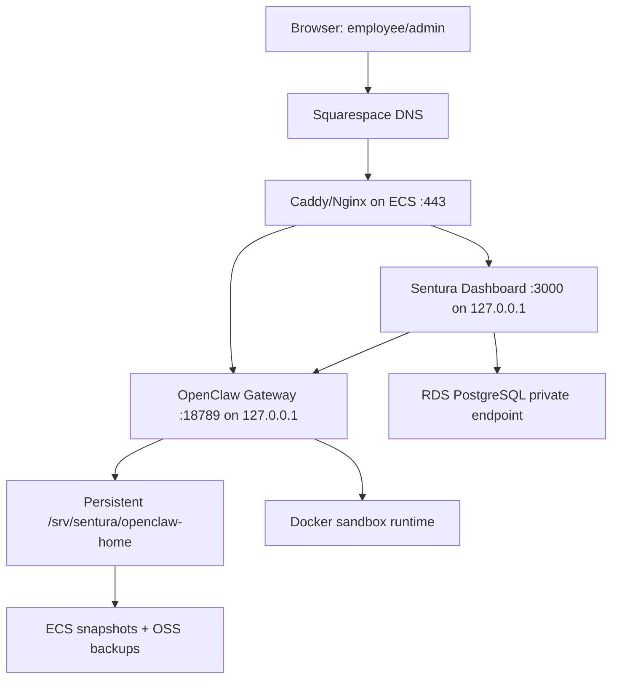
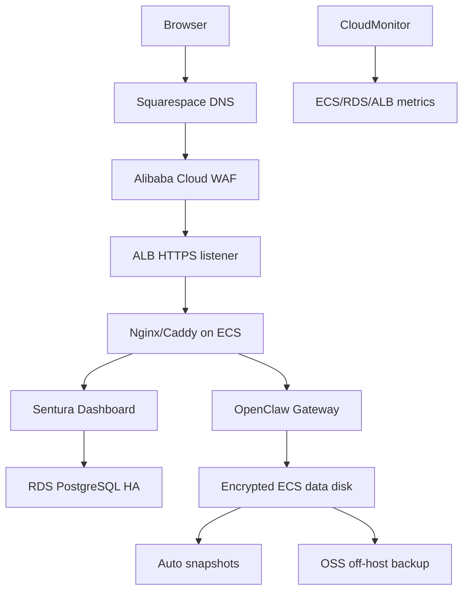

# Sentura Alibaba Cloud Deployment Report

Date: 2026-06-25

## 中文结论摘要

最推荐的部署方式是：先不要动现有 `www.sentura.ai` 的 Render 官网，把 Sentura SaaS 产品部署到阿里云香港 ECS，并新增 `app.sentura.ai` 给普通员工使用、`admin.sentura.ai` 给客户管理员和平台管理员使用。两个入口都走 HTTPS `443`，不要用两个公网端口区分身份；端口只应该是内网实现细节，例如 Dashboard `3000`、OpenClaw Gateway `18789`、PostgreSQL `5432` 都不应直接暴露到公网。

第一阶段建议使用单台阿里云 ECS 做 beta：4 vCPU / 16 GiB RAM、100-200 GiB ESSD PL1 数据盘、Caddy 或 Nginx 反代、OpenClaw Gateway 和 Dashboard 都跑在内网监听地址。业务数据库使用 ApsaraDB RDS PostgreSQL 高可用版；OpenClaw 自身的文件、SQLite、LanceDB 状态仍保留在持久化数据盘下，不迁移到 RDS。

正式付费客户或 30-50 个活跃员工会话后，再升级到 8 vCPU / 32 GiB RAM，并把入口改为 ALB + WAF + ECS 后端。中国大陆地域部署需要 ICP 备案；为了先上线和避免备案阻塞，当前优先选择香港或新加坡地域。Squarespace 继续作为 DNS 管理方即可，只需要添加 `app`、`admin` 等 DNS 记录，暂时不需要迁移域名注册商或权威 DNS。

上线前必须补齐的代码/配置调整是：Dashboard 支持生产部署形态、真实 OIDC/SAML 或企业登录、路由级 RBAC 中间件、Gateway 生产 `allowedOrigins` 与认证配置、可信反代头、`~/.openclaw` 持久化备份恢复演练，以及管理员/普通员工入口的权限与审计边界。

This report is the Alibaba Cloud-specific deployment plan for Sentura. It extends the general production topology in [`docs/HOSTING.md`](HOSTING.md) and is written for the current Sentura architecture:

- OpenClaw Gateway: persistent, stateful, WebSocket-based runtime on port `18789`.
- Sentura Dashboard: Next.js application on port `3000`.
- Database: OpenClaw state remains file/SQLite/LanceDB under `~/.openclaw`; Sentura business/customer data that already uses PostgreSQL, such as Cross-border e-commerce Phase 2, uses `CBE_DATABASE_URL`.
- Docker: production containerization should use upstream OpenClaw Docker assets. Do not add a custom Sentura wrapper around OpenClaw infrastructure.

For a step-by-step Chinese execution guide, use [`docs/ALIYUN-FULL-STACK-RUNBOOK.md`](ALIYUN-FULL-STACK-RUNBOOK.md).

## Executive Recommendation

Use Alibaba Cloud ECS in Hong Kong for the first production beta, keep `www.sentura.ai` as the marketing/public website unless the product must replace it immediately, and expose the SaaS application through subdomains:

| Hostname | Audience | Backing service | Public? |
|---|---|---|---|
| `www.sentura.ai` | Public website / marketing | Current Render site first, or later Alibaba-hosted landing site | Yes |
| `app.sentura.ai` | Ordinary employees / customer users | Sentura Dashboard routes for employee work | Yes, authenticated |
| `admin.sentura.ai` | Customer admins, managers, platform admins | Same Sentura Dashboard deployment, admin routes gated by RBAC | Yes, authenticated and stricter WAF/session policy |
| `ops.sentura.ai` or private `/control/` | Sentura operators only | OpenClaw Control UI + Gateway operations | Prefer VPN/IP allowlist, not customer-facing |
| internal only | OpenClaw Gateway, PostgreSQL, Docker sandbox | `127.0.0.1` / VPC private IP | No |

Do not use separate public ports for admins and ordinary employees. SaaS products normally expose HTTPS on `443` and separate audiences by subdomain, route, session, organization scope, and RBAC. Ports such as `3000`, `18789`, and `5432` are implementation details and should stay private.

Recommended first Alibaba Cloud deployment:

- Region: `China (Hong Kong)` for fastest launch without ICP filing, good China-adjacent latency, and international reach.
- Compute: one ECS general-purpose instance, 4 vCPU / 16 GiB RAM for beta; 8 vCPU / 32 GiB RAM for 30-50 active employee sessions or heavy browser automation.
- Disk: 100-200 GiB ESSD PL1 data disk mounted under `/srv/sentura`, with `~/.openclaw` stored there or symlinked there.
- Database: ApsaraDB RDS PostgreSQL High-availability Edition for customer/business data; keep OpenClaw's own file-backed state on the ECS data disk.
- Entry: Caddy or Nginx on the ECS host for beta; move to ALB + WAF when the product has public traffic or multiple app hosts.
- DNS: keep Squarespace/Google Domains as DNS manager for now; add or edit DNS records there. Do not transfer the domain just to deploy.

## Current DNS Findings

Read-only DNS check on 2026-06-25:

```text
www.sentura.ai CNAME sentura-website-r35a.onrender.com.
sentura.ai     A     216.24.57.8 / 216.24.57.9 / 216.24.57.1
NS             ns-cloud-b{1..4}.googledomains.com
```

This matches the user's statement that the domain is managed through Squarespace/Google Domains and currently points to Render. Render's own DNS guidance says `www` subdomains are normally a CNAME to the app's `onrender.com` hostname. Squarespace DNS changes can take 24-48 hours to propagate and custom records default to a 4-hour TTL.

### DNS Cutover Choices

| Choice | What changes | Best for | Risk |
|---|---|---|---|
| Recommended: keep `www`, add `app`/`admin` | Leave `www.sentura.ai` on Render; add `app.sentura.ai` and `admin.sentura.ai` pointing to Alibaba | Beta SaaS launch without breaking the public site | Lowest |
| Move `www` to Alibaba | Replace the existing Render CNAME/A records with Alibaba ALB CNAME or ECS EIP A record | Product must live at `www.sentura.ai` now | Medium; public site cutover |
| Transfer DNS to Alibaba Cloud DNS | Change authoritative nameservers from Squarespace/Google to Alibaba | Need Alibaba DNS traffic policies, ALIAS, or weighted records | Higher; affects the entire zone |

For the current stage, use the first choice. It lets the Render website continue serving `www.sentura.ai` while Sentura product traffic moves to Alibaba under `app.sentura.ai` and `admin.sentura.ai`.

Current DNS decision: keep Squarespace as the DNS manager. Do not change nameservers or transfer DNS to Alibaba Cloud DNS for this deployment pass; only add `app` and `admin` CNAME records in Squarespace that point to the Alibaba WAF CNAME or, temporarily, the ALB DNS name.

If `www.sentura.ai` must move now:

1. Export or screenshot all existing Squarespace DNS records.
2. Lower TTL where Squarespace allows it.
3. Provision Alibaba entry first and verify by direct EIP/ALB hostname.
4. Replace `www` CNAME from `sentura-website-r35a.onrender.com` to the Alibaba ALB CNAME, or replace it with an A record to the ECS EIP if not using ALB.
5. Keep the old Render CNAME and apex A values in the rollback runbook.

## Why Subdomains Beat Public Ports

Public ports are not the SaaS pattern. They create firewall friction, make TLS/cookie policy messy, expose internal implementation details, and make enterprise SSO/WAF rules harder.

Use this instead:

| Concern | Recommended SaaS pattern | Sentura mapping |
|---|---|---|
| Ordinary employee access | `app.company.com` or same app route after login | `app.sentura.ai` -> employee workspace, own sessions and tasks |
| Admin/customer manager access | `admin.company.com` or `/admin`, gated by RBAC | `admin.sentura.ai` -> manager/admin dashboards |
| Platform operations | Private ops host, VPN, IP allowlist | `ops.sentura.ai` or `/control/` only for Sentura operators |
| Backend/Gateway | Private upstream service | OpenClaw Gateway bound to `127.0.0.1:18789` or VPC private IP |
| Database | Private network only | RDS PostgreSQL only reachable from ECS security group |

For Sentura specifically:

- Ordinary customer users map to `end_user`, or for the current Cross-border e-commerce customer, product-level `operator`.
- Customer supervisors map to Sentura `manager` or CBE `admin`, depending on whether they are using the core platform or the CBE pilot.
- Platform/system operators map to `platform_admin`, `agent_manager`, `ekg_manager`, or `auditor`.
- The OpenClaw Control UI is not the ordinary employee UI. It is an operations surface for config, sessions, logs, cron, and debugging.

## Alibaba Cloud Architecture

### Beta Topology



Use this for the first Alibaba launch because OpenClaw Gateway is stateful and vertical scaling is simpler than premature orchestration.

### Production Topology



ALB is useful for TLS lifecycle, WAF integration, health checks, and later multi-host routing. Alibaba Cloud ALB HTTPS listeners support WSS/WebSocket by default, which matters because the Sentura Dashboard talks to OpenClaw over WebSocket.

Do not horizontally autoscale OpenClaw Gateway as a stateless API. Gateway sessions, workspaces, file-backed state, and LanceDB memory make it a stateful control plane. Scale in this order:

1. Vertical ECS scaling.
2. Split Dashboard from Gateway only when Dashboard render/API load becomes the bottleneck.
3. Shard Gateways by tenant, region, or environment.
4. Use warm standby and restore drills for availability before attempting active-active Gateway.

## Deployment Options Evaluation

| Option | Fit | Pros | Cons | Recommendation |
|---|---:|---|---|---|
| Simple Application Server | Low-Medium | Fastest, bundled basics | Less control; not ideal for stateful AI runtime, Docker sandbox, RDS/VPC hardening | Prototype only |
| ECS single host + Caddy/Nginx | High | Simple, predictable, full Docker/state control | Single host availability; manual ops | Best first production beta |
| ECS + ALB + RDS + WAF | High | Better security perimeter, TLS, monitoring, future scale path | More moving parts/cost | Best paid production path |
| ACK Kubernetes | Medium later | Standard container lifecycle, node pools, HPA, rollback | Too much complexity now; Gateway state/PVC/sandbox concerns | Later, after tenant sharding strategy |
| SAE / serverless PaaS | Low for Gateway, Medium for Dashboard | Managed, elastic app hosting | OpenClaw Gateway needs persistent state, Docker sandbox, long-lived WebSocket sessions | Do not use for Gateway; possible later for Dashboard only |
| Mainland China ECS | Conditional | Best mainland latency | ICP filing required before resolving a public domain to mainland Alibaba Cloud | Use only after ICP readiness |

## Server Sizing

Alibaba's general-purpose ECS families use a 1:4 vCPU-to-memory ratio and are intended for web servers, databases, Java apps, search, and general enterprise workloads. Instance availability varies by region, so confirm the exact family in the ECS purchase page.

| Stage | ECS app/Gateway host | Disk | RDS PostgreSQL | Use case |
|---|---|---|---|---|
| Internal beta | 4 vCPU / 16 GiB, g8i/g9i general-purpose if available | 100 GiB ESSD PL1 | Basic or HA, 2 vCPU / 4 GiB, 50-100 GiB | <10 active users, cloud LLM APIs |
| First paid customers | 8 vCPU / 32 GiB | 200 GiB ESSD PL1 | HA, 4 vCPU / 8-16 GiB, 100-200 GiB | Browser automation, Docker sandbox, 30-50 users |
| Production growth | 16 vCPU / 64 GiB or Gateway shard per tenant | 500 GiB+ with snapshot policy | HA + PITR + cross-region backup if needed | Multiple tenants, heavier memory/workspace volume |
| Self-hosted LLM | Separate GPU ECS or dedicated inference service | Separate model storage | Same as above | Do not colocate GPU inference with Gateway/Dashboard |

Practical notes:

- Keep Docker sandbox enabled for AI employees. The current project ground truth requires `sandbox.mode: "non-main"`.
- Reserve memory for Chromium/Playwright. Browser automation is the reason 16 GiB is the beta floor.
- RDS is not a replacement for OpenClaw's `~/.openclaw` state. Treat `~/.openclaw` as critical state and back it up.
- Use Alibaba's ECS Price Calculator for the final bill because instance availability and pricing change by region.

## Alibaba Cloud Resources to Provision

Minimum beta:

1. VPC and vSwitch in `cn-hongkong` or `ap-southeast-1`.
2. ECS with Ubuntu 24.04 LTS or Debian 12, Docker Engine, Node 24, pnpm.
3. Security group:
   - Inbound `443` from `0.0.0.0/0`.
   - Inbound `80` only for ACME HTTP challenge or redirect to HTTPS.
   - Inbound `22` only from operator office/VPN IPs.
   - No public inbound `3000`, `18789`, or `5432`.
4. RDS PostgreSQL in the same VPC, private endpoint only.
5. OSS bucket for off-host backups.
6. CloudMonitor alerts for ECS CPU/memory/disk, RDS CPU/connections/storage, and public site probes.
7. Certificate path:
   - Beta: Caddy Let's Encrypt is acceptable.
   - ALB/WAF production: Alibaba Certificate Management Service.

Production additions:

- ALB HTTPS listener, health checks, long WebSocket timeout/connection draining.
- WAF in front of `app` and `admin`.
- Cloud Firewall or stricter VPC egress policy if enterprise data connectors are sensitive.
- ACR only if you decide to build and push immutable Dashboard/OpenClaw images.
- RAM users/roles with least privilege for deployment and backup automation.

## Deployment Flow

### 1. Preflight

- Decide domain plan:
  - Recommended: keep `www.sentura.ai` on Render; create `app.sentura.ai`, `admin.sentura.ai`, and optional `ops.sentura.ai`.
  - If moving `www`, prepare rollback to `sentura-website-r35a.onrender.com`.
- Decide region:
  - Hong Kong/Singapore for immediate launch.
  - Mainland China only after ICP filing is complete.
- Confirm model/provider route:
  - Cloud APIs: put keys in `~/.openclaw/.env` or OpenClaw secret provider.
  - Self-hosted: deploy inference separately; configure OpenClaw provider extension.

### 2. Provision ECS/RDS

- Create ECS and attach a data disk.
- Mount data disk at `/srv/sentura`.
- Create directories:

```bash
sudo mkdir -p /srv/sentura/openclaw-home /srv/sentura/app /srv/sentura/backups
sudo chown -R "$USER":"$USER" /srv/sentura
```

- Create RDS PostgreSQL and restrict access to the ECS security group.
- Store production database URLs only in server-side env files or OpenClaw secrets.

### 3. Install Runtime

OpenClaw:

```bash
cd /srv/sentura/app/Sentura-Platform/openclaw
corepack enable
pnpm install --frozen-lockfile
pnpm ui:build
pnpm build
pnpm openclaw onboard
```

Production container path should use upstream OpenClaw Docker assets from the current checkout. In this repository, that is `openclaw/scripts/docker/setup.sh` plus `openclaw/docker-compose.yml`. Keep OpenClaw state mounted from `/srv/sentura/openclaw-home`.

Sentura setup:

```bash
cd /srv/sentura/app/Sentura-Platform
OPENCLAW_HOME=/srv/sentura/openclaw-home ./scripts/sentura-setup.sh
```

Dashboard:

```bash
cd /srv/sentura/app/Sentura-Platform/sentura/dashboard
pnpm install --frozen-lockfile
NEXT_PUBLIC_GATEWAY_URL="wss://app.sentura.ai/control/" \
NEXT_PUBLIC_CONTROL_UI_URL="https://ops.sentura.ai/" \
pnpm build
HOSTNAME=127.0.0.1 PORT=3000 pnpm start
```

If deploying through Docker, add `output: "standalone"` to `sentura/dashboard/next.config.ts` first and build a Dashboard image separately. Do not wrap OpenClaw with a custom Sentura compose stack.

### 4. Configure OpenClaw Gateway for Production

Production gateway config must differ from local dev:

```json5
{
  gateway: {
    bind: "loopback",
    auth: { mode: "token" },
    trustedProxies: ["127.0.0.1"],
    controlUi: {
      allowedOrigins: [
        "https://app.sentura.ai",
        "https://admin.sentura.ai",
        "https://ops.sentura.ai"
      ],
      allowInsecureAuth: false
    }
  }
}
```

For enterprise SSO, prefer trusted-proxy auth behind an authenticated reverse proxy. Do not expose `gateway.controlUi.allowInsecureAuth=true` in production.

### 5. Reverse Proxy

Beta Caddy example:

```caddyfile
app.sentura.ai, admin.sentura.ai {
  reverse_proxy 127.0.0.1:3000
}

ops.sentura.ai {
  @allowed remote_ip 203.0.113.0/24
  handle @allowed {
    reverse_proxy 127.0.0.1:18789
  }
  respond "Forbidden" 403
}
```

Single-domain path alternative:

```caddyfile
www.sentura.ai {
  handle /control/* {
    uri strip_prefix /control
    reverse_proxy 127.0.0.1:18789
  }

  handle {
    reverse_proxy 127.0.0.1:3000
  }
}
```

If using Nginx, include WebSocket upgrade headers and a long `proxy_read_timeout` for the Gateway route.

### 6. DNS in Squarespace

Recommended records:

| Host | Type | Value |
|---|---|---|
| `www` | CNAME | Keep `sentura-website-r35a.onrender.com` until marketing migration |
| `app` | CNAME | Alibaba ALB CNAME, or A record to ECS EIP |
| `admin` | CNAME | Same ALB CNAME, or A record to ECS EIP |
| `ops` | CNAME | Same ALB/Caddy entry, preferably IP/VPN restricted |

If using an ECS EIP directly, use A records. If using ALB, use CNAME records where possible. A CNAME cannot coexist with A/AAAA/MX/TXT records on the same hostname, so remove conflicting records for the host you are cutting over.

### 7. Database Migration

For Cross-border e-commerce Phase 2 or any feature using the PostgreSQL store:

```bash
cd /srv/sentura/app/Sentura-Platform
set -a
. sentura/dashboard/.env.production
set +a
pnpm exec tsx sentura/lib/cross-border-store/migrate.ts --seed
```

Then run:

```bash
pnpm exec tsx scripts/test-cross-border-phase2-store.ts --require-db
```

For core Sentura, the current runtime state remains OpenClaw file-backed state. A future SaaS-grade tenant/user database should be introduced deliberately, not by moving OpenClaw's own workspace/memory files into RDS.

### 8. Go-Live Validation

- `curl -I https://app.sentura.ai`
- Browser login to ordinary employee route.
- Browser login to admin route.
- WebSocket connection to Gateway succeeds over `wss`.
- OpenClaw Control UI only reachable by allowed operators.
- `openclaw security audit --deep` has no public-exposure blockers.
- Dashboard build passes.
- Sentura gateway health/cost RPCs respond.
- Database migration and store smoke pass if using RDS.
- ECS snapshot and OSS backup restore drill are documented and tested.

## Required Product/Repo Adjustments Before Production

These are the concrete changes needed before Sentura should be treated as a real SaaS production deployment:

1. Add production Dashboard env examples:
   - `NEXT_PUBLIC_GATEWAY_URL`
   - `NEXT_PUBLIC_CONTROL_UI_URL`
   - `NEXT_PUBLIC_SENTURA_ADMIN_USER_ID`
   - `NEXT_PUBLIC_SENTURA_ADMIN_TOKEN`
   - server-only database env vars such as `CBE_DATABASE_URL`
2. Add `output: "standalone"` to `sentura/dashboard/next.config.ts` if Dockerizing the Dashboard.
3. Implement production auth boundary:
   - Core Dashboard still has a `usePermission()` stub.
   - The current name/password login is CBE-demo specific.
   - Production SaaS needs real OIDC/SAML or trusted-proxy auth, route middleware, secure cookies, CSRF posture, and per-RPC user/actor token forwarding where needed.
4. Split public routes:
   - Employee/customer routes under `app.sentura.ai`.
   - Admin/manager routes under `admin.sentura.ai`.
   - OpenClaw Control UI under `ops.sentura.ai` or private `/control/`.
5. Harden Gateway config:
   - Bind Gateway to loopback/private network.
   - Set explicit `controlUi.allowedOrigins`.
   - Disable local-only insecure auth.
   - Keep sandbox mode enabled for AI employees.
6. Persist and back up `~/.openclaw`:
   - Store it on the ECS data disk.
   - Snapshot it daily.
   - Back up critical subdirectories to OSS.
7. Use RDS PostgreSQL for business/customer data, but do not try to replace OpenClaw workspace/memory state with RDS.
8. Update deployment docs that still imply a custom Sentura Compose stack. OpenClaw infrastructure must remain upstream-managed.
9. Add a target-environment smoke test:
   - Gateway WSS.
   - Dashboard auth.
   - One non-risky employee task.
   - RDS migration/read/write.
   - Backup/restore.
10. Decide marketing-site ownership:
   - Keep Render for `www` during beta, or migrate the public website into the Sentura Dashboard/Alibaba host later.

## Mainland China and ICP

If `www.sentura.ai`, `app.sentura.ai`, or any public domain resolves to an Alibaba Cloud instance in Chinese mainland, ICP filing is required before providing service. Without an ICP filing, Alibaba Cloud states that access can be blocked. If you already have an ICP filing through another provider, Alibaba Cloud must be added as a service provider before resolving to mainland Alibaba Cloud.

This is why Hong Kong is the recommended first region. Use mainland regions only when:

- The company/entity can complete ICP filing.
- The domain filing and hosting provider are aligned.
- Content footer and regulatory requirements are ready.
- The product needs mainland latency enough to justify the compliance work.

## Operations Checklist

Daily:

- Check ECS CPU/memory/disk.
- Check RDS CPU/connections/storage.
- Check Gateway process health and restart count.
- Check Dashboard error logs.
- Check Sentura cost/health widgets.

Weekly:

- Run `openclaw security audit --deep`.
- Verify snapshots and OSS backups.
- Review WAF/ALB access logs.
- Rotate any leaked or over-scoped provider keys.
- Review admin and platform operator accounts.

Before customer onboarding:

- Create tenant/org.
- Create admin account.
- Assign role/scope.
- Verify ordinary employee cannot access admin pages.
- Verify admin cannot access OpenClaw ops unless also platform/operator authorized.
- Confirm model provider data policy with the customer.

## Sources Used

- Alibaba Cloud ECS overview and instance family guidance: <https://www.alibabacloud.com/help/en/ecs/>
- Alibaba Cloud general-purpose ECS families: <https://www.alibabacloud.com/help/en/ecs/user-guide/general-purpose-instance-families>
- Alibaba Cloud ICP filing requirement: <https://www.alibabacloud.com/help/en/icp-filing/basic-icp-service/product-overview/what-is-an-icp-filing>
- Alibaba Cloud ALB listeners and WebSocket/WSS support: <https://www.alibabacloud.com/help/en/slb/application-load-balancer/user-guide/create-and-manage-listeners>
- Alibaba Cloud RDS HA and PITR: <https://www.alibabacloud.com/help/en/rds/product-overview/high-availability-and-disaster-recovery>
- Alibaba Cloud RDS PostgreSQL High-availability Edition: <https://help.aliyun.com/en/rds/apsaradb-rds-for-postgresql/rds-high-availability-edition>
- Alibaba Cloud CloudMonitor website/ECS/RDS/SLB monitoring: <https://www.alibabacloud.com/help/en/ecs/user-guide/monitor-and-alert-on-websites>
- Alibaba Cloud DNS records: <https://www.alibabacloud.com/help/en/dns/pubz-add-parsing-record>
- Alibaba Cloud Certificate Management Service: <https://www.alibabacloud.com/help/en/ssl-certificate/product-overview/what-is-certificate-management-service>
- Alibaba Cloud WAF: <https://www.alibabacloud.com/help/en/waf/web-application-firewall-3-0/product-overview/what-is-waf>
- Alibaba Cloud ECS backup to OSS / snapshots: <https://www.alibabacloud.com/help/en/oss/how-to-back-up-the-data-of-an-ecs-instance>
- Squarespace DNS editing and propagation: <https://support.squarespace.com/hc/en-us/articles/360002101888-Edit-your-domain-s-DNS-records>
- Squarespace A/CNAME record flow: <https://support.squarespace.com/hc/en-us/articles/31119879125645-DNS-records-for-web-hosting>
- Render custom domain and CNAME guidance: <https://render.com/docs/custom-domains>
- OpenClaw Docker install docs: <https://docs.openclaw.ai/install/docker>
- OpenClaw Gateway and security docs: <https://docs.openclaw.ai/gateway/security>
- OpenClaw web/Control UI docs: <https://docs.openclaw.ai/web>
- Next.js self-hosting docs: <https://nextjs.org/docs/app/guides/self-hosting>
