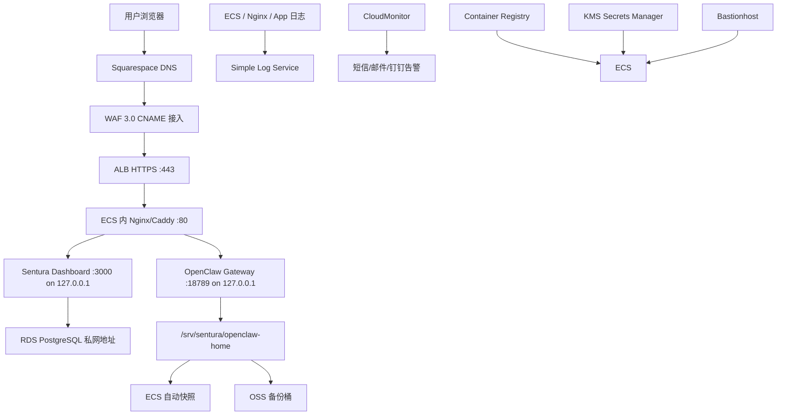
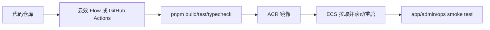

# Sentura 阿里云全栈部署教程

Date: 2026-06-25

本文是面向实操的阿里云部署 Runbook，用于把 Sentura 的主要生产生态尽量集中到阿里云：域名解析、入口安全、负载均衡、ECS、RDS PostgreSQL、容器镜像、证书、日志、监控、备份、堡垒机、身份与密钥管理。选型背景和部署方式评估见 [`docs/ALIYUN-DEPLOYMENT.md`](ALIYUN-DEPLOYMENT.md)；本文专注具体步骤。

本文默认目标是先上线可控的生产 beta，而不是一步到位上 Kubernetes。原因是 OpenClaw Gateway 是有状态的：它依赖持久化工作区、文件状态、SQLite/LanceDB、浏览器自动化和长连接 WebSocket。第一版应先用 ECS 稳定承载 Gateway，再逐步把边界能力交给阿里云托管服务。

## 0. 最终目标

推荐目标架构：



对外只暴露 HTTPS `443`。Sentura Dashboard 的 `3000`、OpenClaw Gateway 的 `18789`、PostgreSQL 的 `5432` 都只允许内网访问。

入口建议：

| 域名 | 用途 | 暴露方式 |
|---|---|---|
| `www.sentura.ai` | 官网/营销页 | 最终迁到阿里云；过渡期可继续保留 Render |
| `app.sentura.ai` | 普通员工/客户操作员 | WAF -> ALB -> Dashboard |
| `admin.sentura.ai` | 客户管理员/经理/平台管理员 | WAF -> ALB -> Dashboard，RBAC 更严格 |
| `ops.sentura.ai` | Sentura 运维和 OpenClaw Control UI | 优先 VPN/IP 白名单/堡垒机，不面向客户 |

不要用 `www.sentura.ai:3000`、`www.sentura.ai:18789` 这类公网端口区分身份。主流 SaaS 是用子域名、路由、组织上下文、登录态、RBAC、审计日志区分用户。

## 1. 阿里云产品清单

最小可控生产 beta：

| 层 | 阿里云产品 | 推荐配置 |
|---|---|---|
| 账号与权限 | Resource Group + RAM + ActionTrail | 单独资源组 `rg-sentura-prod`，RAM 最小权限，根账号 MFA |
| DNS | Squarespace DNS | 保留现有 DNS 管理方；只新增 `app`、`admin` 指向阿里云 WAF/ALB |
| 网络 | VPC + vSwitch + Security Group + NAT Gateway | ECS 不给公网 IP，通过 NAT 出网，通过 ALB 入站 |
| 入口 | WAF 3.0 + ALB | WAF CNAME 接入，ALB HTTPS 监听，支持 WebSocket/WSS |
| 证书 | Certificate Management Service | 管理 `*.sentura.ai` 或单域名证书，部署到 WAF/ALB |
| 计算 | ECS | beta：4 vCPU / 16 GiB；生产首批客户：8 vCPU / 32 GiB |
| 系统盘/数据盘 | ESSD PL1 | 系统盘 80 GiB；数据盘 100-200 GiB 起 |
| 数据库 | ApsaraDB RDS PostgreSQL HA | 私网访问，自动备份，PITR，7-30 天保留 |
| 容器镜像 | ACR | Dashboard 镜像和后续 Sentura 辅助服务镜像 |
| 对象存储 | OSS | OpenClaw state tarball、数据库逻辑备份、离线归档 |
| 日志 | Simple Log Service | Nginx、Dashboard、OpenClaw、系统日志集中检索 |
| 监控 | CloudMonitor | ECS/RDS/ALB/WAF/站点探测和告警 |
| 安全运维 | Bastionhost + Security Center + Cloud Firewall | SSH 审计、漏洞/异常登录、东西向/出入口流量控制 |
| 身份 | Alibaba Cloud IDaaS 或外部企业 IdP | OIDC/SAML；Sentura 内部映射 RBAC |
| 密钥 | KMS Secrets Manager | 数据库密码、LLM API key、Webhook token；不要写进仓库 |

可后置的产品：

- ACK：等 Gateway 状态边界、持久化、沙箱、会话迁移成熟后再考虑。
- SAE：可用于纯无状态辅助 API，不建议跑 OpenClaw Gateway。
- CDN：适合官网静态资源和 OSS 静态站点，不适合作为 Gateway 长连接入口。
- 域名注册商迁移：不是第一天必须。先把 DNS 接到阿里云即可。

## 2. 区域和规格选择

第一阶段推荐：

- Region：香港。
- 备选：新加坡。
- 不推荐第一天直接中国大陆：只要公共域名解析到中国大陆阿里云服务器，就需要 ICP 备案；没有备案可能被阻断。

ECS：

| 阶段 | ECS | 适用场景 |
|---|---|---|
| 内部 beta | 4 vCPU / 16 GiB | 10-20 个员工会话，轻量浏览器自动化 |
| 首批真实客户 | 8 vCPU / 32 GiB | 30-50 个活跃员工会话，多员工并发、Playwright 任务 |
| 增长阶段 | 16 vCPU / 64 GiB 或拆分多台 | Gateway 单独节点，Dashboard/worker 拆出，需压测数据支撑 |

磁盘：

- 系统盘：80 GiB ESSD。
- 数据盘：100-200 GiB ESSD PL1 起，挂载到 `/srv/sentura`。
- OpenClaw 的 `~/.openclaw` 或容器 volume 必须落在数据盘，不要放在临时目录。

数据库：

- 用 RDS PostgreSQL HA 承载 Sentura 业务数据、客户数据、跨境电商 Phase 2 数据。
- 不要把 OpenClaw 的工作区、LanceDB、SQLite 直接迁到 RDS；这些仍属于 OpenClaw 本地持久化状态。

## 3. 第 1 阶段：账号、权限、审计

### 3.1 根账号安全

1. 登录阿里云主账号。
2. 开启 MFA。
3. 创建资源组：`rg-sentura-prod`。
4. 统一标签：
   - `Project=Sentura`
   - `Env=prod`
   - `Owner=platform`
   - `CostCenter=sentura`
5. 开启 ActionTrail，把操作审计投递到 SLS 或 OSS。
6. 配置费用预算告警，至少设置 50%、80%、100% 三档。

### 3.2 RAM 用户和角色

不要用主账号 AccessKey 部署。

建议创建：

| 身份 | 用途 | 权限原则 |
|---|---|---|
| `ram-sentura-admin` | 少数平台管理员登录控制台 | MFA，控制台登录，尽量不用 AccessKey |
| `ram-sentura-ci` | 云效/CI 推镜像到 ACR | 只允许 ACR push/pull、读取必要 KMS secret |
| `role-sentura-ecs` | ECS 实例角色 | 读取 KMS、写 SLS、读 ACR、写 OSS 备份 |
| `ram-sentura-readonly` | 审计/财务查看 | 只读账单、监控、日志 |

关键规则：

- AccessKey 一应用一用户，不共享。
- 不把 AccessKey 写入 `.env`、代码仓库、聊天记录。
- 优先用 ECS RAM Role 让服务器访问 KMS、OSS、SLS、ACR。

## 4. 第 2 阶段：保留 Squarespace DNS，只新增 app/admin

你的域名现在由 Squarespace 管理，当前 DNS 检查结果是：

```text
www.sentura.ai CNAME sentura-website-r35a.onrender.com.
sentura.ai     A     216.24.57.8 / 216.24.57.9 / 216.24.57.1
NS             ns-cloud-b{1..4}.googledomains.com
```

当前决策：不迁移权威 DNS，不修改 nameserver，不迁移注册商。继续使用 Squarespace/Google Domains 这组 nameserver 管理 `sentura.ai`，只在 Squarespace DNS 里新增：

- `app.sentura.ai` -> 阿里云 WAF CNAME，或暂时指向 ALB CNAME。
- `admin.sentura.ai` -> 阿里云 WAF CNAME，或暂时指向 ALB CNAME。
- `ops.sentura.ai` 暂不建议公开；如果必须公开，才新增并配 IP 白名单/SSO。

这样可以保留现有 `www.sentura.ai` Render 官网和 apex `sentura.ai` 不变，避免一次 DNS 迁移影响整站和邮箱。阿里云仍承载应用入口、WAF、ALB、ECS、RDS、日志、监控和备份，只是 DNS 控制台继续用 Squarespace。

### 4.1 变更前记录现有 DNS

在本地记录当前解析，作为回滚依据：

```bash
dig +short NS sentura.ai
dig +short A sentura.ai
dig +short CNAME www.sentura.ai
dig +short MX sentura.ai
dig +short TXT sentura.ai
dig +short CAA sentura.ai
```

在 Squarespace 后台截图所有 DNS 记录。只新增记录，不删除现有记录，特别不要改这些记录：

- `www` CNAME。
- apex `@` A/ALIAS 记录。
- 邮箱相关 MX/TXT/SPF/DKIM/DMARC。
- 任何第三方验证 TXT。
- 任何 Render/Squarespace 相关记录。

### 4.2 先拿到阿里云入口 CNAME

如果走推荐的 WAF：

1. 在 WAF 3.0 里添加 `app.sentura.ai`。
2. 源站填写 ALB 的 DNS name。
3. 完成后复制 WAF 给出的 CNAME。
4. 对 `admin.sentura.ai` 重复一次。
5. 按 WAF 控制台提示，把 WAF 回源 IP 段加入 ALB/ECS 源站允许范围，避免外部绕过 WAF 直连源站。

如果暂时不走 WAF：

1. 创建 ALB。
2. 创建 HTTPS listener 和 server group。
3. 在 ALB 控制台复制 ALB DNS name。
4. `app` 和 `admin` 都先 CNAME 到 ALB DNS name。

生产推荐 `app` 和 `admin` 都先走 WAF，再由 WAF 回源 ALB。

### 4.3 在 Squarespace 添加 app/admin CNAME

在 Squarespace：

1. 打开 Domains dashboard。
2. 点击 `sentura.ai`。
3. 点击 DNS。
4. 进入 DNS Settings / Custom Records。
5. 点击 Add record。
6. Type 选择 `CNAME`。
7. 添加下面两条记录。

| Hostname | Type | Value | 说明 |
|---|---|---|---|
| `app` | CNAME | WAF CNAME，或 ALB DNS name | Sentura 员工端 |
| `admin` | CNAME | WAF CNAME，或 ALB DNS name | 管理端 |

不要新增或修改：

| Hostname | 处理 |
|---|---|
| `www` | 保持 `sentura-website-r35a.onrender.com`，继续服务 Render 官网 |
| `@` | 保持现有 Render A 记录，除非以后决定迁移 apex |
| `MX/TXT` | 保持现有邮箱和验证记录 |

如果 Squarespace 提示同名记录冲突，说明 `app` 或 `admin` 已经存在 A/AAAA/CNAME/TXT 等记录。先截图并确认用途，再决定是否删除或改名；不要直接覆盖未知记录。

### 4.4 验证 Squarespace DNS 生效

添加后先查询当前权威 nameserver：

```bash
dig +short NS sentura.ai
dig @<current-squarespace-ns> app.sentura.ai CNAME
dig @<current-squarespace-ns> admin.sentura.ai CNAME
```

再查询公共解析：

```bash
dig +short CNAME app.sentura.ai
dig +short CNAME admin.sentura.ai
curl -I https://app.sentura.ai
curl -I https://admin.sentura.ai
```

Squarespace DNS 变更可能需要一段时间传播。传播期间不要反复修改记录；先用 `dig` 确认返回值是否已经指向 WAF/ALB。

## 5. 第 3 阶段：VPC、vSwitch、安全组、NAT

### 5.1 创建 VPC

建议：

- VPC：`vpc-sentura-prod`
- CIDR：`10.20.0.0/16`
- vSwitch A：`10.20.1.0/24`
- vSwitch B：`10.20.2.0/24`
- ECS 私有子网：放在 vSwitch A。
- RDS：同 VPC，多可用区高可用。
- ALB：至少挂两个 vSwitch。

### 5.2 安全组

创建三个安全组：

`sg-sentura-alb`：

- 入站：TCP `443` from `0.0.0.0/0`
- 入站：TCP `80` from `0.0.0.0/0`，只用于 HTTP -> HTTPS 跳转或证书验证
- 出站：到 `sg-sentura-app` 的 TCP `80`

`sg-sentura-app`：

- 入站：TCP `80` from `sg-sentura-alb`
- 入站：TCP `22` from Bastionhost 安全组，或仅允许你的固定办公 IP
- 不开放 `3000`
- 不开放 `18789`
- 不开放 `5432`
- 出站：允许访问 RDS 私网、OSS/SLS/KMS/ACR、LLM provider/API provider、必要互联网源

`sg-sentura-db`：

- 入站：TCP `5432` from `sg-sentura-app`
- 不开放公网。

如果接入 WAF CNAME 模式，按 WAF 控制台给出的回源 IP 段进一步收紧 ALB 或源站访问。目标是让外部攻击者不能绕过 WAF 直接打源站。

### 5.3 NAT Gateway

生产建议 ECS 不绑定公网 IP。ECS 出网靠 NAT Gateway：

1. 创建 NAT Gateway。
2. 绑定 EIP。
3. 配置 SNAT，让私网 ECS 可以访问外网。
4. ECS 出网用于：
   - 拉 ACR 镜像。
   - 访问 LLM API。
   - Web search / browser 自动化。
   - `apt` / `pnpm` / 安全更新。

如果第一天为了调试使用 ECS EIP，后续要移除，改成 ALB 入站 + NAT 出站。

## 6. 第 4 阶段：RDS PostgreSQL

### 6.1 创建实例

建议：

- 产品：ApsaraDB RDS PostgreSQL。
- 版本：PostgreSQL 15 或 16；如果依赖库没有验证过最新版本，先用 15。
- Edition：High-availability。
- 网络：`vpc-sentura-prod`。
- 访问：私网地址，不开公网地址。
- 白名单/安全组：只允许 `sg-sentura-app` 或 ECS 私网 IP。
- 存储：beta 100 GiB 起，开启自动扩容或设置磁盘告警。

数据库：

```sql
CREATE DATABASE sentura_business;
CREATE USER sentura_app WITH PASSWORD '<from-kms-or-console>';
GRANT ALL PRIVILEGES ON DATABASE sentura_business TO sentura_app;
```

跨境电商 Phase 2 如果启用，可用单独 database 或 schema：

```sql
CREATE DATABASE cbe_phase2;
CREATE USER cbe_app WITH PASSWORD '<from-kms-or-console>';
GRANT ALL PRIVILEGES ON DATABASE cbe_phase2 TO cbe_app;
```

### 6.2 备份策略

最低要求：

- 自动备份：开启。
- 日志备份/PITR：开启。
- 保留期：beta 7 天；正式客户 30 天起。
- 迁移/大版本发布前手动备份。
- 每月至少做一次恢复演练。

应用上线前，在 ECS 上跑一次连接检查：

```bash
psql "$SENTURA_DATABASE_URL" -c "select now();"
```

跨境电商 Phase 2 迁移命令示例：

```bash
cd /srv/sentura/app/Sentura-Platform
set -a
source sentura/dashboard/.env.production
set +a
pnpm exec tsx sentura/lib/cross-border-store/migrate.ts --seed
```

## 7. 第 5 阶段：ECS 主机准备

### 7.1 创建 ECS

建议第一台生产 beta：

- OS：Ubuntu 22.04 LTS 或 Debian 12。
- 规格：4 vCPU / 16 GiB；首批客户升级 8 vCPU / 32 GiB。
- 公网 IP：生产建议不分配。
- 安全组：`sg-sentura-app`。
- 系统盘：80 GiB。
- 数据盘：100-200 GiB，挂载 `/srv/sentura`。
- 实例 RAM Role：`role-sentura-ecs`。

### 7.2 初始化系统

登录后：

```bash
sudo apt-get update
sudo apt-get install -y ca-certificates curl git jq unzip build-essential nginx postgresql-client
sudo timedatectl set-timezone UTC
```

安装 Docker：

```bash
curl -fsSL https://get.docker.com | sudo sh
sudo usermod -aG docker "$USER"
docker compose version
```

安装 Node.js 24 或至少 22.19+。如果使用 nvm：

```bash
curl -o- https://raw.githubusercontent.com/nvm-sh/nvm/v0.40.3/install.sh | bash
source ~/.bashrc
nvm install 24
nvm use 24
corepack enable
corepack prepare pnpm@11.5.1 --activate
node -v
pnpm -v
```

### 7.3 挂载数据盘

示例：

```bash
lsblk
sudo mkfs.ext4 /dev/vdb
sudo mkdir -p /srv/sentura
sudo mount /dev/vdb /srv/sentura
df -h /srv/sentura
```

写入 `/etc/fstab`，避免重启丢挂载。用磁盘 UUID：

```bash
sudo blkid /dev/vdb
```

`/etc/fstab` 示例：

```text
UUID=<disk-uuid> /srv/sentura ext4 defaults,nofail 0 2
```

创建目录：

```bash
sudo mkdir -p /srv/sentura/app
sudo mkdir -p /srv/sentura/openclaw-home
sudo mkdir -p /srv/sentura/backups
sudo mkdir -p /srv/sentura/logs
sudo chown -R "$USER":"$USER" /srv/sentura
```

## 8. 第 6 阶段：部署代码

### 8.1 拉取仓库

```bash
cd /srv/sentura/app
git clone <your-private-repo-url> Sentura-Platform
cd Sentura-Platform
corepack enable
pnpm install --frozen-lockfile
```

OpenClaw 需要单独构建：

```bash
cd /srv/sentura/app/Sentura-Platform/openclaw
pnpm install --frozen-lockfile
pnpm ui:build
pnpm build
```

Dashboard：

```bash
cd /srv/sentura/app/Sentura-Platform/sentura/dashboard
pnpm install --frozen-lockfile
pnpm build
```

当前仓库状态下，`sentura/dashboard` 还没有 Dockerfile，`next.config.ts` 也没有启用 `output: "standalone"`。因此第一版可以用 systemd 跑源码构建产物；要推 ACR 镜像，需要先补 Dashboard Dockerfile 和 standalone 输出。

### 8.2 环境变量

创建生产环境文件：

```bash
cd /srv/sentura/app/Sentura-Platform/sentura/dashboard
cp .env.local.example .env.production 2>/dev/null || touch .env.production
chmod 600 .env.production
```

示例内容：

```bash
NODE_ENV=production
PORT=3000
HOSTNAME=127.0.0.1
NEXT_PUBLIC_SENTURA_APP_URL=https://app.sentura.ai
NEXT_PUBLIC_SENTURA_ADMIN_URL=https://admin.sentura.ai
OPENCLAW_GATEWAY_URL=ws://127.0.0.1:18789
SENTURA_DATABASE_URL=postgresql://sentura_app:<password>@<rds-private-host>:5432/sentura_business?sslmode=require
CBE_DATABASE_URL=postgresql://cbe_app:<password>@<rds-private-host>:5432/cbe_phase2?sslmode=require
```

生产中这些密码应放在 KMS Secrets Manager 或 OpenClaw secret store。`.env.production` 只是本机运行时文件，不能提交。

OpenClaw 环境。当前 `openclaw/docker-compose.yml` 会读取 `openclaw/.env`，生产中可以把真实 env 放在 `/srv/sentura/secrets`，再用 symlink 指到仓库目录：

```bash
mkdir -p /srv/sentura/secrets
mkdir -p /srv/sentura/openclaw-home/.openclaw/workspace
mkdir -p /srv/sentura/openclaw-home/.config/openclaw
chmod 700 /srv/sentura/secrets /srv/sentura/openclaw-home

cat > /srv/sentura/secrets/openclaw.env <<'EOF'
OPENAI_API_KEY=<from-secret-store-or-runtime-injection>
OPENCLAW_CONFIG_DIR=/srv/sentura/openclaw-home/.openclaw
OPENCLAW_WORKSPACE_DIR=/srv/sentura/openclaw-home/.openclaw/workspace
OPENCLAW_AUTH_PROFILE_SECRET_DIR=/srv/sentura/openclaw-home/.config/openclaw
OPENCLAW_GATEWAY_PORT=127.0.0.1:18789
OPENCLAW_BRIDGE_PORT=127.0.0.1:18790
OPENCLAW_MSTEAMS_PORT=127.0.0.1:3978
OPENCLAW_GATEWAY_BIND=loopback
EOF
chmod 600 /srv/sentura/secrets/openclaw.env

ln -sfn /srv/sentura/secrets/openclaw.env /srv/sentura/app/Sentura-Platform/openclaw/.env
```

## 9. 第 7 阶段：OpenClaw Gateway

### 9.1 推荐运行方式

生产 Docker 应使用 OpenClaw 上游 Docker 资产。当前仓库路径是：

```text
openclaw/scripts/docker/setup.sh
openclaw/docker-compose.yml
```

不要在 Sentura 根目录重新写一套自定义 Docker Compose 去包 OpenClaw。

### 9.2 Docker 启动 OpenClaw

示例：

```bash
cd /srv/sentura/app/Sentura-Platform/openclaw
set -a
source /srv/sentura/secrets/openclaw.env
set +a
bash scripts/docker/setup.sh
docker compose ps
```

确认 Gateway 只在本机或 Docker 内部暴露，不被安全组直接公开。

### 9.3 Gateway 生产配置

生产配置要满足：

- `bind: "loopback"` 或只绑定内网。
- `controlUi.allowedOrigins` 只允许 `https://app.sentura.ai`、`https://admin.sentura.ai`、`https://ops.sentura.ai`。
- `allowInsecureAuth: false`。
- 可信代理只填本机反代或 ALB/Nginx 的真实来源。

示例：

```json5
{
  gateway: {
    bind: "loopback",
    auth: { mode: "token" },
    trustedProxies: ["127.0.0.1"],
    controlUi: {
      allowedOrigins: [
        "https://app.sentura.ai",
        "https://admin.sentura.ai",
        "https://ops.sentura.ai"
      ],
      allowInsecureAuth: false
    }
  }
}
```

如果接入企业 SSO 和可信反代，改用 trusted-proxy 模式，并由反代注入已认证用户头。只有可信反代能访问 Gateway，浏览器不能直连 Gateway 端口。

### 9.4 验证

在 ECS 上：

```bash
curl -I http://127.0.0.1:18789
docker compose logs --tail=100 openclaw-gateway
```

从外网验证应失败：

```bash
nc -vz app.sentura.ai 18789
```

预期：`18789` 不通。

## 10. 第 8 阶段：Sentura Dashboard

### 10.1 源码/systemd 路径

当前仓库可先用 systemd 跑 Dashboard：

```bash
cd /srv/sentura/app/Sentura-Platform/sentura/dashboard
pnpm build
command -v pnpm
```

如果 Node/pnpm 是通过 nvm 安装的，systemd 默认不会加载 nvm shell 环境。生产中更稳的做法是安装系统级 Node/pnpm，或把下面 unit 里的 `ExecStart` 改成 `command -v pnpm` 返回的绝对路径，并确保 `User` 能访问该路径。

创建 `/etc/systemd/system/sentura-dashboard.service`：

```ini
[Unit]
Description=Sentura Dashboard
After=network.target

[Service]
Type=simple
WorkingDirectory=/srv/sentura/app/Sentura-Platform/sentura/dashboard
EnvironmentFile=/srv/sentura/app/Sentura-Platform/sentura/dashboard/.env.production
Environment=HOSTNAME=127.0.0.1
Environment=PORT=3000
ExecStart=<absolute-pnpm-path> start
Restart=always
RestartSec=5
User=sentura
Group=sentura

[Install]
WantedBy=multi-user.target
```

如果使用 `sentura` 用户：

```bash
sudo useradd --system --create-home --shell /usr/sbin/nologin sentura || true
sudo chown -R sentura:sentura /srv/sentura/app/Sentura-Platform/sentura/dashboard
sudo systemctl daemon-reload
sudo systemctl enable --now sentura-dashboard
sudo systemctl status sentura-dashboard
```

### 10.2 ACR 镜像路径

要完全进入阿里云容器镜像生态，需要先补：

1. `sentura/dashboard/next.config.ts`：

```ts
import type { NextConfig } from "next";

const nextConfig: NextConfig = {
  output: "standalone",
};

export default nextConfig;
```

2. `sentura/dashboard/Dockerfile`，按 Next.js standalone 输出构建。
3. CI：云效 Flow 或 GitHub Actions 推送镜像到 ACR。

ACR 手工推送示例：

```bash
docker login --username=<acr-user> registry-intl.<region>.aliyuncs.com
docker build -t registry-intl.<region>.aliyuncs.com/sentura/dashboard:<git-sha> -f sentura/dashboard/Dockerfile .
docker push registry-intl.<region>.aliyuncs.com/sentura/dashboard:<git-sha>
```

ECS 拉取：

```bash
docker pull registry-intl.<region>.aliyuncs.com/sentura/dashboard:<git-sha>
```

如果 ACR 在同 VPC/region 支持内网拉取，优先开启内网地址；否则通过 NAT Gateway 出网拉取。

## 11. 第 9 阶段：Nginx/Caddy 反向代理

ALB 可以做 TLS 终止，ECS 上 Nginx 用 HTTP 内网接入即可。Nginx 只监听 ECS 私网和本机，不给公网直连。

示例 `/etc/nginx/sites-available/sentura.conf`：

```nginx
server {
    listen 80;
    server_name app.sentura.ai admin.sentura.ai;

    client_max_body_size 50m;

    location / {
        proxy_pass http://127.0.0.1:3000;
        proxy_http_version 1.1;
        proxy_set_header Host $host;
        proxy_set_header X-Real-IP $remote_addr;
        proxy_set_header X-Forwarded-For $proxy_add_x_forwarded_for;
        proxy_set_header X-Forwarded-Proto https;
        proxy_set_header X-Forwarded-Host $host;
    }

    location /gateway/ {
        proxy_pass http://127.0.0.1:18789/;
        proxy_http_version 1.1;
        proxy_set_header Upgrade $http_upgrade;
        proxy_set_header Connection "upgrade";
        proxy_set_header Host $host;
        proxy_set_header X-Real-IP $remote_addr;
        proxy_set_header X-Forwarded-For $proxy_add_x_forwarded_for;
        proxy_set_header X-Forwarded-Proto https;
    }
}

server {
    listen 80;
    server_name ops.sentura.ai;

    allow <your-office-ip>/32;
    deny all;

    location / {
        proxy_pass http://127.0.0.1:18789/;
        proxy_http_version 1.1;
        proxy_set_header Upgrade $http_upgrade;
        proxy_set_header Connection "upgrade";
        proxy_set_header Host $host;
        proxy_set_header X-Real-IP $remote_addr;
        proxy_set_header X-Forwarded-For $proxy_add_x_forwarded_for;
        proxy_set_header X-Forwarded-Proto https;
    }
}
```

启用：

```bash
sudo ln -s /etc/nginx/sites-available/sentura.conf /etc/nginx/sites-enabled/sentura.conf
sudo nginx -t
sudo systemctl reload nginx
```

如果 OpenClaw Control UI 必须暴露给运维，推荐 `ops.sentura.ai` + IP 白名单 + SSO，而不是放在 `app.sentura.ai/control/` 面向所有客户用户。

## 12. 第 10 阶段：证书、ALB、WAF

### 12.1 证书

在 Certificate Management Service：

1. 申请或上传 `app.sentura.ai`、`admin.sentura.ai`、`ops.sentura.ai` 证书。
2. 更推荐申请 `*.sentura.ai` wildcard，便于后续 `tenant.sentura.ai`。
3. 通过 DNS TXT 验证域名所有权。
4. 部署证书到 WAF 或 ALB。

### 12.2 ALB

1. 创建 ALB，选择 `vpc-sentura-prod` 和两个 vSwitch。
2. 创建 server group：`sgp-sentura-dashboard`。
3. 后端服务器：ECS 私网 IP，端口 `80`。
4. 健康检查：
   - 协议：HTTP。
   - 路径：`/api/health`；如果当前 Dashboard 没有健康检查路由，先用 `/`，上线前补 `/api/health`。
   - 健康阈值：2-3 次。
5. 创建 HTTPS 监听 `443`，绑定证书。
6. 转发规则：
   - Host `app.sentura.ai` -> server group。
   - Host `admin.sentura.ai` -> server group。
   - Host `ops.sentura.ai` -> server group 或单独 ops server group。

ALB HTTPS 监听支持 WebSocket/WSS，Gateway 的 WebSocket 流量可以通过 `/gateway/` 转发到 Nginx，再到 OpenClaw。

### 12.3 WAF

在 WAF 3.0：

1. 选择 CNAME 接入。
2. 添加 `app.sentura.ai`、`admin.sentura.ai`，可单独添加 `ops.sentura.ai`。
3. 绑定证书。
4. 源站填写 ALB 的 DNS 名称。
5. 配置 HTTPS `443`。
6. 复制 WAF 提供的 CNAME。
7. 按 WAF 控制台提示，将 WAF 回源 IP 加入 ALB/ECS 源站允许范围。
8. 本地 hosts 验证通过后，再改 DNS。

建议 WAF 策略：

- `app.sentura.ai`：基础防护、Bot/频率限制、登录接口限速。
- `admin.sentura.ai`：更严格频率限制、地理/ASN 风险策略、强制 MFA/SSO。
- `ops.sentura.ai`：只允许固定 IP/VPN，尽量不开放公网。

## 13. 第 11 阶段：Squarespace DNS 最终记录

如果走 WAF：

| Hostname | Type | Value |
|---|---|---|
| `app` | CNAME | WAF 给出的 CNAME |
| `admin` | CNAME | WAF 给出的 CNAME |
| `ops` | CNAME | WAF 给出的 CNAME，或不创建公网记录 |

如果暂时不走 WAF，只走 ALB：

| Hostname | Type | Value |
|---|---|---|
| `app` | CNAME | ALB DNS name |
| `admin` | CNAME | ALB DNS name |
| `ops` | CNAME | ALB DNS name |

当前方案下，不改 nameserver，不把 `sentura.ai` 添加到 Alibaba Cloud DNS。所有 DNS 记录继续在 Squarespace 管理。

如果要把官网也迁到阿里云：

| 方案 | 适合场景 |
|---|---|
| `www` -> Dashboard public landing route | 官网和产品在同一个 Next.js 应用 |
| `www` -> OSS static website + CDN | 官网主要是静态页，发布频率低 |
| `www` -> 独立 ECS/ALB 站点 | 官网和产品部署生命周期必须分离 |

迁移 `www` 前先保留 Render 回滚记录：

```text
www.sentura.ai CNAME sentura-website-r35a.onrender.com.
sentura.ai     A     216.24.57.8 / 216.24.57.9 / 216.24.57.1
```

## 14. 第 12 阶段：身份登录和权限边界

生产不能继续依赖 demo 登录或本地用户名密码。

推荐：

1. 对 Sentura 自有平台用户，使用 Alibaba Cloud IDaaS 的 OIDC。
2. 对企业客户，支持客户自己的 OIDC/SAML IdP。
3. Dashboard 登录后把身份映射到 Sentura RBAC：
   - 普通员工：`end_user` 或客户项目内 `operator`。
   - 客户管理员：`manager` 或客户项目内 `admin`。
   - Sentura 平台管理员：`platform_admin`。
   - 审计员：`auditor`。
4. `admin.sentura.ai` 必须只允许管理员角色进入。
5. `ops.sentura.ai` 必须只允许 Sentura 运维进入，不给普通客户管理员使用。

技术调整清单：

- Dashboard middleware：按 hostname + route 做 RBAC。
- Secure cookies：`HttpOnly`、`Secure`、`SameSite=Lax/Strict`。
- Session store：服务端可撤销。
- Gateway RPC：每个请求带 actor/user/org scope。
- Audit：登录、权限变更、审批、Agent 配置变更、工具调用都要可追踪。

## 15. 第 13 阶段：密钥和配置

短期：

- ECS 本机 `.env.production`，权限 `600`。
- OpenClaw `~/.openclaw/.env`，权限 `600`。
- 不提交任何密钥。

生产推荐：

- KMS Secrets Manager 存：
  - RDS password。
  - LLM API keys。
  - OAuth client secret。
  - Webhook secrets。
  - Third-party API tokens。
- ECS 通过 RAM Role 读取 KMS。
- 应用启动时注入环境变量或写入本机运行时 secret 文件。
- OpenClaw 自身 secret 仍走 OpenClaw secret store；阿里云 KMS 作为外部托管源时，需要显式实现或配置 bridge，不要绕过 OpenClaw 直接把密钥写进 agent workspace。

## 16. 第 14 阶段：日志、监控、告警

### 16.1 CloudMonitor

配置告警：

| 对象 | 指标 | 阈值建议 |
|---|---|---|
| ECS | CPU | 70% 持续 3 个周期 |
| ECS | Memory | 75% 告警，85% 严重 |
| ECS | Disk | 75% 告警，85% 严重 |
| RDS | CPU | 70% 持续 3 个周期 |
| RDS | Connections | 超过上限 70% |
| RDS | Storage | 75% 告警 |
| ALB | Unhealthy hosts | > 0 立即告警 |
| ALB/WAF | 5xx | 连续升高告警 |
| 站点探测 | `https://app.sentura.ai` | 不可用立即告警 |
| 站点探测 | `https://admin.sentura.ai` | 不可用立即告警 |

告警接收：

- 邮件。
- 手机。
- 钉钉群机器人。
- 后续可接入 Sentura 自己的 incident channel。

### 16.2 Simple Log Service

采集：

- `/var/log/nginx/access.log`
- `/var/log/nginx/error.log`
- `journalctl -u sentura-dashboard`
- OpenClaw Docker logs。
- 系统 auth logs。

保留期：

- beta：14-30 天。
- 正式客户：90 天起，按合同和合规要求调整。

注意：日志里不能输出 API key、数据库密码、客户敏感原文。

## 17. 第 15 阶段：备份与恢复

OpenClaw state：

```bash
tar -czf /srv/sentura/backups/openclaw-home-$(date +%F-%H%M).tar.gz -C /srv/sentura openclaw-home
```

上传 OSS：

```bash
ossutil cp /srv/sentura/backups/openclaw-home-YYYY-MM-DD-HHMM.tar.gz oss://sentura-prod-backups/openclaw/
```

RDS：

- 开启自动备份和日志备份。
- 大发布前手动备份。
- 需要离线备份时使用 `pg_dump`：

```bash
pg_dump "$SENTURA_DATABASE_URL" -Fc -f /srv/sentura/backups/sentura-business-$(date +%F).dump
```

ECS 数据盘：

- 创建自动快照策略。
- 每日快照，保留 7-14 天。
- 关键发布前手动快照。

恢复演练：

1. 新建临时 ECS。
2. 从快照挂载数据盘或从 OSS 拉 OpenClaw tarball。
3. 恢复 RDS 到临时实例。
4. 启动 Gateway + Dashboard。
5. 验证员工列表、会话、memory、业务数据。
6. 记录 RTO/RPO。

没有恢复演练的备份不算真正可用。

## 18. 第 16 阶段：CI/CD 进入阿里云生态

第一版可以手工部署；进入正式客户前，建议改成：



如果想尽量全在阿里云：

1. 代码镜像到云效 Codeup。
2. 云效 Flow 执行：
   - `pnpm install --frozen-lockfile`
   - `pnpm --dir sentura/dashboard build`
   - `pnpm exec tsc --noEmit` 或项目对应测试。
   - 构建 Dashboard Docker image。
   - 推送 ACR。
3. ECS 通过 RAM Role 拉 ACR。
4. 部署脚本：
   - 拉新镜像。
   - 健康检查。
   - 切换容器。
   - 保留上一个镜像 tag 作为回滚。

OpenClaw Gateway 不建议被通用 CI 随意重建。Gateway 升级要单独走维护窗口，先备份 `openclaw-home`，再执行 upstream Docker 升级流程。

## 19. 第 17 阶段：上线前代码/配置必改项

当前仓库还需要补这些生产化调整：

| 项 | 原因 |
|---|---|
| Dashboard `next.config.ts` 增加 `output: "standalone"` | 方便 Docker/ACR 部署 |
| 新增 `sentura/dashboard/Dockerfile` | 让 Dashboard 镜像化 |
| 新增 `/api/health` | ALB 健康检查需要稳定轻量接口 |
| 新增 `.env.production.example` | 明确生产环境变量，不泄露真实值 |
| Dashboard 登录接入 OIDC/SAML | demo 登录不能进生产 |
| hostname/route RBAC middleware | `app` 和 `admin` 入口必须强隔离 |
| Gateway `allowedOrigins` 生产配置 | 防止任意 origin 连接 WebSocket |
| `allowInsecureAuth=false` | 生产禁止不安全认证 |
| 反代可信头校验 | 避免伪造 `X-Forwarded-*` 或 user header |
| 审计日志完整链路 | 登录、审批、工具调用、配置变更都要追踪 |
| 备份恢复脚本 | OpenClaw state + RDS 都要可恢复 |
| 阿里云部署 smoke 脚本 | 发布后自动验证 app/admin/ops |

## 20. 第 18 阶段：上线检查

### 20.1 内网检查

在 ECS：

```bash
curl -I http://127.0.0.1:3000
curl -I http://127.0.0.1:18789
psql "$SENTURA_DATABASE_URL" -c "select now();"
docker compose ps
systemctl status sentura-dashboard
nginx -t
```

### 20.2 公网检查

```bash
curl -I https://app.sentura.ai
curl -I https://admin.sentura.ai
curl -I https://ops.sentura.ai
```

端口检查：

```bash
nc -vz app.sentura.ai 443
nc -vz app.sentura.ai 3000
nc -vz app.sentura.ai 18789
nc -vz app.sentura.ai 5432
```

预期：

- `443` 通。
- `3000` 不通。
- `18789` 不通。
- `5432` 不通。

### 20.3 权限检查

| 场景 | 预期 |
|---|---|
| 普通员工访问 `app.sentura.ai` | 可进入自己的工作区 |
| 普通员工访问 `admin.sentura.ai` | 被拒绝或跳转无权限 |
| 客户管理员访问 `admin.sentura.ai` | 只看本客户/本 tenant |
| 客户管理员访问 `ops.sentura.ai` | 被拒绝 |
| Sentura 运维访问 `ops.sentura.ai` | 需要 SSO/MFA/IP 白名单 |
| 未登录用户访问任意 app/admin 页面 | 跳转登录 |

### 20.4 回滚检查

必须准备：

- 上一个 Dashboard 镜像 tag 或上一版代码目录。
- RDS 发布前手动备份。
- OpenClaw state 发布前 tarball 和 ECS 快照。
- DNS 回滚记录，尤其是 Render 的 `www` CNAME。
- ALB/WAF 旧配置截图或导出。

## 21. 建议执行顺序

最稳的顺序：

1. 阿里云账号、RAM、资源组、预算、ActionTrail。
2. 创建 VPC/vSwitch/security group/NAT。
3. 创建 RDS PostgreSQL。
4. 创建 ECS，挂载数据盘。
5. 在 ECS 上跑通 OpenClaw Gateway 和 Dashboard 内网访问。
6. 创建 ALB，先只接 `app` 测试域名。
7. 创建证书。
8. 创建 WAF CNAME 接入。
9. 在 Squarespace DNS 里新增 `app` 和 `admin` CNAME，指向 WAF CNAME 或 ALB DNS name。
10. 做 smoke test 和权限检查。
11. 再决定是否迁 `www.sentura.ai`。
12. 配 SLS、CloudMonitor、备份、快照、Bastionhost。
13. 完成 Dashboard Dockerfile/ACR/CI。

## 22. 常见错误

- 把 `18789` 暴露到公网。
- 把 PostgreSQL 公网地址打开给 `0.0.0.0/0`。
- 误改 `www`、`@`、MX/TXT 记录，导致 Render 官网或邮箱中断。
- 迁 `www` 时没有保留 Render 回滚记录。
- 用主账号 AccessKey 跑 CI。
- 把 LLM API key 写进仓库。
- 把 OpenClaw state 当成无状态容器，重启后工作区丢失。
- 在未备案情况下把公共域名解析到中国大陆 ECS。
- ALB 健康检查打到需要登录的页面，导致误判 unhealthy。
- 没做恢复演练就声称备份完成。

## 23. 外部资料

- Squarespace 编辑 DNS 记录：<https://support.squarespace.com/hc/en-us/articles/360002101888-Edit-your-domain-s-DNS-records>
- Squarespace 添加 A/CNAME Web hosting 记录：<https://support.squarespace.com/hc/en-us/articles/31119879125645-DNS-records-for-web-hosting>
- ECS 安全组：<https://www.alibabacloud.com/help/en/ecs/user-guide/start-using-security-groups>
- ECS 自动快照：<https://www.alibabacloud.com/help/en/ecs/user-guide/create-an-automatic-snapshot-policy-1>
- WAF CNAME 接入：<https://www.alibabacloud.com/help/en/waf/web-application-firewall-3-0/user-guide/add-a-domain-name-to-waf-in-cname-record-mode>
- ALB HTTPS listener / WebSocket：<https://www.alibabacloud.com/help/en/slb/application-load-balancer/user-guide/create-and-manage-listeners>
- ALB server group / health check：<https://www.alibabacloud.com/help/en/slb/application-load-balancer/user-guide/create-and-manage-a-server-group>
- Certificate Management Service：<https://www.alibabacloud.com/help/en/ssl-certificate/deploy-ssl-certificates-to-alibaba-cloud-services>
- RDS PostgreSQL 备份：<https://help.aliyun.com/en/rds/apsaradb-rds-for-postgresql/back-up-an-apsaradb-rds-for-postgresql-instance>
- ACR 镜像推拉：<https://www.alibabacloud.com/help/en/acr/user-guide/use-a-container-registry-personal-edition-instance-to-push-and-pull-images>
- RAM 最小权限与 AccessKey 安全：<https://www.alibabacloud.com/help/en/ram/product-overview/best-practices-for-identity-and-access-control>
- KMS Secrets Manager：<https://www.alibabacloud.com/help/en/kms/key-management-service/getting-started/getting-started-with-secrets-manager>
- IDaaS OIDC：<https://www.alibabacloud.com/help/en/idaas/eiam/developer-reference/integrate-sso-with-oidc>
- Bastionhost 管理员快速开始：<https://www.alibabacloud.com/help/en/bh/bastionhost/getting-started/administrator-quick-start>
- CloudMonitor 网站监控：<https://www.alibabacloud.com/help/en/ecs/user-guide/monitor-and-alert-on-websites>
- ICP 备案要求：<https://www.alibabacloud.com/help/en/icp-filing/basic-icp-service/product-overview/what-is-an-icp-filing>
- OpenClaw Docker：<https://docs.openclaw.ai/install/docker>
- OpenClaw Gateway security：<https://docs.openclaw.ai/gateway/security>
- Next.js self-hosting：<https://nextjs.org/docs/app/guides/self-hosting>
