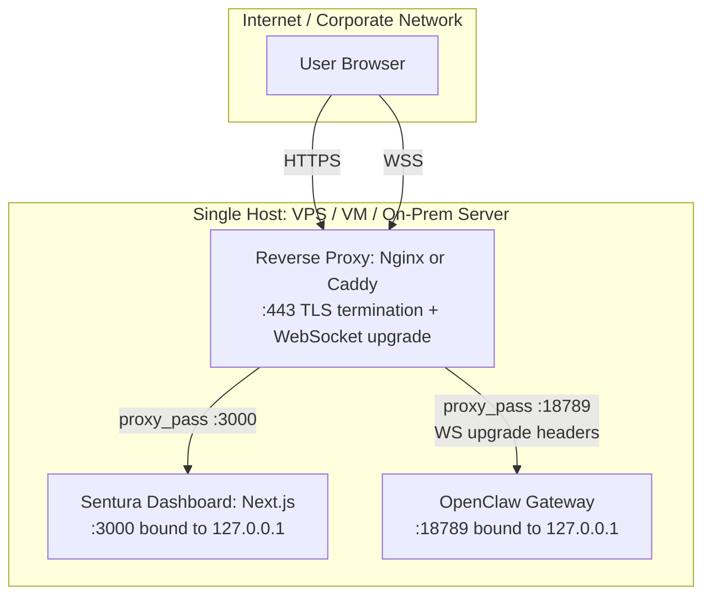
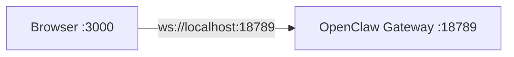

# Sentura Production Hosting Guide

This document covers how the Sentura Dashboard and OpenClaw Gateway are deployed and communicate in production across all supported hosting environments.

## Deployment Targets

Sentura supports three hosting environments based on customer demands:

| Target | Examples | Managed by |
|--------|----------|------------|
| Cloud VPS | DigitalOcean, Hetzner, AWS EC2, Linode | Sentura or customer |
| Virtual Machine | VMware, Hyper-V, Proxmox | Customer's private cloud / data center |
| On-premise server | Bare-metal or virtualized, behind corporate firewall | Customer's IT team |

In all three cases, **the Sentura Dashboard and OpenClaw Gateway are co-hosted on the same machine**. OpenClaw is a persistent, stateful service (shell execution, browser automation via Chromium, file management, SQLite/LanceDB state) that requires a dedicated host. Co-hosting eliminates cross-network latency and simplifies the deployment to a single unit.

## Host Requirements

| Resource | Minimum | Recommended |
|----------|---------|-------------|
| OS | Ubuntu 22.04 LTS or Debian 12 | Docker-compatible Linux |
| CPU | 4 vCPU | 8+ vCPU (browser automation / high concurrency) |
| RAM | 8 GB | 16 GB+ (Playwright/Chromium headroom) |
| Storage | 80 GB SSD | 100 GB+ NVMe (logs, workspaces, Docker layers, LanceDB) |
| Network | Static IP (VPS/VM) or stable internal IP (on-prem) | Open port 443 |

## Architecture

### Production Topology (Co-Hosted)



Both services bind to `127.0.0.1` (loopback) and are never exposed directly to the internet. Nginx/Caddy is the single public-facing entry point on port 443.

**Hybrid UI architecture:** The Sentura Dashboard handles enterprise management features (employee lifecycle, approvals, cost, audit, integrations). The OpenClaw Control UI (served by the gateway) handles operational/developer tasks (config editing, sessions, chat, logs, debug, cron, skills). Both UIs are served from a single domain using path-based routing:

- `sentura.example.com/` -> Next.js `:3000` (Sentura Dashboard — enterprise UI)
- `sentura.example.com/control/` -> OpenClaw Gateway `:18789` (Control UI + WebSocket RPC)

For on-premise deployments behind a corporate firewall, the same topology applies but with internal DNS/IP instead of public domains.

### Local Development Setup



- Dashboard and gateway run on the same machine with no reverse proxy
- `controlUi.allowInsecureAuth: true` allows token auth without device crypto over HTTP
- Origin check passes because both are localhost

## Authentication Modes

OpenClaw supports multiple auth modes for the gateway. The right choice depends on the deployment.

### Token Auth (VPS / VM)

Best for: single-tenant VPS deployments, small teams, quick setup.

- Gateway config: `auth.mode: "token"`, `bind: "loopback"`
- Nginx terminates TLS, forwards WebSocket to gateway
- Dashboard sends token in `ConnectParams.auth.token` during the WebSocket handshake
- With HTTPS, browser SubtleCrypto enables device pairing (preserves operator scopes)

**Gateway config:**

```json5
{
  gateway: {
    auth: { mode: "token" },
    bind: "loopback",
    controlUi: {
      allowedOrigins: ["https://dashboard.example.com"]
    },
    trustedProxies: ["127.0.0.1"]
  }
}
```

### Trusted-Proxy Auth (Enterprise On-Prem)

Best for: enterprise customers with existing SSO (SAML/OIDC), multi-user access, audit requirements. This is the **recommended** pattern for enterprise deployments.

- Reverse proxy handles authentication and injects identity headers (e.g., `X-Remote-User`)
- Gateway trusts the proxy and reads user identity from `trustedProxy.userHeader`
- No shared token in browser code -- auth is fully delegated to the proxy
- Scopes are preserved for trusted-proxy clients without device pairing

**Gateway config:**

```json5
{
  gateway: {
    auth: {
      mode: "trusted-proxy",
      trustedProxy: {
        userHeader: "X-Remote-User",
        requiredHeaders: ["X-Forwarded-Proto"],
        allowUsers: ["admin@company.com"]
      }
    },
    bind: "loopback",
    trustedProxies: ["127.0.0.1"],
    controlUi: {
      allowedOrigins: ["https://dashboard.company.internal"]
    }
  }
}
```

### Tailscale (Small Teams / Hybrid)

Best for: distributed teams, developers accessing a shared instance, hybrid setups where the server is on-prem but users are remote.

- Gateway config: `tailscale.mode: "serve"` or `"funnel"`
- Tailscale provides mesh networking with built-in TLS and identity
- No reverse proxy needed

## Gateway Config Reference

All settings live in the `gateway` section of `openclaw.json`:

| Setting | Values | Purpose |
|---------|--------|---------|
| `bind` | `"loopback"` (default), `"lan"`, `"tailnet"` | Network interface binding |
| `auth.mode` | `"token"`, `"password"`, `"trusted-proxy"`, `"none"` | Authentication strategy |
| `controlUi.allowedOrigins` | `["https://dashboard.example.com"]` | Required for non-loopback. Without it, browser WebSocket connections are rejected |
| `trustedProxies` | `["127.0.0.1"]` | IP ranges allowed to set forwarded headers |
| `controlUi.allowInsecureAuth` | `true` / `false` | **Local dev only.** Allows HTTP without device crypto. Never use in production. |

## Reverse Proxy Configuration

### Nginx (Single-Domain, Path-Based Routing — Recommended)

A single server block serves both the Sentura Dashboard and the OpenClaw Control UI from one domain. The dashboard is the default route; the Control UI is served at `/control/`.

```nginx
server {
    listen 443 ssl;
    server_name sentura.example.com;

    ssl_certificate     /etc/ssl/certs/sentura.pem;
    ssl_certificate_key /etc/ssl/private/sentura.key;

    # Sentura Dashboard (enterprise UI)
    location / {
        proxy_pass http://127.0.0.1:3000;
        proxy_set_header Host $host;
        proxy_set_header X-Real-IP $remote_addr;
        proxy_set_header X-Forwarded-For $proxy_add_x_forwarded_for;
        proxy_set_header X-Forwarded-Proto $scheme;
    }

    # OpenClaw Control UI + Gateway WebSocket (operations)
    location /control/ {
        proxy_pass http://127.0.0.1:18789/;
        proxy_http_version 1.1;
        proxy_set_header Upgrade $http_upgrade;
        proxy_set_header Connection "upgrade";
        proxy_set_header Host $host;
        proxy_set_header X-Real-IP $remote_addr;
        proxy_set_header X-Forwarded-For $proxy_add_x_forwarded_for;
        proxy_set_header X-Forwarded-Proto $scheme;
        proxy_read_timeout 86400;
    }
}
```

The `/control/` route requires `proxy_http_version 1.1`, `Upgrade`, and `Connection "upgrade"` headers for WebSocket connections. The `proxy_read_timeout 86400` (24 hours) prevents Nginx from closing idle persistent connections. The trailing slash in `proxy_pass http://127.0.0.1:18789/` strips the `/control/` prefix before forwarding to the gateway.

### Nginx (Two-Subdomain Alternative)

For deployments that prefer separate subdomains:

```nginx
server {
    listen 443 ssl;
    server_name dashboard.example.com;
    ssl_certificate     /etc/ssl/certs/dashboard.pem;
    ssl_certificate_key /etc/ssl/private/dashboard.key;

    location / {
        proxy_pass http://127.0.0.1:3000;
        proxy_set_header Host $host;
        proxy_set_header X-Real-IP $remote_addr;
        proxy_set_header X-Forwarded-For $proxy_add_x_forwarded_for;
        proxy_set_header X-Forwarded-Proto $scheme;
    }
}

server {
    listen 443 ssl;
    server_name gateway.example.com;
    ssl_certificate     /etc/ssl/certs/gateway.pem;
    ssl_certificate_key /etc/ssl/private/gateway.key;

    location / {
        proxy_pass http://127.0.0.1:18789;
        proxy_http_version 1.1;
        proxy_set_header Upgrade $http_upgrade;
        proxy_set_header Connection "upgrade";
        proxy_set_header Host $host;
        proxy_set_header X-Real-IP $remote_addr;
        proxy_set_header X-Forwarded-For $proxy_add_x_forwarded_for;
        proxy_set_header X-Forwarded-Proto $scheme;
        proxy_read_timeout 86400;
    }
}
```

### Caddy (Alternative)

Caddy handles TLS certificates automatically via Let's Encrypt. Single-domain with path-based routing:

```
sentura.example.com {
    handle /control/* {
        uri strip_prefix /control
        reverse_proxy 127.0.0.1:18789
    }

    handle {
        reverse_proxy 127.0.0.1:3000
    }
}
```

Caddy natively supports WebSocket proxying with no extra headers needed.

## Dashboard Client Configuration

No code changes are needed between environments. Only environment variables change per deployment:

| Variable | Development | Production (single-domain) | Production (two-subdomain) |
|----------|-------------|---------------------------|---------------------------|
| `NEXT_PUBLIC_GATEWAY_URL` | `ws://localhost:18789` | `wss://sentura.example.com/control/` | `wss://gateway.example.com` |
| `NEXT_PUBLIC_GATEWAY_TOKEN` | local gateway token | production token (token auth) or empty (trusted-proxy) | same |
| `NEXT_PUBLIC_CONTROL_UI_URL` | `http://localhost:18789` | `https://sentura.example.com/control/` | `https://gateway.example.com` |

The `NEXT_PUBLIC_CONTROL_UI_URL` is used by the Sentura Dashboard sidebar to generate external links to the OpenClaw Control UI for operational tasks (sessions, config, logs, debug, cron). The client ID stays `openclaw-control-ui` in all environments.

## Week 3 Runtime State (Secrets + Per-Agent MCP)

Production operators should account for three additional state files introduced by Week 3 A:

- `~/.openclaw/secrets.json` stores Sentura's file-backed per-agent secrets. The main config only holds the provider descriptor under `openclaw.json -> secrets.providers.default`.
- `~/.openclaw/workspace/<agentId>/config.json5` stores employee-local `mcpServers` written by `sentura.agents.upsertMcpServers` / `sentura_agents_manage { action: "upsert_mcp_servers" }`.
- `~/.openclaw/logs/sentura-config-diffs.jsonl` stores redacted before/after diffs for Sentura-owned secret and config writes.

Operational rules:

- Secret pointers are strings shaped like `"$secret:/sentura/agents/<agentId>/<service>/<credential>"`.
- Sentura resolves those pointers only for stdio MCP server `env` values, just before the child process is spawned.
- Plaintext secrets are injected into the child process environment only; they are not written back into `config.json5`.
- Remote HTTP/SSE MCP servers with secret-bearing `headers` remain operator-managed in this round.
- Shared/global connectors can still live in `openclaw.json -> mcp.servers`, but employee self-provisioning should use per-agent `config.json5 -> mcpServers`.

## Security & Risk Analysis

Sentura is not a typical web application. It runs AI agents with **shell execution, browser automation (Chromium), file system access, credential storage, and MCP connections to enterprise systems**. The attack surface and blast radius are significantly larger than a standard API server. This section covers risks per hosting type and platform-wide concerns.

### Risk by Hosting Type

#### Cloud VPS

**Safety level: Moderate**

| Risk | Severity | Detail |
|------|----------|--------|
| Data sovereignty | High | Enterprise data (prompts, tool outputs, credentials) resides on third-party infrastructure. May violate GDPR, HIPAA, or customer compliance policies. |
| LLM data transit | High | Prompts containing enterprise context are sent to cloud LLM providers over the internet. Even with TLS, the data passes through the provider's systems. |
| Provider access | Medium | VPS providers have physical/hypervisor access. A compromised or subpoenaed provider could access Sentura's file-backed secrets, LanceDB memory, and agent workspaces. |
| Shared infrastructure | Medium | Noisy-neighbor and hypervisor escape risks. Not isolated at the hardware level. |
| Internet exposure | Medium | Port 443 is public. The reverse proxy is the perimeter. A vulnerability in Nginx/Caddy or the gateway's WebSocket handling is directly exploitable. |
| Credential blast radius | High | If the VPS is compromised, the attacker gets all stored API keys, agent workspaces, and the ability to execute shell commands as the OpenClaw process. |

**Mitigations:** Disk encryption, firewall rules (only port 443 open), regular OS/Docker patching, self-hosted LLMs to eliminate LLM data transit risk, choose VPS providers with SOC 2 / ISO 27001 certification.

#### Virtual Machine (Customer's Private Cloud)

**Safety level: High**

| Risk | Severity | Detail |
|------|----------|--------|
| Data sovereignty | Low | Data stays within customer's infrastructure. Customer controls where it resides. |
| LLM data transit | Medium-High | Still applies if using cloud LLM APIs. Eliminated if customer runs self-hosted models (Ollama/vLLM/SGLang). |
| Customer ops burden | Medium | Customer's team must patch the OS, Docker, Nginx, and monitor for intrusions. Misconfigurations are the most common cause of breaches. |
| Network segmentation | Low-Medium | Depends on customer's network architecture. The VM should be in a restricted VLAN with access only to the enterprise systems it needs via MCP. |
| Credential blast radius | Medium | Same blast radius as VPS if compromised, but attack surface is smaller (no public internet exposure if behind corporate firewall). |
| VM escape | Low | Theoretical hypervisor escape risk, but well-understood and rare in enterprise hypervisors (VMware, Hyper-V). |

**Mitigations:** Customer's existing security stack (IDS/IPS, SIEM, network segmentation), self-hosted LLMs, restricted MCP server access scopes per employee.

#### Customer's On-Premise Server

**Safety level: Highest (if properly managed)**

| Risk | Severity | Detail |
|------|----------|--------|
| Data sovereignty | None | Data never leaves the building. Full compliance control. |
| LLM data transit | None-High | None if self-hosted LLMs. High if still calling cloud APIs from behind the firewall. |
| Physical security | Varies | Depends entirely on the customer's facility. A server room with badge access differs from an unsecured closet. |
| Operational expertise | Medium-High | Customer bears full responsibility for hardware, OS, patching, backups, and monitoring. Many on-prem breaches happen due to unpatched systems or weak internal network security. |
| Air-gap possibility | Advantage | Can be fully air-gapped (no internet) with self-hosted LLMs. This is the most secure configuration possible for Sentura. |
| Insider threat | Medium | On-prem servers are accessible to customer's IT staff. Physical access means full access unless disk encryption is enforced. |

**Mitigations:** Disk encryption at rest, air-gapped deployment with self-hosted LLMs, customer's physical security controls, Sentura's audit logging via `sentura-audit` extension.

### Platform-Wide Risks (All Hosting Types)

These risks apply regardless of where Sentura is hosted:

| Risk | Detail | Mitigation |
|------|--------|------------|
| Agent shell execution | AI employees can run arbitrary shell commands. A prompt injection or jailbreak could lead to data exfiltration, file deletion, or lateral movement. | OpenClaw's sandbox mode (`non-main`) is mandatory. The `## Hard Rules` section inside each employee's `AGENTS.md` defines top-priority boundaries the agent must not override. Tool denylists block `exec` and `gateway` tools for most employees. |
| Browser automation | Playwright/Chromium can navigate to any URL. A compromised agent could exfiltrate data via HTTP requests or browser navigation. | Tool allowlists restrict browser access. Self-provisioning requires HITL approval for new accounts. Network-level egress filtering on the host. |
| Credential store compromise | Sentura's file-backed secret provider (plus any operator-managed env vars) holds API keys for enterprise systems. Host compromise means access to all stored credentials. | Encrypt secrets at rest. Rotate credentials regularly. Limit per-employee MCP access to only the integrations they need. |
| MCP server access | MCP servers connect to enterprise databases and APIs. An agent with MCP access can read/write enterprise data. | Minimize access scope per employee. Use read-only MCP tools where possible. Audit all MCP tool calls via `sentura-audit`. |
| LLM prompt leakage | Every LLM call sends enterprise context (SOUL.md, `BOOTSTRAP.md` Enterprise Context, conversation history) to the provider. With cloud LLMs, this data is outside the customer's control. | Self-hosted LLMs (Ollama/vLLM/SGLang) eliminate this risk entirely. For cloud LLMs, use providers with enterprise data agreements (no training on customer data). |
| Approval bypass | If the HITL approval system is misconfigured (auto-approve, short timeouts), high-risk actions could execute without human review. | `sentura-approval` extension enforces escalation chains and timeout policies. The `## Hard Rules` section inside each employee's `AGENTS.md` defines mandatory approval triggers per position. |

### Security Spectrum

```
Most Secure ──────────────────────────────────── Least Secure

On-Prem (air-gapped,      VM (private cloud,         Cloud VPS (internet-
self-hosted LLMs)          network segmentation)      exposed, third-party)
```

The biggest risk differentiator is not the hosting type itself but **whether LLMs are self-hosted or cloud-based**. An on-prem server calling OpenAI's API still sends enterprise data over the internet. The most secure configuration is on-prem or VM with self-hosted LLMs, which OpenClaw supports via its Ollama/vLLM/SGLang provider extensions.

### Recommended Security Posture by Customer Profile

| Customer Profile | Hosting | LLM | Auth Mode | Key Measures |
|-----------------|---------|-----|-----------|--------------|
| Startup / small team | Cloud VPS | Cloud APIs | Token Auth | Disk encryption, firewall, SOC 2 provider |
| Mid-market enterprise | VM (private cloud) | Cloud APIs + local for sensitive data | Token Auth or Trusted-Proxy | Network segmentation, SIEM integration, mixed LLM routing |
| Regulated enterprise (finance, healthcare) | On-prem server | Self-hosted only | Trusted-Proxy (SSO) | Air-gapped, full audit trail, disk encryption, no cloud LLM calls |
| Distributed team | VM + Tailscale | Cloud APIs | Tailscale | Zero-trust networking, encrypted mesh, identity-based access |

## Deployment Packaging

Sentura ships as a Docker Compose stack for all target environments:

**VPS / VM:**
- Docker Compose file with two services (OpenClaw Gateway + Sentura Dashboard)
- Nginx/Caddy config included
- Single `docker compose up -d` to start

**On-premise:**
- Same Docker Compose stack
- Documentation for integrating with customer's existing reverse proxy and SSO infrastructure
- Alternative: setup script for native (non-Docker) installation

**All environments:**
- A `sentura-deploy.sh` script that:
  - Configures `openclaw.json` (auth mode, allowed origins, trusted proxies)
  - Generates Nginx/Caddy config for the target domain
  - Sets up TLS certificates (Let's Encrypt or customer-provided)
  - Creates systemd services or Docker Compose overrides as needed
