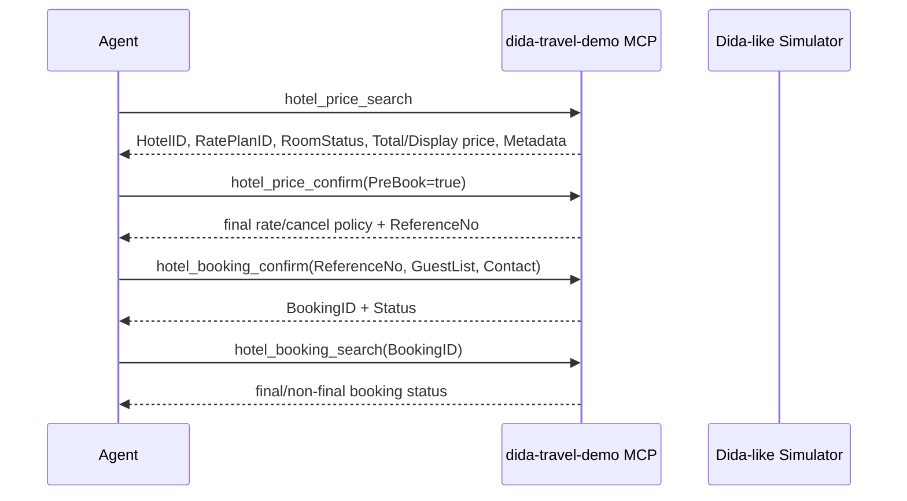
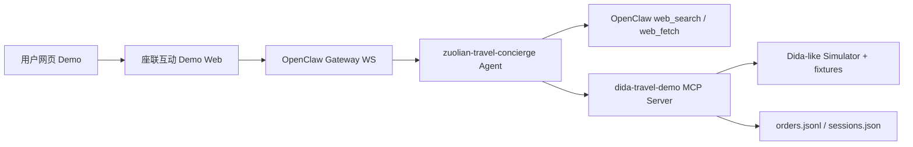

# 座联互动 AI 出行客服员工 — 第一阶段 MVP 设计

> **状态**: Phase 1 MVP 详细设计与开发计划  
> **最后更新**: 2026-06-02  
> **范围**: 后端模拟 + 网页对话 Demo；暂不接微信/企业微信正式接口；道途/道旅（DidaTravel）相关调用按官方文档结构模拟。  
> **主要依据**: `docs/PLATFORM-DESIGN.md`, `docs/MEMORY.md`, `座联互动/座联互动方案.pdf`, Dida Booking API / Content API 文档, OpenClaw docs。

---

## 1. 背景与目标

座联互动当前的核心入口是交通站点充电硬件。客户方案中的转型目标是：把“扫码充电 + 广告跳转”的一次性流量入口，升级为座联自有的旅行服务入口，让用户在扫码充电后能直接获得出行攻略、酒店/交通/景点推荐、预订与后续服务。

Sentura 侧的定位不是另建一套 Agent Runtime，而是在 OpenClaw 之上创建一个可部署、可审计、可接工具的 AI 客服员工。第一阶段先用网页对话替代企业微信入口，验证以下闭环：

1. 用户扫码充电后，系统模拟收到用户行程上下文：人在机场，目的地深圳。
2. AI 客服主动发出第一次问候。
3. 用户提出“为我制定 5 日深圳旅游攻略”。
4. Agent 调用网络搜索能力获取深圳攻略信息。
5. Agent 调用道途模拟工具查询酒店、专车、景点候选。
6. Agent 生成可报价、可修改的 5 日方案。
7. 用户反馈后，Agent 迭代方案。
8. 用户确认方案并提供身份信息。
9. Agent 通过符合 Dida 文档顺序的模拟工具完成酒店预订。
10. 预订成功后返回确认订单信息，并支持订单查询。

第一阶段只要求 Demo 可跑通，不触碰真实支付、真实 Dida 订单、企业微信生产账号或真实用户 PII 存储。

---

## 2. Sentura / OpenClaw 当前可复用能力

从平台文档和开发记忆看，当前 Sentura 已具备本 MVP 需要的大部分底座：

| 能力 | 当前状态 | 本项目使用方式 |
|---|---|---|
| 多 Agent | OpenClaw 支持多隔离 agent，每个 agent 有独立 workspace、session store、agentDir。 | 创建 `zuolian-travel-concierge` AI 客服员工。 |
| Agent workspace | Sentura 强制使用 8 个 OpenClaw 原生文件：`AGENTS.md`, `SOUL.md`, `TOOLS.md`, `IDENTITY.md`, `USER.md`, `HEARTBEAT.md`, `BOOTSTRAP.md`, `MEMORY.md`。 | 客服员工按 8 文件约定生成，Hard Rules 放在 `AGENTS.md`，客户/业务上下文放在 `BOOTSTRAP.md`。 |
| MCP 工具接入 | Sentura 已有 Tier-2 MCP server 模式：API 文档 -> TypeScript MCP server -> OpenClaw agent 工具。 | 新建 `sentura/mcp-servers/dida-travel-demo/`，工具先模拟 Dida 酒店流程。 |
| 网页对话 | Sentura Dashboard 已有 1:1 `/chat` 与 `AgentChat` 组件，底层走 OpenClaw Gateway WS。 | MVP 可复用该聊天组件，也可新增 `/client-demos/zuolian` 路由做客户专属演示页。 |
| 审计/成本/健康检查 | 已有 `sentura-audit`, `sentura-cost`, `sentura-monitoring`, `sentura-mcp-health`。 | Demo 工具调用需要产生日志；正式化时把预订、查询、售后都标注 dataTier。 |
| 安全审批 | `sentura-approval` 已有多租户能力。 | 第一阶段真实支付禁用；任何真实下单/退款在后续阶段必须走审批。 |

OpenClaw 官方文档确认了本设计所依赖的形态：Gateway 是单进程 WebSocket 控制面；WebChat/Control UI 使用同一 Gateway WS API；多 Agent 是独立 workspace + 独立 session；MCP 是 OpenClaw 管理外部工具服务器的标准路径。

---

## 3. 客户需求拆解

### 3.1 客户长期方向

客户希望从“充电硬件广告分流”转型为“自有出行服务平台”。关键变化：

- 流量不再直接分流给合作商，而是沉淀到座联自己的用户池。
- 座联成为用户对接的第一服务方。
- AI 客服提供攻略制定、报价、预订、订单查询、售后、投诉处理。
- 中长期通过自有 CRM / 数据库 / 推荐算法形成独立平台能力。

### 3.2 第一阶段 MVP 边界

本阶段只做可演示闭环：

| 项目 | 第一阶段做 | 第一阶段不做 |
|---|---|---|
| 对话入口 | 网页聊天 Demo，模拟扫码后上下文注入 | 微信/企业微信正式接入 |
| Agent | 一个座联 AI 出行客服员工 | 多 Agent 协同 |
| 攻略 | 网络搜索 + Agent 整理 | 自建攻略数据库 |
| 酒店 | Dida API 流程模拟：查价、确认、预订、订单查询 | 真实 Dida 订单、真实支付 |
| 专车/景点 | 本地模拟候选，用于形成完整攻略 | 真实 API 对接 |
| 身份信息 | 前端表单/对话中模拟采集，内存或本地测试库保存脱敏信息 | 生产 PII 存储 |
| 售后 | 订单查询；取消/投诉只设计不实现 | 退款、投诉闭环 |

### 3.3 Demo 目标验收句

“用户在机场扫码充电后，座联 AI 客服主动问候，能根据用户的 5 日深圳旅行需求生成攻略，结合模拟 Dida 酒店工具完成酒店报价与预订，并返回可查询的确认订单。”

---

## 4. 官方 Dida API 调研结果

本节只记录第一阶段会用到的事实。所有模拟工具字段必须以这些事实为边界，不得创造与文档冲突的“道途 API”。

### 4.1 Content API v2

文档：`https://apidoc.didatravel.com/content-api-v2/how-to-use-content-api.html`

| 项目 | 已核实内容 |
|---|---|
| Static API domain | `https://static-apiint.didatravel.com` |
| 认证 | Basic access authentication；`ClientID` 作 username，`LicenseKey` 作 password。测试示例为 `DidaApiTestID` / `TestKey`。 |
| 返回格式 | 新版 Content API 以 JSON 返回 Dida 酒店静态信息。 |
| QPS | 文档明确存在 QPS 限制。默认示例：countries 10 QPS, destinations 1 QPS, hotel/list 1 QPS, hotel/details 10 QPS。 |
| Gzip | 请求应接受 gzip，响应也以 gzip 编码返回。 |

Content API 列表：

| Endpoint | 用途 | 默认 QPS |
|---|---|---:|
| `GET /api/v1/region/countries` | 获取国家列表 | 10 |
| `GET /api/v1/region/destinations` | 获取指定国家的目的地列表 | 1 |
| `GET /api/v1/hotel/list` | 获取指定国家下授权酒店列表 | 1 |
| `GET /api/v1/hotel/details` | 获取指定 hotel ID 列表的酒店详情 | 10 |

`/api/v1/hotel/list` 文档页已核实要求传入有效 `countryCode`，不支持不传国家码一次性获取全球所有授权酒店；示例为：

```text
GET https://static-apiint.didatravel.com/api/v1/hotel/list?countryCode=CN&lastUpdateTime=1735097363&language=en-US
Authorization: Basic <base64(ClientID:LicenseKey)>
```

语言策略：

- 第一阶段面向用户的 Agent 对话、攻略、报价、订单确认和售后解释统一使用简体中文。
- Dida Content API 官方列出的中文语言码为 `zh-CN`，但文档也提示非英文静态内容覆盖可能不如英文，且非默认测试账号默认英文；真实接入时优先请求中文静态内容，若供应商仅返回英文或字段缺失，则由 Sitlink 展示层维护受控中文展示字段，不直接把英文供应商文本裸露给用户。
- Dida 对齐字段、订单状态码、ID、`Metadata`、`ReferenceNo` 等机器字段保留原始命名和原始值，不做中文化改名，避免破坏 `PriceSearch -> PriceConfirm -> BookingConfirm -> BookingSearch` 链路。

### 4.2 Booking API

Booking API 文档侧栏显示测试 BaseUrl 为：

```text
https://apiint.didatravel.com
```

第一阶段酒店预订必须按以下顺序模拟：



#### 4.2.1 Price Search

文档：`https://apidoc.didatravel.com/booking-api/price-search.html`

已核实：

- JSON endpoint: `POST https://apiint.didatravel.com/api/rate/pricesearch?$format=json`
- 请求包含 `Header.ClientID`, `Header.LicenseKey`
- 常用请求字段包括：
  - `HotelIDList`
  - `CheckInDate`
  - `CheckOutDate`
  - `IsRealTime.Value`
  - `IsRealTime.RoomCount`
  - `RealTimeOccupancy.AdultCount`
  - `RealTimeOccupancy.ChildCount`
  - `RealTimeOccupancy.ChildAgeDetails`
  - `Currency`
  - `Nationality`
- `PriceSearch` 阶段只返回一间房价格；多间同房型订单总价需要按房间数估算，到 `PriceConfirm` 才返回所有房间总价。
- Dida 支持同一房型多间房，但不支持单请求中混合不同房型。
- 如果 `PriceSearch` 返回 `Metadata`，调用 `PriceConfirm` 时必须原样传回。

MVP 模拟要求：

- `hotel_price_search` 必须返回 `hotelId`, `ratePlanId`, `roomStatus`, `currency`, `pricePerRoom`, `roomCount`, `estimatedTotal`, `metadata`。
- 如果 `roomCount > 1`，明确标注 `estimatedTotal` 是搜索阶段估算，最终价格以 `PriceConfirm` 为准。

#### 4.2.2 Price Confirm

文档：`https://apidoc.didatravel.com/booking-api/price-confirm.html`

已核实：

- JSON endpoint: `POST https://apiint.didatravel.com/api/rate/PriceConfirm?$format=json`
- `PriceConfirm` 在创建 booking 前调用，用于获得 `ReferenceNo`。
- 文档说明通常约 2 秒返回，PriceConfirm 阶段超时配置为 20 秒；20 秒无结果建议重发。
- 如果 `PriceConfirm` 返回的取消政策、餐食、价格、房型、可售状态等与 `PriceSearch` 不一致，以 `PriceConfirm` 为最终信息。
- `PreBook=true` 时会返回 `ReferenceNo`，该号码是后续 `Booking Confirm` 必需字段。
- `PreBook=false` 仅确认价格，不进入预订创建流程。

MVP 模拟要求：

- `hotel_price_confirm` 必须支持 `preBook: true | false`。
- 当 `preBook=true` 时返回 `referenceNo`；当 `preBook=false` 时不允许继续调用 `hotel_booking_confirm`。
- 模拟器可随机或按 fixture 轻微调整最终价，但必须在响应中说明“最终价以 PriceConfirm 为准”。

#### 4.2.3 Booking Confirm

文档：`https://apidoc.didatravel.com/booking-api/booking-confirm.html`

已核实：

- JSON endpoint: `POST https://apiint.didatravel.com/api/booking/HotelBookingConfirm?$format=json`
- `ReferenceNo` 来自 `PriceConfirm`。
- 请求包含：
  - `Header.ClientID`, `Header.LicenseKey`
  - `ReferenceNo`
  - `CheckInDate`, `CheckOutDate`
  - `GuestList`
  - `Contact`
  - `CustomerRequest`
  - `ClientReference`
  - `PaymentInfo`（文档说明 balance payment 场景不强制）
- `GuestInfo` 包括姓名、first name、last name、电话、地址、邮箱、年龄等字段；儿童年龄强制，成人年龄可选。
- 文档建议提高预订成功率时将姓名转换为英文再提交，因部分供应商可能不支持某些语言字符。
- HCN / hotel confirmation number 可能实时返回，也可能后续通过 `HotelBookingSearch` 获取。

MVP 模拟要求：

- `hotel_booking_confirm` 只接受从 `hotel_price_confirm(preBook=true)` 产生且未使用的 `referenceNo`。
- 用户身份信息最小集：英文名/拼音名、手机号、邮箱、入住人数量。身份证/护照号第一阶段不进入模拟 Dida payload，避免制造文档未确认字段。
- 返回 `bookingId`, `referenceNo`, `status`, `statusName`, `hotelConfirmationNumber?`, `clientReference`, `guestSummary`。

#### 4.2.4 Booking Search

文档：`https://apidoc.didatravel.com/booking-api/booking-search.html`

已核实：

- JSON endpoint: `POST https://apiint.didatravel.com/api/booking/HotelBookingSearch?$format=json`
- 可按 Dida Booking ID 或其他参数查询。
- 订单状态码：
  - `0` = PreBook
  - `1` = Booked / PreBook + awaiting payment
  - `2` = Confirmed，最终状态
  - `3` = Canceled，最终状态
  - `4` = Failed，最终状态
  - `5` = Pending / InProcess，PreBook 到最终状态可能约 3 分钟
  - `6` = OnRequest，最终化可能最长 120 分钟，可按客户需求配置
- 文档强调：只有明确返回 `2`, `3`, `4` 时才可视为最终状态；空响应或其他状态不能解释为最终结果。

MVP 模拟要求：

- `hotel_booking_search` 必须支持 booking ID 查询。
- Demo 默认在 `HotelBookingConfirm` 后返回 `2 Confirmed`，但保留 `5 Pending` 分支用于测试。
- Agent 不得把 `0`, `1`, `5`, `6` 说成“最终成功”；只能说“处理中/待确认”。

---

## 5. 第一阶段系统架构



### 5.1 组件

| 组件 | 路径建议 | 说明 |
|---|---|---|
| AI 客服员工 | `sentura/agents/zuolian-travel-concierge/` | 8 个 OpenClaw 原生 workspace 文件 + 技能。 |
| Dida 模拟 MCP | `sentura/mcp-servers/dida-travel-demo/` | TypeScript MCP server，按 Dida endpoint 和字段顺序模拟。 |
| Demo Web | `sentura/dashboard/src/app/client-demos/zuolian/` | 面向客户演示的网页对话入口，模拟扫码上下文并连接 Agent。 |
| 测试夹具 | `sentura/mcp-servers/dida-travel-demo/fixtures/` | 深圳酒店、专车、景点、订单状态 fixtures。 |
| 订单存储 | `~/.openclaw/sentura-demo/zuolian/orders.jsonl` | 本地 Demo 持久化；不放真实敏感信息。 |
| Demo 测试脚本 | `scripts/test-zuolian-mvp.ts` | 端到端验证工具顺序和对话输出。 |

### 5.2 Agent 工具清单

Agent 需要的工具：

- `web_search` / `web_fetch`: 查询深圳旅行攻略、景点营业信息、推荐路线。
- `dida_demo_search_hotels`: Content/PriceSearch 对齐的酒店候选查询。
- `dida_demo_price_confirm`: PriceConfirm 对齐的价格确认。
- `dida_demo_book_hotel`: BookingConfirm 对齐的酒店预订。
- `dida_demo_get_booking`: BookingSearch 对齐的订单查询。
- `dida_demo_search_transfer`: 本地 fixture 专车查询。
- `dida_demo_search_attractions`: 本地 fixture 景点查询。

工具命名使用 `dida_demo_` 前缀，避免与未来真实 Dida MCP server 混淆。真实接入时另建 `dida-travel` server，不能复用 demo id。

### 5.3 Agent workspace 设计

`AGENTS.md` Hard Rules:

- 不承诺真实付款或真实出票/下单。
- 不收集非必要敏感信息；MVP 不要求身份证/护照号。
- 只有 `BookingSearch` 返回 `2 Confirmed` 才能说“酒店预订已确认”。
- 对 `0`, `1`, `5`, `6` 状态必须说“处理中/待确认”，不得伪造成功。
- 价格、取消政策、房型以 `PriceConfirm` 结果为准。
- 真实支付、真实退款、真实 Dida 生产调用必须升级为人工审批。
- 所有面向用户的回复必须使用简体中文，包括主动问候、行程攻略、酒店/专车/景点推荐、价格说明、订单确认、异常解释和售后状态。
- 工具响应里的 Dida 对齐字段可以保留英文 key 和状态码；Agent 对用户展示时必须使用中文名称、中文取消政策摘要和中文状态解释。
- 如果 MCP 返回的中文展示字段缺失，Agent 只能给出保守的中文兜底描述，并把该缺口记录为 Demo 数据问题；不要把英文酒店/房型/政策文本直接作为最终客服话术。

`BOOTSTRAP.md` Enterprise Context:

- 座联互动业务背景：交通站点充电入口、用户出行场景、平台转型目标。
- 当前 Demo 场景：用户从机场前往深圳，计划 5 日游。
- 第一阶段范围与禁区。

技能建议：

| Skill | 作用 |
|---|---|
| `travel-intake/SKILL.md` | 从扫码上下文和用户消息提取目的地、天数、人数、预算、偏好。 |
| `itinerary-planning/SKILL.md` | 网络搜索 -> 形成每日路线 -> 插入酒店/景点/专车候选。 |
| `dida-hotel-booking/SKILL.md` | 严格执行 Dida 模拟流程：search -> confirm -> booking -> search。 |
| `booking-status/SKILL.md` | 解释 Dida 状态码，生成确认函或处理中说明。 |
| `feedback-refinement/SKILL.md` | 用户反馈后只改相关部分，保留已确认约束。 |

---

## 6. Demo 对话流程

### 6.1 扫码上下文模拟

网页 Demo 启动时自动注入：

```json
{
  "event": "charging_qr_scanned",
  "scenario": "airport_to_shenzhen",
  "userLocation": "深圳宝安国际机场",
  "destinationCity": "深圳",
  "chargingStation": "SZX-A01",
  "detectedAt": "2026-06-02T16:00:00+08:00",
  "language": "zh-CN"
}
```

Agent 第一条主动消息：

> 您好，我是座联互动 AI 出行客服。看到您刚在机场扫码充电，可能正准备前往深圳市区。我可以帮您规划深圳行程、查询酒店和接送方案。您这次大概想玩几天，偏向轻松度假、亲子、商务顺路，还是城市探索？

### 6.2 用户提出需求

用户：

> 为我制定 5 日深圳旅游攻略。

Agent 行为：

1. 调用 `web_search` 搜索深圳 5 日游、热门景点、区域交通建议。
2. 调用 `dida_demo_search_hotels` 查询酒店候选。
3. 调用 `dida_demo_search_transfer` 查询机场到酒店专车。
4. 调用 `dida_demo_search_attractions` 查询景点票务模拟候选。
5. 返回第一版方案。

第一版方案必须包含：

- 每日主题与路线。
- 推荐住宿区域。
- 2-3 个酒店候选，含价格、房型、取消政策摘要。
- 机场接送候选。
- 景点候选与预计费用。
- 总预算估算。
- 明确提示：当前为 Demo 模拟报价，真实订单需最终确认。

### 6.3 用户反馈与优化

用户可能说：

- “预算低一点。”
- “我想住离海边近一点。”
- “不要太赶，少安排购物。”
- “酒店换成五星。”

Agent 行为：

- 不重新问所有信息，只修改相关约束。
- 如影响酒店，重新调用 `dida_demo_search_hotels` 或 `dida_demo_price_confirm`。
- 输出“变更点”和“新版行程”。

### 6.4 用户确认并预订

用户：

> 就按第二版订吧。入住人是 Zhang Wei，电话 13800000000，邮箱 zhangwei@example.com。

Agent 行为：

1. 检查是否已有最终方案和酒店候选。
2. 如尚未 `PriceConfirm(preBook=true)`，调用 `dida_demo_price_confirm`。
3. 调用 `dida_demo_book_hotel`，传入 `referenceNo`, `checkInDate`, `checkOutDate`, `guestList`, `contact`, `customerRequest`, `clientReference`。
4. 调用 `dida_demo_get_booking` 查询最终状态。
5. 仅当状态为 `2 Confirmed` 时返回确认订单。

确认信息模板：

```text
酒店预订已确认
订单号: DIDATEST-...
Dida ReferenceNo: REF-...
状态: 2 Confirmed
酒店: ...
入住/离店: ...
房型: ...
入住人: Zhang Wei
联系电话: 138****0000
取消政策: ...
备注: ...
```

---

## 7. MCP Server 设计

### 7.1 工具定义

| Tool | 对齐的 Dida 文档 | Mutates | 输入 | 输出 |
|---|---|---:|---|---|
| `dida_demo_search_hotels` | Content API + PriceSearch | false | city, checkInDate, checkOutDate, adults, children, roomCount, budget, preferences | hotel/rate candidates |
| `dida_demo_price_confirm` | PriceConfirm | false | hotelId, ratePlanId, checkInDate, checkOutDate, occupancy, preBook, metadata | final price, cancellation policy, referenceNo? |
| `dida_demo_book_hotel` | HotelBookingConfirm | true | referenceNo, dates, guestList, contact, customerRequest, clientReference | bookingId, status, confirmation |
| `dida_demo_get_booking` | HotelBookingSearch | false | bookingId or referenceNo | booking status/detail |
| `dida_demo_search_transfer` | local fixture | false | pickup, dropoff, dateTime, passengers | transfer candidates |
| `dida_demo_search_attractions` | local fixture | false | city, dates, preferences | attraction candidates |

`dida_demo_book_hotel` 是写操作，`annotations.destructiveHint=true`；Demo 默认仍允许执行，但文案必须标注“模拟预订”。正式接入时该工具必须接 `sentura-approval`。

### 7.2 订单状态模型

内部类型：

```ts
type DidaBookingStatus = 0 | 1 | 2 | 3 | 4 | 5 | 6;

const STATUS_NAME = {
  0: "PreBook",
  1: "Booked",
  2: "Confirmed",
  3: "Canceled",
  4: "Failed",
  5: "Pending",
  6: "OnRequest",
} as const;
```

Agent 展示规则：

| Status | Agent 可说 |
|---:|---|
| 2 | “预订已确认” |
| 3 | “订单已取消” |
| 4 | “预订失败” |
| 0/1/5/6 | “订单处理中/待确认，不是最终状态” |

### 7.3 中文展示字段与 fixture 语言要求

需要。第一阶段 MCP server 必须存储中文展示内容，尤其是酒店名、区域、地址、房型、床型/早餐、取消政策、专车车型、景点/票种、推荐理由和订单确认摘要。原因是座联互动客户是中国企业，Demo 的用户入口和客服话术都应当是中文；如果只保留英文供应商字段，Agent 很容易在最终回复中输出英文酒店名、英文政策或生硬状态码，客户演示体验会断裂。

MCP 响应采用双层字段：

- 机器字段：保留 Dida 对齐的字段名和值，例如 `hotelId`, `ratePlanId`, `roomTypeCode`, `metadata`, `referenceNo`, `bookingId`, `status`, `statusName`, `final`。这些字段用于工具链校验、订单状态判断和后续真实 Dida adapter 迁移。
- 中文展示字段：所有面向用户的对象必须带 `locale: "zh-CN"` 和可直接展示的中文字段，例如 `hotelNameZh`, `districtZh`, `addressZh`, `roomNameZh`, `boardNameZh`, `cancellationPolicyZh`, `sellingPointsZh`, `transferNameZh`, `vehicleClassZh`, `attractionNameZh`, `ticketTypeZh`, `displaySummaryZh`。
- Agent 优先使用 `*Zh` / `displaySummaryZh` 组织回复；只有在这些字段缺失时，才可基于结构化机器字段生成保守中文兜底说明。
- Dida 官方 BookingConfirm 文档说明 `Name` 字段支持中文等语言，但也建议转成英文以提高第三方供应商成功率；MVP 中入住人姓名仍使用英文或拼音姓名，中文称呼可用于对话展示，但不要作为未经校验的 Dida 下单姓名。
- 订单状态展示必须同时保护业务语义和可审计性，例如对用户说“预订已确认”，在调试/订单详情中可附带“Dida 状态：2 Confirmed”。不要只显示 `2 Confirmed`。

### 7.4 Fixture 数据

深圳 Demo fixture 建议：

- 酒店：
  - 南山/科技园商务酒店
  - 福田中心区五星酒店
  - 大梅沙/盐田海边度假酒店
- 专车：
  - 宝安机场 -> 南山
  - 宝安机场 -> 福田
  - 宝安机场 -> 盐田
- 景点：
  - 世界之窗
  - 深圳湾公园
  - 大梅沙/小梅沙
  - 甘坑古镇
  - 仙湖植物园
  - 蛇口/海上世界

所有 fixture 必须清楚标注 `source: "demo-fixture"`，并带 `locale: "zh-CN"` 与中文展示字段，不要伪造成真实 Dida 返回。

---

## 8. 网页 Demo 设计

### 8.1 路由

建议新增：

```text
sentura/dashboard/src/app/client-demos/zuolian/page.tsx
```

页面启动即创建/恢复一个 `zuolian-travel-concierge` session，并展示：

- 左侧：模拟扫码上下文、当前行程摘要、订单状态。
- 右侧：聊天窗口。
- 底部：快捷按钮：
  - “制定 5 日深圳旅游攻略”
  - “预算低一点”
  - “住海边”
  - “确认并预订”
  - “查询订单”

### 8.2 主动问候实现

实现方式：

1. 前端首次进入页面时调用 dashboard 后端 Route Handler。
2. Route Handler 创建 OpenClaw session，附带扫码上下文。
3. 如果该 session 没有 assistant 首条消息，发送一条 system/demo event 或首条 user seed，让 Agent 生成问候。
4. 前端渲染问候，不需要用户先输入。

不要在前端硬编码完整客服回复；前端只注入上下文，回复应由 Agent 生成。

---

## 9. 开发计划

### Milestone 0 — 设计冻结

- [x] 阅读 Sentura 平台设计和进度文档。
- [x] 阅读座联互动方案 PDF。
- [x] 调研 Dida Content API / Booking API 官方文档。
- [x] 调研 OpenClaw Gateway / Multi-agent / MCP 官方文档。
- [x] 完成本文档。

### Milestone 1 — Dida 模拟 MCP Server

- [x] 新建 `sentura/mcp-servers/dida-travel-demo/`。
- [x] 实现 config：`DIDA_DEMO_MODE=fixture | proxy-disabled`，默认 fixture。
- [x] 实现 `dida_demo_search_hotels`。
- [x] 实现 `dida_demo_price_confirm`，支持 `preBook=true` 返回 `referenceNo`。
- [x] 实现 `dida_demo_book_hotel`，校验 `referenceNo` 未使用。
- [x] 实现 `dida_demo_get_booking`，按 Dida 状态码返回。
- [x] 实现专车/景点 fixture 查询。
- [x] 写 MCP `InMemoryTransport` 测试，覆盖工具列表、字段校验、完整预订链路、状态码解释。

### Milestone 1a — 中文展示字段补强

- [x] 在酒店、专车、景点 fixture 中补齐 `locale: "zh-CN"` 和 `*Zh` / `displaySummaryZh` 字段。
- [x] 更新 MCP 工具响应，让每个面向用户的候选项都返回中文展示字段，同时保留 Dida 对齐机器字段。
- [x] 增加 MCP 测试：断言酒店名、房型、取消政策、专车、景点、订单摘要都存在中文展示字段；为后续 Agent 避免展示英文供应商文本提供结构化字段。

### Milestone 2 — AI 客服员工

- [ ] 创建 `sentura/agents/zuolian-travel-concierge/`。
- [ ] 写 8 个 OpenClaw 原生 workspace 文件。
- [ ] 写 5 个技能文件：需求提取、攻略规划、Dida 酒店预订、订单状态、反馈优化。
- [ ] 将 MCP server 配置到该 Agent。
- [ ] 验证 Agent 工具可见性。
- [ ] 跑一次 CLI 或 dashboard chat smoke test。

### Milestone 3 — 网页 Demo

- [ ] 新增 `/client-demos/zuolian` 页面。
- [ ] 注入扫码上下文并触发主动问候。
- [ ] 复用 `AgentChat` 或封装客户专属聊天组件。
- [ ] 增加行程摘要/订单状态侧栏。
- [ ] 增加快捷操作按钮。
- [ ] 支持刷新后恢复会话。

### Milestone 4 — E2E Demo 脚本

- [ ] 新增 `scripts/test-zuolian-mvp.ts`。
- [ ] 自动启动/连接 dashboard 和 gateway。
- [ ] 执行用户脚本：
  1. 打开 Demo 页面。
  2. 检查主动问候。
  3. 发送“为我制定 5 日深圳旅游攻略”。
  4. 断言调用搜索/酒店/专车/景点工具。
  5. 发送反馈并检查新版方案。
  6. 发送身份信息并确认预订。
  7. 查询订单，断言状态为 `2 Confirmed`。
- [ ] 输出 Demo 录屏/截图检查清单。

### Milestone 5 — 客户演示包装

- [ ] 准备一份固定 Demo 讲解脚本。
- [ ] 明确“模拟”与“真实接入”边界。
- [ ] 列出接入 Dida 生产账号前所需资料：ClientID, LicenseKey, 可访问酒店范围、币种、国籍策略、取消政策展示要求、支付/余额账户方式。
- [ ] 列出企业微信 Phase 2 接入点。

---

## 10. 测试计划

| ID | 测试 | 验收 |
|---|---|---|
| ZL-MCP-1 | MCP 工具清单 | 6 个 `dida_demo_*` 工具全部注册，mutating 工具有 destructive annotation。 |
| ZL-MCP-2 | PriceSearch 模拟 | 输入深圳日期/人数，返回 `hotelId`, `ratePlanId`, `metadata`, `estimatedTotal`。 |
| ZL-MCP-3 | PriceConfirm 模拟 | `preBook=true` 返回 `referenceNo`；`preBook=false` 不允许 BookingConfirm。 |
| ZL-MCP-4 | BookingConfirm 模拟 | 合法 `referenceNo` 创建订单；重复使用 `referenceNo` 报错。 |
| ZL-MCP-5 | BookingSearch 状态 | `2/3/4` 标记 final；`0/1/5/6` 标记 non-final。 |
| ZL-MCP-6 | 中文展示字段 | MCP fixture 响应带 `locale: "zh-CN"` 和 `*Zh` / `displaySummaryZh`；Dida 机器字段保持原样。 |
| ZL-AGENT-1 | 主动问候 | 扫码上下文注入后 Agent 主动发第一条问候。 |
| ZL-AGENT-2 | 攻略制定 | 用户要求 5 日深圳攻略后，回复含每日路线、酒店、专车、景点、预算。 |
| ZL-AGENT-3 | 反馈优化 | 用户改预算/住宿区域后，Agent 只调整相关部分并重新报价。 |
| ZL-AGENT-4 | 预订链路 | Agent 按 `PriceSearch -> PriceConfirm -> BookingConfirm -> BookingSearch` 顺序调用工具。 |
| ZL-AGENT-5 | 状态安全 | Agent 不把 `Pending`/`OnRequest` 说成最终确认。 |
| ZL-AGENT-6 | 中文客服话术 | 除 Dida ID、订单号、邮箱、状态码等必要机器信息外，用户可见内容全部为简体中文。 |
| ZL-WEB-1 | 页面可用 | `/client-demos/zuolian` 可打开，聊天可发送，侧栏状态更新。 |
| ZL-WEB-2 | 刷新恢复 | 刷新后会话历史和订单状态不丢失。 |

---

## 11. 风险与待确认问题

| 风险/问题 | 影响 | 第一阶段处理 |
|---|---|---|
| Dida 生产账号权限未知 | 可访问酒店范围、语言、币种、实时价格能力可能受限。 | Demo 只用 fixture；设计中保留账号接入清单。 |
| 供应商内容语言不稳定 | Dida 或后续供应商可能返回英文酒店名/政策，影响中文客服体验。 | MCP fixture 先存中文展示字段；真实接入时请求中文静态内容并建立受控中文展示/翻译层。 |
| 专车/景点不在提供的 Dida 酒店 API 文档中 | 不能伪称 Dida 覆盖完整出行链路。 | 第一阶段本地模拟，后续按真实供应商 API 建 MCP。 |
| 支付与退款风险 | 涉及真实资金和消费者责任。 | 第一阶段禁用；后续必须接 `sentura-approval` 和财务规则。 |
| 用户 PII | 旅行业务涉及证件、电话、邮箱。 | MVP 只采集最小字段并脱敏展示；不采集证件号。 |
| 订单状态解释错误 | 会导致客服承诺错误。 | 固化 Dida 状态码规则，测试覆盖 `0-6`。 |
| 企业微信入口 | 客户最终入口是企业微信。 | 第一阶段只做网页；企业微信作为 Phase 2 channel binding。 |

---

## 12. 第二阶段预留

第二阶段重点不是重写第一阶段，而是在同一 Agent + MCP 架构上扩展：

- 企业微信入口：OpenClaw channel binding 或客户后端转发到 Gateway。
- Dida 真实 API adapter：从 fixture 切换到真实 HTTP client，凭证放 OpenClaw secret store。
- 售后工具：取消订单、投诉、退款进度查询。
- 人工审批：真实下单、退款、投诉赔付、大额金额全部走 `sentura-approval`。
- CRM 沉淀：保存用户偏好、历史行程、常用住宿区域，但要按 T0-T4 分级和 per-user memory 隔离。
- 多供应商：机票、火车/高铁、门票、专车各自作为独立 MCP server，Agent 只编排工具。

---

## 13. 参考链接

- Dida Booking Price Search: https://apidoc.didatravel.com/booking-api/price-search.html
- Dida Booking Price Confirm: https://apidoc.didatravel.com/booking-api/price-confirm.html
- Dida Booking Confirm: https://apidoc.didatravel.com/booking-api/booking-confirm.html
- Dida Booking Search: https://apidoc.didatravel.com/booking-api/booking-search.html
- Dida Content API v2: https://apidoc.didatravel.com/content-api-v2/how-to-use-content-api.html
- Dida Content Hotel List: https://apidoc.didatravel.com/content-api-v2/hotel/list.html
- OpenClaw Gateway Architecture: https://docs.openclaw.ai/concepts/architecture
- OpenClaw Multi-agent Routing: https://docs.openclaw.ai/concepts/multi-agent
- OpenClaw MCP: https://docs.openclaw.ai/cli/mcp
