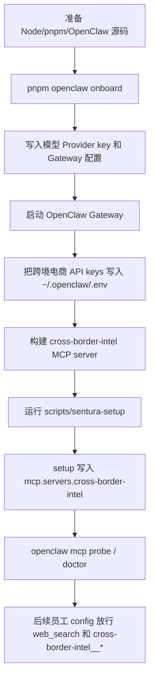

# 跨境电商 API Key 获取与 OpenClaw 接入流程

> 适用范围：Cross-border e-commerce / 跨境电商 Phase-1，特别是 `cross-border-intel` MCP server、Marketing 的 `web_search`、Screening 的背调工具，以及后续三个员工工作区接入。
>
> 重要边界：不要把真实 API key 写进本仓库、聊天记录、员工 workspace 文件或 `openclaw.json` 明文。真实 key 只放在 OpenClaw 运行机的 `~/.openclaw/.env`，或 OpenClaw/Sentura secret store 中。本文只写占位符。

## 1. 总流程



推荐顺序：

1. 先完成 OpenClaw onboard，让 OpenClaw 有模型 provider、gateway token、默认配置和 `~/.openclaw/` 状态目录。
2. 把跨境电商相关 env 写入 OpenClaw 状态目录的 `.env`。
3. 构建 `cross-border-intel` MCP server。
4. 再运行 Sentura setup，让 Creator/Tuner/Orchestrator/MCP Builder、RBAC admin、dashboard `.env.local`、Sentura extensions、沙箱工具策略和 `cross-border-intel` MCP 注册一次到位。

## 2. OpenClaw Onboard 流程

从项目根目录进入 OpenClaw 源码：

```bash
cd openclaw
pnpm install
pnpm ui:build
OPENCLAW_A2UI_SKIP_MISSING=1 pnpm build
pnpm openclaw onboard
```

Windows PowerShell：

```powershell
cd openclaw
pnpm install
pnpm ui:build
pnpm build
pnpm openclaw onboard
```

Onboard 时重点选择/填写：

| 步骤 | 操作 | 说明 |
|---|---|---|
| Gateway URL | 使用 `http://localhost:18789` | Sentura 本地开发默认端口。 |
| Gateway auth token | 接受向导生成的 token | 该 token 会写入 `~/.openclaw/openclaw.json`，dashboard 后续通过 setup 脚本读取。 |
| Model provider | 选择企业允许的 provider | 云模型填 API key；本地模型选择 Ollama/vLLM/SGLang 等自托管 provider。 |
| Web search provider | 推荐 Brave 或企业已购买 provider | 如果 onboard 未配置 web search，后续可运行 `openclaw configure --section web`。 |

启动 Gateway：

```bash
cd openclaw
pnpm gateway:watch
```

常见检查：

```bash
node --version      # 必须 >= 22.19，推荐 24
pnpm --version      # 必须 >= 11.2.2
openclaw --version  # 应为 2026.6.2
```

如果之前装过全局 OpenClaw，先按 `docs/SETUP.md` 清掉旧 gateway/LaunchAgent/全局 CLI，避免新旧版本争用 `18789`。

## 3. Sentura Setup 之后会发生什么

OpenClaw onboard 和 Gateway 可启动后，从项目根目录运行：

```bash
./scripts/sentura-setup.sh
```

Windows PowerShell：

```powershell
powershell -ExecutionPolicy Bypass -File scripts\sentura-setup.ps1
```

setup 脚本会做这些事：

| 项目 | 结果 |
|---|---|
| Meta-agent workspace | 复制 Creator、Tuner、Orchestrator、MCP Builder 的 8 个 OpenClaw 原生 workspace 文件和 skills。 |
| Agent 注册 | 写入 `~/.openclaw/openclaw.json -> agents.list`。 |
| Sentura extensions | 启用 `sentura-agents`、`sentura-rbac`、`sentura-audit`、`sentura-approval`、`sentura-provisioner` 等。 |
| Dashboard auth | 写入 `sentura/dashboard/.env.local`，包含 admin token 和 gateway auth。 |
| Platform admin | 在 Sentura RBAC store 里自动 seed 第一个 `platform_admin`。 |
| Sandbox policy | 给 meta-agents 写入 `tools.sandbox.tools.alsoAllow`，避免 dashboard session 下插件工具消失。 |
| Diagnostics | 打开 diagnostics，使 cost/monitoring/audit 相关事件可见。 |
| Dida demo MCP | 当前会自动注册 Sitlink 的 `dida-travel-demo`。 |
| Cross-border MCP | 自动写入 `mcp.servers.cross-border-intel`，从 `~/.openclaw/.env` / 当前进程 env 检测已配置 key，并用 `${ENV_VAR}` 引用 API key。 |
| Cross-border lead employee | Milestone 4 起会复制并注册 `cbe-lead-discovery`，用于 `/client-demos/cross-border/lead-discovery` 的真实 AgentChat 会话。 |

不会自动做的事：

- 不会替你购买或获取跨境电商第三方 API key。
- 不会自动创建 `cbe-buyer-screening`、`cbe-accio-memory` 两个客户员工，这些是 Milestone 5-6。

setup 是幂等的。新增或修改跨境电商 env 后可以重跑；脚本会覆盖更新 `cross-border-intel` 的 MCP 定义，但不会把真实 key 写进 `openclaw.json` 明文。

## 4. API Key 总表

| Key / 配置 | 谁使用 | 必需性 | 获取方式摘要 |
|---|---|---:|---|
| `OPENAI_API_KEY` / `ANTHROPIC_API_KEY` / 其他模型 key | OpenClaw onboard 的模型 provider | 必需，除非使用自托管模型 | 在所选模型 provider 控制台创建。由 onboard 或 `~/.openclaw/.env` 提供。 |
| `DEEPSEEK_API_KEY` / `QWEN_API_KEY` / `MOONSHOT_API_KEY` | 大陆部署的国产模型 provider（跨境员工已预置 DeepSeek/千问/Kimi 三个可选模型） | 大陆云服务器上线时必需其一 | DeepSeek 开放平台 / 阿里云百炼（DashScope）/ Moonshot 开放平台控制台创建。见 §5.1 大陆部署小节。 |
| `OLLAMA_BASE_URL` | 本地模型 provider | 自托管时需要 | 本机运行 Ollama 后填 `http://localhost:11434`。 |
| `BRAVE_API_KEY` | OpenClaw `web_search`，主要给 Marketing 获客和 Screening web fallback | 推荐其一 | Brave Search API dashboard 订阅 Search plan 后复制 subscription token。 |
| `TAVILY_API_KEY` | OpenClaw `web_search` provider + CE4 Dashboard live search route | 推荐其一 | Tavily Platform 创建 key。不写入 `cross-border-intel` MCP env；Dashboard route 会从进程 env 或 `~/.openclaw/.env` 读取。 |
| `COMPANIES_HOUSE_API_KEY` | `cross-border-intel` 英国公司注册查询 | 可选但强烈建议 | Companies House Developer Hub 创建 app/key。 |
| `OPENCORPORATES_API_KEY` | `cross-border-intel` 全球公司注册付费 fallback | 可选，付费 | OpenCorporates API 账号/计划获取。Phase-1 默认不用。 |
| `ABSTRACT_API_KEY` | `cross-border-intel` 可选邮箱验证 | 可选 | Abstract Email Validation API 控制台创建。 |
| `HUNTER_API_KEY` | 预留邮箱/公司 enrichment | 可选 | Hunter API overview/API keys 页面创建。当前 MCP server 保留变量，后续扩展使用。 |
| `VOLZA_API_KEY` | `cross-border-intel` 付费贸易数据 | 可选，付费 | Volza API 需要销售/控制台开通。必须配合预算开关。 |
| `IMPORTYETI_API_KEY` | `cross-border-intel` 付费/授权 US import 数据 | 可选，付费或授权 | ImportYeti API/pricing 获取。必须配合预算开关。 |
| `SEC_USER_AGENT` | `cross-border-intel` SEC EDGAR 查询 | 推荐，不是 key | 写一个可识别的产品/组织/联系方式字符串。SEC public data API 不需要 key。 |
| RDAP / DNS | `cross-border-intel` 域名注册和 MX/SPF/DMARC | 不需要 key | 免费公开查询。低频使用 RDAP.org，规模化后改 IANA bootstrap client。 |
| `CBE_ENABLE_PAID_TRADE_DATA` | 付费贸易数据总开关 | 付费数据时需要 | `true`/`1` 才会尝试 Volza/ImportYeti。 |
| `CBE_MAX_PAID_SPEND_USD` | 付费贸易数据预算上限 | 付费数据时需要 | 默认 `0`，建议演示期保持 `0`。 |
| `CBE_INTEL_REQUEST_TIMEOUT_MS` | MCP HTTP 超时 | 可选 | 默认 `30000`。 |

## 5. 每个 API Key 的获取流程

### 5.1 模型 Provider key

用途：让 OpenClaw agent 可以调用 LLM。没有模型 provider，Sentura 员工无法正常对话。

流程：

1. 选企业允许的模型 provider：OpenAI、Anthropic、OpenRouter、Google、或自托管 Ollama/vLLM/SGLang。
2. 在 provider 控制台创建 API key。
3. 首选在 `pnpm openclaw onboard` 过程中按提示粘贴 key。
4. 如果要手动补充，写入 `~/.openclaw/.env`：

```bash
OPENAI_API_KEY=sk-REPLACE_ME
# 或
ANTHROPIC_API_KEY=sk-ant-REPLACE_ME
# 或自托管
OLLAMA_BASE_URL=http://localhost:11434
```

5. 重启 Gateway：

```bash
cd openclaw
pnpm gateway:watch
```

注意：模型 key 是全局运行基础，不属于 `cross-border-intel` MCP server。不要把它写进 `mcp.servers.cross-border-intel.env`。

#### 5.1.1 大陆部署：国产模型（DeepSeek / 千问 / Kimi）

中国大陆云服务器无法直连 OpenAI/Anthropic API。三个跨境员工（`cbe-lead-discovery` / `cbe-buyer-screening` / `cbe-accio-memory`）的源配置和 setup 注册已预置三个国产模型为可选项：

| Provider | 模型 ref | API key 环境变量 | key 获取入口 |
|---|---|---|---|
| DeepSeek | `deepseek/deepseek-chat` | `DEEPSEEK_API_KEY` | `https://platform.deepseek.com` |
| 通义千问（阿里云百炼） | `qwen/qwen3.5-plus` | `QWEN_API_KEY` | `https://bailian.console.aliyun.com` |
| Kimi（Moonshot） | `moonshot/kimi-k2.6` | `MOONSHOT_API_KEY` | `https://platform.moonshot.cn` |

流程：

1. 在上表入口为选定的 provider 创建 API key，写入 `~/.openclaw/.env`：

```bash
DEEPSEEK_API_KEY=sk-REPLACE_ME
# 或
QWEN_API_KEY=sk-REPLACE_ME
# 或
MOONSHOT_API_KEY=sk-REPLACE_ME
```

2. 切换跨境员工的主模型（不改任何配置文件）——在运行 Sentura setup 时带上 `SENTURA_CBE_AGENT_MODEL`：

```bash
SENTURA_CBE_AGENT_MODEL=deepseek/deepseek-chat bash scripts/sentura-setup.sh
```

不设置该变量时主模型沿用 `SENTURA_META_AGENT_MODEL`（默认 `openai/gpt-5.5`），三个国产模型仍保持在可选列表里，可在会话中切换。

3. 大陆端点说明：DeepSeek 的 `api.deepseek.com` 大陆可直连，无需额外配置。千问 provider 默认指向国际 DashScope 端点，Kimi 默认指向 `api.moonshot.ai`（国际）；如在大陆服务器遇到连通问题，在 `~/.openclaw/openclaw.json` 覆写 provider base URL：

```json5
{
  models: {
    providers: {
      qwen: { baseUrl: "https://dashscope.aliyuncs.com/compatible-mode/v1" },
      moonshot: { baseUrl: "https://api.moonshot.cn/v1" },
    },
  },
}
```

4. 切换模型后必须重跑一次员工冒烟：让每个员工产出一次 JSON（`LEAD_CANDIDATES_JSON_START/END`、`ACCIO_SUMMARIES_JSON_START/END` 标记），确认所选国产模型能稳定遵循结构化输出约定——这是换模型后最大的回归风险点。

### 5.2 `BRAVE_API_KEY`

用途：OpenClaw 原生 `web_search`。Marketing Acquisition 员工用它搜索手机壳、钢化膜、充电器等买家线索；Screening 员工也会用它作为注册/贸易数据缺失时的 public web fallback。

获取流程：

1. 打开 Brave Search API 页面并进入 API dashboard。
2. 注册或登录账号。
3. 在 dashboard 中订阅 Search plan。
4. 进入 API key / subscription token 页面，复制 token。
5. 写入 `~/.openclaw/.env`：

```bash
BRAVE_API_KEY=bsa-REPLACE_ME
```

6. 如果 onboard 没有配置 web search provider，运行：

```bash
openclaw configure --section web
```

选择 Brave。OpenClaw 官方文档说明 `web_search` 可直接通过 `BRAVE_API_KEY` 自动检测 Brave provider。

验证：

```bash
cd openclaw
pnpm gateway:watch
# 在支持 web_search 的员工里发起一次搜索，或后续用员工 smoke test 检查。
```

注意：`BRAVE_API_KEY` 不需要放进 `cross-border-intel` MCP env。它属于 OpenClaw `web_search` provider。

### 5.3 `TAVILY_API_KEY`

用途：OpenClaw `web_search` provider，以及 CE4 Marketing Acquisition Dashboard live search route。如果客户已配置 Tavily，可以用它替代 Brave 作为 Phase-1 的搜索来源；`/api/client-demos/cross-border/lead-discovery/run` 会直接调用 Tavily Search API 生成实时候选表。

获取流程：

1. 打开 Tavily Platform。
2. 创建账号或登录。
3. 在 dashboard 复制 API key。
4. 写入 `~/.openclaw/.env`：

```bash
TAVILY_API_KEY=tvly-REPLACE_ME
```

5. 运行 `openclaw configure --section web`，选择 Tavily 或按 OpenClaw web docs 设置 provider。
6. 如果只启动 Dashboard 而不启动 OpenClaw Gateway，CE4 live search route 仍会从 `~/.openclaw/.env` fallback 读取 `TAVILY_API_KEY`。

注意：`cross-border-intel` MCP server 不直接调用 Tavily，也不应把 `TAVILY_API_KEY` 放进 MCP env。Tavily 用于 OpenClaw `web_search` 和 CE4 Dashboard live search route。

### 5.4 `COMPANIES_HOUSE_API_KEY`

用途：`cbe_intel_company_registry_search` 和 `cbe_intel_company_profile` 对英国公司做官方注册查询。

获取流程：

1. 打开 Companies House Developer Hub。
2. 注册或登录。
3. 创建 application。
4. 复制 REST API key。
5. 写入 `~/.openclaw/.env`：

```bash
COMPANIES_HOUSE_API_KEY=REPLACE_ME
```

连接行为：

- Search tool 会构造 `GET /search/companies?q=...&items_per_page=...`。
- Profile tool 会构造 `GET /company/{companyNumber}`。
- MCP server 使用 Basic auth，用户名是 API key，密码为空。

没有这个 key 时：

- 英国官方 registry API 不会被调用。
- 工具会返回 `unavailable_api` 或 public web fallback 建议，不会把缺 key 误判成买家高风险。

### 5.5 `OPENCORPORATES_API_KEY`

用途：付费/计划型全球公司注册 fallback。Phase-1 默认不购买，只有客户明确需要跨国家注册源时启用。

获取流程：

1. 打开 OpenCorporates API 页面。
2. 确认客户的使用场景、计划、合规条款和用量限制。
3. 创建 API 账号并获取 API token。
4. 写入 `~/.openclaw/.env`：

```bash
OPENCORPORATES_API_KEY=REPLACE_ME
```

连接行为：

- `cbe_intel_company_registry_search` 在没有更精确低成本官方路线时可使用 OpenCorporates。
- 当前实现会在 API key 存在时启用该 adapter；没有 key 则禁用。

### 5.6 `ABSTRACT_API_KEY`

用途：邮箱可达性验证的付费增强。基础 DNS/MX/SPF/DMARC 不需要这个 key。

获取流程：

1. 打开 Abstract API 的 Email Validation API 页面。
2. 注册或登录。
3. 进入 Email Validation API dashboard。
4. 复制该 API 的专用 key。Abstract 不同 API 的 key 可能不是通用的。
5. 写入 `~/.openclaw/.env`：

```bash
ABSTRACT_API_KEY=REPLACE_ME
```

连接行为：

- `cbe_intel_email_domain_check` 默认只跑免费 DNS 检查。
- 只有调用工具时传 `enable_paid_validation: true` 且 key 存在，才会调用 Abstract。
- 输出应显示为 `official_api`，并和 DNS 证据分开。

### 5.7 `HUNTER_API_KEY`

用途：邮箱验证、Domain Search、Email Finder、公司 enrichment 的后续扩展。当前 MCP server 已保留 env 变量，但 Phase-1 工具默认没有直接调用 Hunter。

获取流程：

1. 打开 Hunter API overview/API keys 页面。
2. 注册或登录。
3. 在 API overview 找到 secret API key。
4. 写入 `~/.openclaw/.env`：

```bash
HUNTER_API_KEY=REPLACE_ME
```

注意：

- Hunter 的 Email Verifier、Domain Search、Email Finder 计费单位不同。
- 如果后续扩展启用 Hunter，必须给工具加预算阈值和输出成本字段。

### 5.8 `VOLZA_API_KEY`

用途：贸易/海关数据证据。适合 Screening 员工判断买家是否有进口记录或相关品类交易证据。

获取流程：

1. 打开 Volza API 页面。
2. 和客户确认需要的国家、产品范围、字段、价格、月度预算和合规授权。
3. 通过 Volza 控制台或销售流程获取 API key。
4. 写入 `~/.openclaw/.env`：

```bash
VOLZA_API_KEY=REPLACE_ME
CBE_ENABLE_PAID_TRADE_DATA=false
CBE_MAX_PAID_SPEND_USD=0
```

启用付费调用时再改：

```bash
CBE_ENABLE_PAID_TRADE_DATA=true
CBE_MAX_PAID_SPEND_USD=5
```

连接行为：

- `cbe_intel_trade_record_search` 会估算本次请求成本。
- 只有 request budget 和全局 budget 都覆盖预估成本时才会调用。
- 未启用或超预算时返回 `disabled_by_budget` / `unavailable_api`，只影响 `evidence_coverage`，不扣 normalized score。

### 5.9 `IMPORTYETI_API_KEY`

用途：US import shipment / BOL / company trade evidence。适合查美国买家或供应链记录。

获取流程：

1. 打开 ImportYeti API / pricing 页面。
2. 确认客户需要的是 company、BOL、product、powerquery 哪类 endpoint。
3. 购买 credits 或按平台流程申请 API key。
4. 写入 `~/.openclaw/.env`：

```bash
IMPORTYETI_API_KEY=REPLACE_ME
CBE_ENABLE_PAID_TRADE_DATA=false
CBE_MAX_PAID_SPEND_USD=0
```

启用方式同 Volza。没有预算开关时，MCP server 不应调用付费贸易 API。

### 5.10 `SEC_USER_AGENT`

用途：SEC EDGAR public data API 的识别头。SEC public data API 不需要 key，但 automated access 需要遵守 fair access 规则。

配置：

```bash
SEC_USER_AGENT=SenturaCrossBorderIntel/0.1 ops@example.com
```

建议格式：

```text
产品名/版本 组织或项目 联系邮箱
```

连接行为：

- `cbe_intel_sec_lookup` 会把 CIK 补齐成 10 位，例如 `320193` 变成 `0000320193`。
- 请求路径是 `https://data.sec.gov/submissions/CIK##########.json`。
- 不要超过 SEC fair access 指南的请求频率。

### 5.11 RDAP / DNS

用途：域名注册、MX、SPF、DMARC 检查。

不需要 key。

连接行为：

- `cbe_intel_domain_rdap_lookup` 使用 `https://rdap.org/domain/{domain}`。
- RDAP.org 适合低频 demo。高频生产应改 IANA bootstrap client 或付费 RDAP provider。
- `cbe_intel_email_domain_check` 用本机 DNS resolver 查 MX/TXT。

## 6. 把 key 写入 OpenClaw

macOS / Linux / WSL2：

```bash
vi ~/.openclaw/.env
```

Windows：

```powershell
notepad $env:USERPROFILE\.openclaw\.env
```

模板：

```bash
# LLM provider, choose one or more according to onboard provider.
OPENAI_API_KEY=sk-REPLACE_ME
ANTHROPIC_API_KEY=sk-ant-REPLACE_ME
OLLAMA_BASE_URL=http://localhost:11434

# OpenClaw web_search provider.
BRAVE_API_KEY=bsa-REPLACE_ME
TAVILY_API_KEY=tvly-REPLACE_ME

# Cross-border intel MCP.
COMPANIES_HOUSE_API_KEY=REPLACE_ME
OPENCORPORATES_API_KEY=REPLACE_ME
ABSTRACT_API_KEY=REPLACE_ME
HUNTER_API_KEY=REPLACE_ME
VOLZA_API_KEY=REPLACE_ME
IMPORTYETI_API_KEY=REPLACE_ME
SEC_USER_AGENT=SenturaCrossBorderIntel/0.1 ops@example.com
CBE_ENABLE_PAID_TRADE_DATA=false
CBE_MAX_PAID_SPEND_USD=0
CBE_INTEL_REQUEST_TIMEOUT_MS=30000
```

只保留实际要用的 key。不要把空的 `REPLACE_ME` 留在生产机器上。

改完 `.env` 后重启 Gateway：

```bash
cd openclaw
pnpm gateway:watch
```

## 7. 构建 `cross-border-intel`

从项目根目录：

```bash
pnpm --filter @sentura/mcp-cross-border-intel build
pnpm --filter @sentura/mcp-cross-border-intel test
```

构建成功后入口文件是：

```text
sentura/mcp-servers/cross-border-intel/dist/index.js
```

## 8. 通过 Sentura Setup 连接到 OpenClaw MCP

不要让客户或操作者手动进入 OpenClaw MCP 页面粘贴配置，也不要把这条链路依赖在 `openclaw mcp set` 上。Sentura 的本地 setup 脚本是跨境电商 MCP 的配置入口。

从项目根目录运行：

```bash
./scripts/sentura-setup.sh
```

Windows PowerShell：

```powershell
powershell -ExecutionPolicy Bypass -File scripts\sentura-setup.ps1
```

脚本会写入：

```json5
{
  mcp: {
    servers: {
      "cross-border-intel": {
        command: "node",
        args: ["/absolute/path/to/Sentura-Platform/sentura/mcp-servers/cross-border-intel/dist/index.js"],
        cwd: "/absolute/path/to/Sentura-Platform",
        env: {
          COMPANIES_HOUSE_API_KEY: "${COMPANIES_HOUSE_API_KEY}",
          ABSTRACT_API_KEY: "${ABSTRACT_API_KEY}",
          HUNTER_API_KEY: "${HUNTER_API_KEY}",
          IMPORTYETI_API_KEY: "${IMPORTYETI_API_KEY}",
          SEC_USER_AGENT: "SenturaCrossBorderIntel/0.1 contact=ops@example.invalid",
          CBE_ENABLE_PAID_TRADE_DATA: "false",
          CBE_MAX_PAID_SPEND_USD: "0",
          CBE_INTEL_REQUEST_TIMEOUT_MS: "30000"
        },
        requestTimeoutMs: 30000
      }
    }
  }
}
```

实际写入时，setup 会读取当前进程 env 和 `~/.openclaw/.env`：

- 已配置的 API key 使用 `${ENV_VAR}` 引用，不会把真实 key 明文写入 `openclaw.json`。
- 未配置的可选 API key 不会写入 `env` 块，避免 OpenClaw 因缺失 `${ENV_VAR}` 而加载失败。
- `SEC_USER_AGENT`、`CBE_ENABLE_PAID_TRADE_DATA`、`CBE_MAX_PAID_SPEND_USD`、`CBE_INTEL_REQUEST_TIMEOUT_MS` 是非密钥控制项，setup 会写入当前值或安全默认值。
- `TAVILY_API_KEY` 不属于 `cross-border-intel` MCP env；它由 OpenClaw `web_search` provider 自动检测，并由 CE4 Dashboard live search route 从进程 env 或 `~/.openclaw/.env` 读取。

配置形状仍然必须是 flat map：`mcp.servers.cross-border-intel`。区别只是这个位置由 Sentura setup 写入，不由操作者手工改。

检查：

```bash
openclaw mcp status --verbose
openclaw mcp doctor cross-border-intel --probe
openclaw mcp probe cross-border-intel
```

如果 probe 报 `node` 找不到或 `dist/index.js` 不存在：

1. 确认 `node --version` 是 22.19+。
2. 重新运行 `pnpm --filter @sentura/mcp-cross-border-intel build`。
3. 重跑 `./scripts/sentura-setup.sh` 或 PowerShell setup。
4. 确认 `cwd` 是项目根目录。

## 9. 后续员工如何看到 MCP 工具

OpenClaw 沙箱有两层工具过滤。只把 MCP server 写进 `mcp.servers` 不够，员工 config 也必须放行工具。

跨境电商三个员工的工具策略应包含：

```json5
{
  tools: {
    profile: "minimal",
    allow: [
      "web_search",
      "web_fetch",
      "memory_search",
      "memory_get",
      "group:plugins"
    ],
    sandbox: {
      tools: {
        allow: [
          "web_search",
          "web_fetch",
          "memory_search",
          "memory_get",
          "cross-border-intel__*"
        ]
      }
    },
    deny: [
      "exec",
      "gateway",
      "write",
      "edit",
      "apply_patch",
      "sessions_spawn",
      "subagents",
      "sessions_yield"
    ]
  }
}
```

如果员工使用 `coding` profile 并希望保留默认工具，可用 `tools.sandbox.tools.alsoAllow` 追加：

```json5
{
  tools: {
    alsoAllow: ["group:plugins", "web_search", "web_fetch"],
    sandbox: {
      tools: {
        alsoAllow: ["cross-border-intel__*", "web_search", "web_fetch"]
      }
    }
  }
}
```

验证员工能看到工具：

```bash
openclaw mcp probe cross-border-intel
```

等 Milestone 4-6 员工创建后，再用员工会话请求它列出可用工具，或运行对应的 `scripts/test-cross-border-agents.ts`。

## 10. 安全和成本默认值

- 默认不要启用付费贸易数据：`CBE_ENABLE_PAID_TRADE_DATA=false`，`CBE_MAX_PAID_SPEND_USD=0`。
- 第一次客户 demo 只启用：LLM key、`BRAVE_API_KEY` 或 `TAVILY_API_KEY`、`COMPANIES_HOUSE_API_KEY`、`SEC_USER_AGENT`。RDAP/DNS 不需要 key。
- Abstract/Hunter/Volza/ImportYeti/OpenCorporates 只有在客户确认预算后启用。
- 所有 tool 输出必须保留 `source_url`、`source_type`、`fetched_at`、`confidence`。
- 没有 key 或超预算时，系统应该报告证据覆盖缺口，不应直接扣买家真实性分。
- 不发送自动外联邮件，不写外部 CRM，不把 Accio 原始聊天发到外部 channel。

## 11. 常见问题

### `web_search` 说缺搜索 provider key

检查：

```bash
grep -E 'BRAVE_API_KEY|TAVILY_API_KEY' ~/.openclaw/.env
openclaw configure --section web
```

然后重启 gateway。daemon/LaunchAgent 环境可能不会自动继承新 shell 的变量，所以本地开发推荐用 `pnpm gateway:watch`。

### MCP probe 找不到 `cross-border-intel`

检查：

```bash
openclaw mcp list
openclaw mcp show cross-border-intel --json
```

确认 config 路径是 `mcp.servers.cross-border-intel`，不是 `mcp.servers.entries.cross-border-intel`。

### MCP doctor 提示 env API key 是 literal sensitive value

如果 `openclaw mcp doctor cross-border-intel --probe` 显示：

```text
env.COMPANIES_HOUSE_API_KEY contains a literal sensitive value
```

先检查实际配置文件里是不是仍然保存 `${ENV_VAR}` 占位符，而不是明文 key：

```bash
node <<'NODE'
const fs = require("fs");
const path = require("path");
const config = JSON.parse(fs.readFileSync(path.join(process.env.HOME, ".openclaw", "openclaw.json"), "utf8"));
const env = config.mcp?.servers?.["cross-border-intel"]?.env || {};
for (const [key, value] of Object.entries(env)) {
  const kind = typeof value === "string" && /^\$\{[A-Z0-9_]+\}$/.test(value) ? "placeholder" : "literal";
  console.log(`${key}: ${kind}`);
}
NODE
```

如果 API key 行显示 `placeholder`，这只是 OpenClaw doctor 在运行时解析 `${ENV_VAR}` 后产生的敏感值提示，不影响 MCP 实际调用，也不代表 key 被写成明文。`SEC_USER_AGENT` 和 `CBE_*` 预算/超时项是非密钥配置，可以是 literal。

### MCP 工具在 agent 会话里消失

通常是沙箱工具策略缺失。给该员工加 `tools.sandbox.tools.allow` 或 `tools.sandbox.tools.alsoAllow`，包含 `cross-border-intel__*` 或 `group:plugins`。

### SEC 查询失败或被限流

确认 `SEC_USER_AGENT` 是可识别字符串，并降低请求频率。SEC public API 不需要 key，但仍受 fair access 规则约束。

### 付费贸易数据没有调用

检查三项：

```bash
grep CBE_ENABLE_PAID_TRADE_DATA ~/.openclaw/.env
grep CBE_MAX_PAID_SPEND_USD ~/.openclaw/.env
grep VOLZA_API_KEY ~/.openclaw/.env
```

工具调用参数里的 `max_paid_spend_usd` 也必须足够覆盖预估成本。

## 12. 参考来源

- OpenClaw web search docs: https://docs.openclaw.ai/tools/web
- OpenClaw MCP docs: https://docs.openclaw.ai/cli/mcp
- OpenClaw tool/sandbox docs: https://docs.openclaw.ai/gateway/config-tools
- Brave Search API: https://brave.com/search/api/
- Companies House API get started: https://developer.company-information.service.gov.uk/get-started
- SEC EDGAR data APIs: https://www.sec.gov/edgar/sec-api-documentation
- RDAP.org: https://about.rdap.org/
- Abstract Email Validation API: https://docs.abstractapi.com/api/email-validation
- Hunter API: https://help.hunter.io/en/articles/1970956-hunter-api
- OpenCorporates API: https://api.opencorporates.com/documentation/API-Reference
- Volza API: https://www.volza.com/p/api/
- ImportYeti API: https://www.importyeti.com/yeti-api
- Tavily quickstart: https://docs.tavily.com/documentation/quickstart
