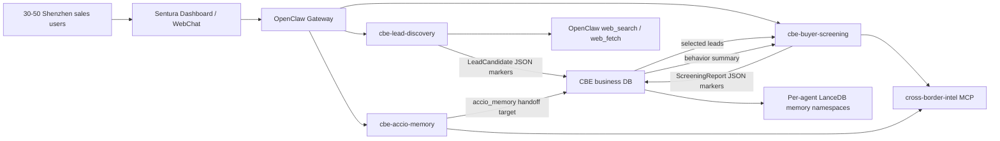

# Sentura x Cross-Border E-Commerce — Shared Platform Design

> **On-demand reference — not read by default.**
>
> Customer: cross-border B2B exporter of mobile-phone accessories.
>
> Original design date: 2026-06-07.
>
> Reorganized: 2026-06-13.
>
> Status: Phase-1 employee workspaces and demo routes are implemented for the three-agent MVP; production persistence, cloud deployment, Alibaba API integration, and concurrent lead-run coordinator remain planned implementation work.

This file is now the shared platform and cross-agent design for the mobile-accessory cross-border e-commerce client lane. Agent-specific design, implementation status, and future work live in:

| Agent | File | Owns |
|---|---|---|
| Marketing Acquisition / Lead Discovery | [`MARKET_ACQUISITION.md`](MARKET_ACQUISITION.md) | `cbe-lead-discovery`, lead search strategy, lead UI, output schema, copy-to-Screening, concurrent lead-run dedupe. |
| Screening and Background | [`SCREENING.md`](SCREENING.md) | `cbe-buyer-screening`, evidence ladder, registry/domain/email/trade checks, contextual scoring, Alibaba International Station API enhancement. |
| Accio Memory Processing | [`MEMORY_PROCESSING.md`](MEMORY_PROCESSING.md) | `cbe-accio-memory`, Accio JSON fixture/upload, chat summarization, memory-write preview, Screening handoff. |

Role-level UI design lives in [`UI.md`](UI.md). It defines the target ordinary-user/Admin monitoring split, the ordinary-user navigation, personal center, unified customer list for Lead Discovery + Screening, memory-record list, status colors, Admin monitoring console, and the hidden Agent task connection contract.

Phase 2 execution planning lives in [`PHASE-2.md`](PHASE-2.md). It translates the current database, concurrency, and agent-hardening design into an implementation sequence for production persistence, typed store boundaries, multi-user sessions, Lead run coordination, durable Screening/Accio workflows, and load-smoke validation.

Phase 2 also owns the cross-border customer user layer. For this client, the product UI has only two customer-facing levels: `operator` for ordinary business users and `admin` for customer-side supervisors who monitor task activity, aggregate lead/screening output, per-user lists, and statistics. This Admin role is not a Sentura platform administrator and does not expose employee creation, prompt tuning, provider settings, OpenClaw config, or tool-policy management. The full permission/database plan lives in [`PHASE-2.md §2.1`](PHASE-2.md#21-customer-user-levels-and-permission-boundary).

Independent client memory and tests:

- Memory detail: [`docs/memory/cross-border-ecommerce/phase-1.md`](../docs/memory/cross-border-ecommerce/phase-1.md)
- Test detail: [`docs/tests/tests-cross-border-ecommerce.md`](../docs/tests/tests-cross-border-ecommerce.md)
- Role UI design: [`UI.md`](UI.md)
- Phase 2 execution plan: [`PHASE-2.md`](PHASE-2.md)
- API/setup runbook: [`API_KEYS_OPENCLAW_SETUP.md`](API_KEYS_OPENCLAW_SETUP.md)

## 1. Inputs And Customer Baseline

Inputs used across the lane:

- `README.md` — Sentura is an enterprise AI employee platform built on OpenClaw.
- `docs/MEMORY.md` — current ground truth: OpenClaw `2026.6.2`, exactly 8 OpenClaw-native workspace files, MCP wiring via `mcp.servers.<name>`, sandboxed employees require sandbox tool allowlists for MCP/plugin tools.
- `docs/TESTS.md` — cross-border e-commerce is an independent client lane, not A/B/C/D TeamPlan work.
- `docs/PLATFORM-DESIGN.md` — Sentura control plane, multi-tenant design, connector layer through MCP servers, future cloud migration path.
- `跨境电商/Sentura_跨境电商_Agent_商业汇报_v2.pdf` — customer problem statement and three-agent proposal.
- OpenClaw docs for agent workspace, agent runtime, web search, MCP config, tool config, sandbox filtering, configuration RPC, multi-agent routing, multiple gateways, security, session tools, and sub-agents.

Customer facts:

- Customer sells mobile-phone accessories through cross-border B2B channels.
- Primary commercial context is Alibaba International Station / Accio-style sales conversations plus overseas public channels.
- Current market coverage includes Europe, North America, and South America.
- Customer coordinates from Shenzhen and has decided on cloud deployment.

Sales-front-end problems:

1. Buyer authenticity judgment is inconsistent.
2. Disposable or weak buyer emails reduce follow-up stickiness.
3. Salespeople manually research overseas companies across many public and paid sources.
4. Customer records are fragmented across chats, spreadsheets, and personal memory.
5. There is no quantitative buyer score or evidence coverage model.

Project promise:

- AI handles finding customers, verifying authenticity, and retaining customer context.
- Human sales focus on final conversion with verified buyers.
- No Phase-1 employee sends outreach automatically.

## 2. Employee Roster

Tenant slug:

```text
cross-border-ecommerce
```

Employees:

| Employee | Agent id | Chinese name | Primary output | Detail file |
|---|---|---|---|---|
| Marketing Acquisition | `cbe-lead-discovery` | 跨境营销获客员工 | Daily/source-audited potential buyer list | [`MARKET_ACQUISITION.md`](MARKET_ACQUISITION.md) |
| Screening and Background | `cbe-buyer-screening` | 跨境筛选背调员工 | Buyer authenticity score report with evidence chain | [`SCREENING.md`](SCREENING.md) |
| Accio Memory Processing | `cbe-accio-memory` | 跨境记忆处理员工 | Accio chat summary report + structured customer memory preview | [`MEMORY_PROCESSING.md`](MEMORY_PROCESSING.md) |

Tenant-prefixed workspace ids for a shared Sentura instance:

- `cross-border-ecommerce-lead-discovery`
- `cross-border-ecommerce-buyer-screening`
- `cross-border-ecommerce-accio-memory`

## 3. Shared Knowledge Pack

All employees share a cross-border mobile-accessory knowledge pack.

Product category tree:

- phone cases:
  - TPU
  - silicone
  - leather
  - rugged
  - clear case
  - MagSafe case
- screen protectors:
  - tempered glass
  - privacy glass
  - hydrogel film
- chargers:
  - USB-C charger
  - GaN charger
  - wall charger
  - travel adapter
- cables:
  - USB-C cable
  - Lightning cable
  - braided cable
  - fast charging cable
- mobile holders:
  - car mount
  - magnetic holder
  - desk stand
- power accessories:
  - power bank
  - wireless charger
  - MagSafe charger
- repair accessories:
  - LCD screen replacement
  - battery replacement
  - tool kits

Buyer personas:

- importer
- distributor
- wholesaler
- retailer
- repair chain
- e-commerce seller
- marketplace seller
- electronics store
- mobile shop chain

Geographic focus:

- Phase 1: US, UK, Germany, France, Spain, Italy, Brazil, Mexico, Chile, Colombia.
- Expandable through country adapter files.

Scoring reference:

- Long-term PDF model: authenticity 60, business fit 25, behavior signal 15.
- Phase 1 uses contextual scoring so cold leads do not lose behavior points and disabled paid APIs reduce evidence coverage rather than producing false negative scores.
- Detailed scoring blocks live in [`SCREENING.md`](SCREENING.md#10-contextual-scoring-model).

Outreach boundary:

- No Phase-1 employee sends cold email or messages automatically.
- Employees can produce buyer lists, risk reports, memory previews, and draft text only when explicitly requested.

## 4. Shared OpenClaw/Sentura Implementation Shape

Each employee is a normal OpenClaw embedded agent with:

- exactly the 8 OpenClaw-native top-level workspace files:
  - `AGENTS.md`
  - `SOUL.md`
  - `TOOLS.md`
  - `IDENTITY.md`
  - `USER.md`
  - `HEARTBEAT.md`
  - `BOOTSTRAP.md`
  - `MEMORY.md`
- `skills/*/SKILL.md`
- optional `ekg/` structured seed files
- `config.json5`
- sandbox mode `non-main`
- MCP/plugin tools allowed at both normal tool-policy and sandbox tool-policy layers

OpenClaw/Sentura rules:

- OpenClaw is the runtime. Sentura is the control plane layer.
- Do not build a custom agent runtime, gateway, Docker wrapper, or channel adapter for this customer lane.
- Do not call model APIs directly from Sentura business logic; route through OpenClaw providers.
- Do not give agents raw SQL credentials or free-form SQL tools.
- Runtime config changes go through OpenClaw config patching/setup, not ad hoc file mutation at runtime.
- Tool access is enforced by config; `TOOLS.md` is guidance only.
- Sandbox sessions need explicit allowlists for MCP/plugin tools.

Shared tool policy shape:

```json5
tools: {
  profile: "minimal",
  allow: ["web_search", "web_fetch", "memory_search", "memory_get", "cron", "group:plugins"],
  sandbox: {
    tools: {
      allow: ["web_search", "web_fetch", "memory_search", "memory_get", "cross-border-intel__*"]
    }
  },
  deny: ["exec", "gateway", "write", "edit", "apply_patch", "sessions_spawn", "subagents", "sessions_yield"]
}
```

The three worker employees continue to deny recursive session/sub-agent tools. If future Mode-B automation is needed, add a dedicated `cbe-orchestrator` employee that is the only CBE component allowed to use `sessions_send` / `sessions_spawn`.

## 5. Cross-Agent Architecture



Formal Phase-1 execution remains UI-driven:

1. User starts Lead Discovery from `/client-demos/cross-border/lead-discovery`.
2. Dashboard sends a structured task through the real `cbe-lead-discovery` AgentChat session.
3. Lead employee calls `web_search` / `web_fetch` and returns `LEAD_CANDIDATES_JSON_START/END`.
4. Dashboard validates JSON, persists the lead run, and lets the user copy or submit selected records to Screening.
5. Screening page sends batch/manual tasks through `cbe-buyer-screening`; the employee calls `cross-border-intel__*` tools and returns `SCREENING_REPORTS_JSON_START/END`.
6. Accio page sends uploaded JSON through `cbe-accio-memory`; the employee calls parser/summarizer tools and returns `ACCIO_SUMMARIES_JSON_START/END`.
7. Memory writes remain preview-first. A human approves before concise facts are promoted to `memory_facts` and vector memory.

Agent-to-agent messaging is not enabled for Phase 1. Handoff is typed DB/Dashboard handoff, not free-form inter-agent chat.

## 6. Client Demo UI Surfaces

The current routes below are the implemented demo workbenches. The target customer-facing role UI is specified in [`UI.md`](UI.md): Employee users should see `个人中心`, `获客与背调`, and `记忆整理` pages, with no visible direct free-form Agent chat session. Business buttons still run the real OpenClaw employees through hidden structured tasks and JSON marker parsing.

Routes:

| Route | Employee | Human workflow | Detail |
|---|---|---|---|
| `/client-demos/cross-border/lead-discovery` | `cbe-lead-discovery` | Configure lead-search run, review deduped buyer table, inspect source provenance and dedupe reasoning. | [`MARKET_ACQUISITION.md`](MARKET_ACQUISITION.md#6-ui-design) |
| `/client-demos/cross-border/screening` | `cbe-buyer-screening` | Investigate Marketing leads or manual company/email/domain/contact inputs, inspect evidence, adjust source/budget toggles, export reports. | [`SCREENING.md`](SCREENING.md#3-ui-design) |
| `/client-demos/cross-border/accio-memory` | `cbe-accio-memory` | Upload/select Accio JSON, inspect transcript, review extracted deal facts, preview memory write, hand buyer context to Screening. | [`MEMORY_PROCESSING.md`](MEMORY_PROCESSING.md#7-ui-design) |

Shared UI conventions:

- Dense operational workbench layout, not landing pages.
- Customer-facing labels in Simplified Chinese.
- Source URLs, API field names, and machine ids remain available in expandable technical details.
- Every visible result shows source type and timestamp.
- Paid/unavailable sources appear as disabled/locked toggles with cost notes, not as silent missing evidence.
- Demo fixture data is marked `演示数据`.
- Employee-produced live results are marked `员工执行`.
- Diagnostic API adapter output can be marked `实时查询` when used outside the formal employee workflow.
- Buttons that imply downstream action use safe language such as `生成草稿`, `发送到背调`, `写入记忆预览`; no `自动联系客户`.

## 7. Shared MCP Servers

### 7.1 `cross-border-intel`

Phase-1 read-mostly MCP server:

```text
sentura/mcp-servers/cross-border-intel/
```

Purpose:

- Wrap deterministic low-cost APIs and local checks behind audited tools.
- Avoid ad hoc HTTP logic in employee prompts.
- Keep external evidence normalized, source-tagged, and testable.

Tool catalog:

| Tool | Used by | Behavior |
|---|---|---|
| `cbe_intel_company_registry_search` | Screening | UK Companies House API when country is GB; OpenCorporates only with paid key; otherwise web-search registry fallback. |
| `cbe_intel_company_profile` | Screening | Fetch profile from known registry source. |
| `cbe_intel_domain_rdap_lookup` | Screening | RDAP through RDAP.org for low volume, IANA bootstrap client for scale. |
| `cbe_intel_email_domain_check` | Screening | Syntax, free-provider flag, disposable-domain list, DNS MX/SPF/DMARC, optional paid validation. |
| `cbe_intel_official_contact_email_search` | Screening | Fetch bounded official-site pages and extract same-domain contact emails before paid validation. |
| `cbe_intel_sec_lookup` | Screening | SEC EDGAR lookup for US public-company candidates; resolves company name through `company_tickers.json` when CIK is absent. |
| `cbe_intel_trade_record_search` | Screening | ImportYeti if key exists; Volza if key exists; otherwise web evidence query marked weak. |
| `cbe_intel_score_buyer` | Screening | Deterministic contextual scoring from normalized evidence. |
| `cbe_intel_parse_accio_chat` | Memory | Validate and normalize uploaded Accio JSON fixture. |
| `cbe_intel_summarize_accio_chat` | Memory | Produce structured summary fields for Memory employee. |

Wiring:

- Normal stdio MCP server.
- Wired by `scripts/sentura-setup.sh` / `scripts/sentura-setup.ps1`.
- Operators set env vars in `~/.openclaw/.env`, build MCP package, rerun Sentura setup.
- Do not require manual OpenClaw UI paste during normal setup.

Config shape:

```json5
{
  mcp: {
    servers: {
      "cross-border-intel": {
        command: "node",
        args: ["sentura/mcp-servers/cross-border-intel/dist/index.js"],
        cwd: ".",
        env: {
          COMPANIES_HOUSE_API_KEY: "${COMPANIES_HOUSE_API_KEY}",
          HUNTER_API_KEY: "${HUNTER_API_KEY}",
          ABSTRACT_API_KEY: "${ABSTRACT_API_KEY}",
          IMPORTYETI_API_KEY: "${IMPORTYETI_API_KEY}",
          SEC_USER_AGENT: "SenturaCrossBorderIntel/0.1 contact=ops@example.invalid",
          CBE_ENABLE_PAID_TRADE_DATA: "false",
          CBE_MAX_PAID_SPEND_USD: "0",
          CBE_INTEL_REQUEST_TIMEOUT_MS: "30000"
        },
        requestTimeoutMs: 30000
      }
    }
  }
}
```

Notes:

- `TAVILY_API_KEY` and `BRAVE_API_KEY` belong to OpenClaw `web_search` provider auto-detection, not this MCP env block.
- All tools are read-only in Phase 1.
- Every tool returns source URL/type, fetched timestamp, confidence, and provider status.
- Non-2xx provider responses are coverage gaps unless they are target-specific adverse evidence.

### 7.2 Future `icbu-openapi`

Alibaba International Station API access is Screening-specific and conditional on customer account proof. The planned read-only MCP is documented in [`SCREENING.md`](SCREENING.md#12-alibaba-international-station-api-enhancement).

It must:

- use seller-authorized tokens stored only in secret storage;
- expose only read-only tools;
- redact CRM/order/note data before LLM prompts;
- return coverage statuses and source method metadata;
- reject mutation APIs.

## 8. Shared Business Database

Do not create three independent business databases. Use one tenant-scoped CBE business database for the whole workflow, plus three per-agent LanceDB memory namespaces.

Production recommendation:

- Managed PostgreSQL-compatible DB.
- SQLite WAL only for single-server pilot fallback with explicit migration plan.
- On Alibaba Cloud: PolarDB/RDS PostgreSQL if available.
- On Tencent Cloud: TencentDB/TDSQL-C PostgreSQL if procurement prefers Tencent.

Storage layout:

| Layer | Store | Purpose |
|---|---|---|
| OpenClaw runtime state | OpenClaw native state directory on encrypted disk | Gateway config, sessions, transcripts, task state, MCP process state. |
| Agent workspaces | `~/.openclaw/workspace/{cbe-*}` copied from `sentura/agents/cbe-*` | 8 native files, skills, EKG seed files. |
| Vector memory | LanceDB / Sentura memory extension namespaces per employee | Concise semantic recall; not raw Accio chat. |
| Structured business records | Managed PostgreSQL-compatible database | Runs, candidates, reports, evidence, imports, summaries, handoff, cost, audit. |
| Uploaded files | OSS/COS or encrypted server volume | Raw Accio JSON uploads, exports, screenshots. |
| Secrets | `~/.openclaw/.env`, OpenClaw secret references, cloud KMS/env injection | Model/search/API keys. |

Core schema:

```sql
-- Shared dimensions
tenants(id, slug, display_name, data_region, created_at)
sentura_users(id, tenant_id, display_name, role, department_id, user_token_hash, created_at)
cbe_user_profiles(id, tenant_id, user_id, cbe_role, display_name, team_name, status, created_at, updated_at)
agent_runs(id, tenant_id, user_id, agent_id, session_key, status, target_record_type, target_record_id, target_summary, current_stage, started_at, last_activity_at, finished_at, model_ref, cost_usd_estimate)
agent_run_activity_events(id, tenant_id, agent_run_id, user_id, agent_id, event_type, stage, target_summary, tool_name, source_type, source_url, message, status, created_at)

-- Marketing Acquisition
lead_runs(id, tenant_id, user_id, agent_run_id, query_config_json, status, target_count, created_at)
lead_candidates(id, tenant_id, lead_run_id, normalized_domain, company_name, country, buyer_type, confidence, dedupe_key, status, created_at)
lead_sources(id, tenant_id, lead_candidate_id, source_type, source_url, query, excerpt, fetched_at, confidence)

-- Screening and Background
screening_targets(id, tenant_id, source, lead_candidate_id, company_name, country, domain, email, contact_person, product_interest_json, supplied_fields_json, created_at)
screening_reports(id, tenant_id, screening_target_id, agent_run_id, risk_tier, normalized_score, evidence_coverage, recommended_action, created_at)
screening_evidence(id, tenant_id, screening_report_id, layer, source_type, source, source_url, finding, confidence, cost_usd, score_block, score_impact, fetched_at)
screening_score_blocks(id, tenant_id, screening_report_id, block, status, max_points, earned_points, reason)

-- Accio Memory
accio_imports(id, tenant_id, user_id, agent_run_id, source_file_name, file_hash, storage_key, validation_status, classification, uploaded_at)
accio_conversations(id, tenant_id, accio_import_id, external_conversation_id, company_name, country, contact_person, email, website)
accio_messages(id, tenant_id, accio_conversation_id, message_ts, sender_role, text_hash, text_redacted, attachment_json)
accio_summaries(id, tenant_id, accio_conversation_id, agent_run_id, customer_profile_json, purchase_intent_json, negotiated_price_json, next_actions_json, behavior_signals_json, created_at)

-- Cross-agent handoff, audit, and cost
handoff_events(id, tenant_id, from_agent_id, to_agent_id, source_record_type, source_record_id, payload_json, status, created_at)
memory_facts(id, tenant_id, agent_id, source_record_type, source_record_id, fact_json, vector_memory_ref, status, created_at)
api_call_ledger(id, tenant_id, agent_run_id, provider, endpoint, source_type, request_units, cost_usd, status, created_at)
audit_events(id, tenant_id, user_id, agent_id, event_type, data_tier, metadata_json, created_at)
```

Customer role-aware row ownership:

- CBE product roles are `operator` and `admin` only. Sentura authentication can still protect the session under the hood, but the CBE product must not surface the full Sentura platform role model.
- Business tables that create user-visible records must carry `created_by_user_id`, `owner_user_id`, `team_name`, and `visibility_scope` where applicable.
- Ordinary operators use the existing `个人中心`, `获客与背调`, and `记忆整理` pages. They can start Lead/Screening/Accio work, see their own records, see approved shared/team rows, and retry their own recoverable failures.
- Admins are customer-side supervisors with read-mostly monitoring access: live task activity, aggregate lead/screening lists, per-user lists, per-agent usage, statistics, costs, and failure summaries.
- Admins cannot create AI employees, tune prompts, change model/provider keys, change OpenClaw config, edit tool policy, bypass Lead duplicate-run coordination, or impersonate users to start silent tasks.

Minimum indexes:

- `lead_candidates(tenant_id, normalized_domain)` unique per tenant when non-null.
- `screening_targets(tenant_id, domain, email)`.
- `screening_reports(tenant_id, screening_target_id, created_at desc)`.
- `accio_conversations(tenant_id, company_name, email)`.
- `api_call_ledger(tenant_id, created_at, provider)`.
- `audit_events(tenant_id, created_at, event_type, data_tier)`.
- `cbe_user_profiles(tenant_id, cbe_role, status)`.
- `agent_run_activity_events(tenant_id, status, agent_id, created_at desc)`.
- Owner/team/visibility indexes on Lead, Screening, and Accio record families for route-level row filtering and Admin monitoring views.

Controlled write path:

- Phase 1: Dashboard route handlers persist structured records after validating employee JSON markers.
- Production hardening: add `cross-border-store` MCP server or Sentura plugin tools:
  - `cbe_store_lead_run`
  - `cbe_store_screening_report`
  - `cbe_store_accio_summary`
  - `cbe_store_handoff`
- Typed tools validate Zod schemas, apply tenant/user IDs from the authenticated CBE tenant context, redact PII for logs, and write the DB.

Per-employee database details:

- Lead-specific persistence and concurrent dedupe: [`MARKET_ACQUISITION.md`](MARKET_ACQUISITION.md#8-business-database-and-persistence) and [`MARKET_ACQUISITION.md`](MARKET_ACQUISITION.md#9-concurrent-lead-discovery-dedupe).
- Screening-specific evidence tables and Alibaba additions: [`SCREENING.md`](SCREENING.md#13-database-and-persistence).
- Accio-specific import/message/summary tables: [`MEMORY_PROCESSING.md`](MEMORY_PROCESSING.md#10-database-and-persistence).

## 9. Multi-Agent Runtime And Concurrency

Recommended topology for one customer company:

- One primary OpenClaw Gateway on one cloud VM.
- Three persistent OpenClaw agents registered in `agents.list`.
- One Sentura Dashboard instance talking to Gateway through WebSocket RPC.
- One compiled `cross-border-intel` stdio MCP server spawned by OpenClaw.
- One tenant business database plus per-agent LanceDB memory.
- Optional rescue Gateway profile for operations recovery only.

Why not one Gateway per employee:

- OpenClaw supports multiple agents and channels in one Gateway.
- These three employees share one tenant, customer auth/scope model, audit/cost ledger, and pipeline data.
- Multiple Gateways would complicate handoff, memory, cost attribution, and deployment without improving trust isolation for one cooperative customer team.

When to split Gateways:

- A second external customer is onboarded.
- Customer requires hard department separation with different tool authority.
- A privileged admin/rescue bot is needed.
- A future outbound-action agent gets broader tools than the current read-only employees.

Concurrency targets for 30-50 users:

| Workload | Initial limit | Reason |
|---|---:|---|
| Concurrent user web sessions | 50-80 | Dashboard sessions are cheap; users often review existing reports. |
| Active Lead Discovery runs | 8-12 | Search APIs are rate/cost limited; duplicate-scope coordinator should further reduce waste. |
| Active Screening runs | 8-12 targets or 3-5 batches | Registry/RDAP/search/paid API pressure must be controlled. |
| Active Accio imports | 3-5 files | Large uploads create long contexts. |
| Browser/Playwright tasks | 0 normally; max 1-2 for self-provisioning | Not needed for normal Phase-1 customer use. |
| Model calls | Provider quota minus 20% headroom | Prevent throttling cascades. |

Backpressure:

- If limits are exceeded, Dashboard creates queued `agent_runs` and shows `排队中`.
- Long tasks need server-side timeout and visible partial-result path.
- Every external API call writes `api_call_ledger`.
- Paid trade/email checks require budget flag and per-run confirmation above cap.

Session isolation:

- Every run includes `tenant_id`, `user_id`, `agent_id`, and `session_key`.
- Sentura user tokens drive per-user memory injection and tag business DB writes.
- Users inside one company may share buyer records according to CBE owner/team/visibility scope. This is cooperative multi-user operation, not hostile multi-tenant isolation.

## 10. Cloud Deployment And Model Routing

Decision:

- Use a Chinese cloud provider as primary production host.
- Do not choose a US region as primary host for this Shenzhen customer.

Preferred:

- Alibaba Cloud ECS China (Shenzhen) `cn-shenzhen`.
- China (Guangzhou) fallback if required instance family or procurement constraints apply.
- Rationale: close to Shenzhen users, mainland data residency, easier ICP path, and natural fit with Alibaba/Accio/Qwen ecosystem.

Acceptable alternative:

- Tencent Cloud CVM South China Shenzhen/Guangzhou if customer already procures from Tencent, WeCom/WeChat integration matters, or Tencent has better availability.

Do not default to US primary hosting because:

- Shenzhen latency/access is worse.
- Raw Accio chats, buyer contacts, and reports would be outside mainland China by default.
- PIPL outbound-transfer work increases.
- US hosting does not solve OpenAI availability for mainland production traffic.

Optional international egress:

- If mainland VM cannot reliably reach Companies House, SEC, ImportYeti, Brave/Tavily, or other overseas public sources, add a small Hong Kong/Singapore egress worker later.
- It receives only low-sensitivity public-search queries and target domains.
- It must not receive raw Accio chats, complete contact lists, or memory facts.

ICP/access model:

- Public mainland HTTPS domain requires ICP and public-security filing path before customer-wide rollout.
- Before ICP, use VPN/private network/bastion and avoid presenting the service as a public website.

Recommended initial production size:

| Component | Starting size |
|---|---|
| App VM | 8 vCPU, 16 GB RAM, Ubuntu LTS, Node 24 or Node 22.19+, pnpm 11.2.2+ |
| Safer headroom | 16 vCPU, 32 GB RAM for frequent Screening batches/Accio imports |
| System disk | 100 GB SSD |
| Data disk | 200-500 GB encrypted SSD |
| Managed PostgreSQL | 2 vCPU / 4-8 GB RAM, 100 GB storage, backups enabled |
| Bandwidth | 10 Mbps minimum; 20 Mbps recommended |
| Object storage | 100 GB initial bucket |
| Backup | Daily DB backup, daily OpenClaw state snapshot, weekly encrypted full archive, restore drill |

Model routing:

| Task | Default | Fallback |
|---|---|---|
| Lead query expansion / lead JSON cleanup | `deepseek/deepseek-v4-flash` or `qwen/qwen3.5-plus` | Volcengine/Doubao fast model |
| Screening report synthesis | `qwen/qwen3.5-plus` or `deepseek/deepseek-v4-pro` for difficult cases | `deepseek/deepseek-v4-flash` for normal batch runs |
| Accio chat parsing/summarization | `qwen/qwen3.5-plus` or `deepseek/deepseek-v4-flash` | Kimi/Moonshot if customer already uses it |
| Embeddings/memory | configured Sentura memory provider; mainland-accessible embedding endpoint if OpenAI unavailable | self-hosted embedding if required |

Operational policy:

- Store model keys in `~/.openclaw/.env` or cloud secret injection only.
- Configure fallbacks in OpenClaw config.
- Do not call provider SDKs directly from Dashboard routes.
- Use deterministic MCP scoring for risk tiers.
- LLM may explain score but must not invent evidence.
- Track tokens/cost by `tenant_id`, `agent_id`, `user_id`, and `agent_run_id`.
- Overseas model APIs require compliance approval, data minimization/redaction, and explicit customer sign-off.

## 11. Security, Compliance, Cost, And Data Classification

Data tiers:

| Data | Tier | Handling |
|---|---|---|
| Public company websites, public registry URLs, search snippets | T0/T1 | Store as evidence with source URL and timestamp. |
| Buyer contact names, work emails, phone numbers, lead lists | T2 | Mask in demo/export where possible; CBE-authenticated internal view with owner/team/visibility scope. |
| Raw Accio chats, negotiated prices, payment terms, customer notes | T3 | Store encrypted; never send to external channels; summarize before memory write. |
| API keys, model keys, provider credentials | T4 | Secret store / `.env`; never in DB, workspace prose, logs, or chat. |

China data posture:

- Mainland primary hosting keeps customer operational data local by default.
- US server or overseas model endpoint for raw chats/contact data can become personal-information outbound transfer work.
- Search egress follows minimum data principle: overseas search providers receive query terms/target domains only.

Safety rules:

- No login-gated social scraping.
- No automatic outreach in Phase 1.
- No fraud claim solely because evidence is missing.
- Mask personal emails/phones in demo reports unless operator requests full internal view.
- Every report includes source URLs and evidence confidence.
- Every paid lookup is traceable with query, provider, timestamp, and approximate cost.

Cost defaults:

| Category | Default cap |
|---|---:|
| Search API | $0-$30/month during development |
| Email validation | $0-$17/month unless production deliverability matters |
| Trade records | $0 for demo; optional Volza pilot capped at $50-$100 |
| Company registry | $0 unless OpenCorporates is approved |

Security controls before production:

- Gateway behind HTTPS reverse proxy and auth.
- Dashboard uses Sentura authentication/per-user tokens, then applies the CBE `operator`/`admin` product role and owner/team/visibility scope in customer routes.
- `openclaw security audit --deep` passes or findings have explicit exception.
- Dangerous tools denied for all three employees.
- Paid API usage has budget caps and human approval for cap increases.
- Logs redact secrets and direct personal contact values where feasible.

## 12. Build Milestones And Current Status

| Milestone | Scope | Status | Detail |
|---|---|---|---|
| 1 | Design and source tracking | Complete | Initial design, independent memory/test lane. |
| 2 | Shared fixtures, ontology, schemas, contextual scoring | Complete | Accio fixture, mobile-accessory ontology, Zod schemas, 39-check validation. |
| 3 | `cross-border-intel` MCP server | Complete | 10 read-only tools, 17/17 tests plus build. |
| 4 | Marketing Acquisition employee | Complete after execution-path correction | [`MARKET_ACQUISITION.md`](MARKET_ACQUISITION.md) |
| 5 | Screening and Background employee | Complete after execution-path, visual mapping, official-source ordering fixes | [`SCREENING.md`](SCREENING.md) |
| 6 | Accio Memory Processing employee | Complete after execution-path correction | [`MEMORY_PROCESSING.md`](MEMORY_PROCESSING.md) |
| 7 | Three client demo UI surfaces | Complete | Lead, Screening, Accio routes covered by CE4/CE5/CE6/CE7. |
| 8 | End-to-end MVP smoke | Designed, still to execute in production-like environment | Scenario below. |
| 9 | Production cloud/database/multi-agent deployment | Designed, not implemented | China cloud, managed DB, model routes, go-live checklist. |
| 10 | Alibaba International Station API enhancement | Designed, access proof pending | Screening-specific. |
| 11 | Concurrent Lead Discovery dedupe | Designed, implementation pending | Marketing-specific. |

End-to-end MVP smoke scenario:

1. Marketing employee finds 20 buyers for phone cases and chargers in UK/US.
2. Operator sends selected leads to Screening through Lead Discovery UI.
3. Screening employee scores top 5 with evidence reports using contextual scoring.
4. Operator manually enters one company/domain/email outside lead list and gets a report.
5. Memory employee processes simulated Accio JSON through Accio UI.
6. Screening employee updates one buyer score using chat behavior when Accio summary exists.

Expected outputs:

- `lead_candidates.json`
- `screening_reports/*.json`
- `accio_summaries/*.json`
- UI screenshots or Playwright snapshots for all three pages
- `mvp_summary.md` in Chinese with trusted/cautious/high-risk/insufficient-evidence buyers, missing paid data, and recommended next sales action.

## 13. Go-Live Verification Checklist

Before giving the customer a production URL:

1. Build OpenClaw and Sentura on the target VM using Node 24 or Node 22.19+ and pnpm 11.2.2+.
2. Run OpenClaw production setup using OpenClaw's own setup path.
3. Build `@sentura/mcp-cross-border-intel` and rerun Sentura setup so `mcp.servers.cross-border-intel` is registered.
4. Run `openclaw mcp doctor cross-border-intel --probe`.
5. Run `openclaw security audit --deep`.
6. Run `npx tsx scripts/test-cross-border-agents.ts`.
7. Run `pnpm --filter @sentura/mcp-cross-border-intel test`.
8. Run `pnpm --filter @sentura/mcp-cross-border-intel build`.
9. Run live search/API smoke from selected China region for Tavily/Brave and required registry/trade APIs.
10. Run 50-user load smoke: 50 dashboard sessions, 10 active Lead runs, 5 active Screening batches, 3 Accio imports, with p95 dashboard API latency and provider throttling recorded.
11. Verify backup restore: DB restore, OpenClaw state restore, one Accio upload restore.
12. Confirm every employee workspace uses only the 8 OpenClaw-native top-level workspace files.
13. Confirm all customer-facing labels remain Simplified Chinese.
14. Confirm all reports show evidence source URLs, timestamps, and source type.

## 14. Open Questions

1. Does the customer already have Brave/Tavily/Exa/SerpApi, Companies House, Hunter/Abstract, ImportYeti, or Volza accounts?
2. Which countries are mandatory for first live demo: US/UK only, or include Brazil/Mexico/EU from day one?
3. Should Marketing output only buyer lists, or also draft first-contact emails in Chinese/English/Spanish/Portuguese/German?
4. Where should uploaded Accio chat files enter production: dashboard upload, chat attachment, object storage upload, or local operator drop folder?
5. Should Phase 1 persist customer profiles in local JSON first, or directly write business DB + reviewed memory facts?
6. Which Alibaba International Station seller package does the customer have, and can the main account authorize API access?
7. Does the customer need department-level separation for lead visibility/allocation, or one shared sales pool?

## 15. Sources Checked

OpenClaw:

- `https://docs.openclaw.ai/agent-workspace`
- `https://docs.openclaw.ai/agent`
- `https://docs.openclaw.ai/tools/web`
- `https://docs.openclaw.ai/cli/mcp`
- `https://docs.openclaw.ai/gateway/config-tools`
- `https://docs.openclaw.ai/gateway/configuration`
- `https://docs.openclaw.ai/concepts/multi-agent`
- `https://docs.openclaw.ai/gateway/multiple-gateways`
- `https://docs.openclaw.ai/gateway/security`
- `https://docs.openclaw.ai/gateway/sandboxing`
- `https://docs.openclaw.ai/tools/subagents`
- `https://docs.openclaw.ai/concepts/session-tool`

Cloud/model/compliance:

- `https://www.alibabacloud.com/help/en/ecs/user-guide/regions-and-zones`
- `https://www.alibabacloud.com/en/global-locations`
- `https://www.alibabacloud.com/help/en/icp-filing/basic-icp-service/product-overview/icp-filing-application-for-enterprises-outside-the-chinese-mainland`
- `https://www.tencentcloud.com/global-infrastructure`
- `https://www.tencentcloud.com/solutions/icp-registration-support`
- `https://support.huaweicloud.com/intl/en-us/productdesc-cc/cc_01_0004.html`
- `https://developers.openai.com/api/docs/supported-countries`
- `https://www.alibabacloud.com/help/en/model-studio/models`
- `https://www.alibabacloud.com/help/en/model-studio/model-pricing`
- `https://api-docs.deepseek.com/quick_start/pricing`
- `https://api-docs.deepseek.com/guides/kv_cache`
- `https://www.cac.gov.cn/2023-02/24/c_1678884830036813.htm`

Agent-specific source lists:

- Marketing/search sources: [`MARKET_ACQUISITION.md`](MARKET_ACQUISITION.md#11-source-and-test-traceability)
- Screening/registry/domain/email/trade/Alibaba sources: [`SCREENING.md`](SCREENING.md#16-source-and-test-traceability)
- Accio fixture and memory-processing files: [`MEMORY_PROCESSING.md`](MEMORY_PROCESSING.md#13-source-and-test-traceability)

## 16. Self-Check

- Shared design keeps OpenClaw as runtime and Sentura as control plane.
- Three agent files now own agent-specific design, implementation details, and implementation plans.
- This shared design keeps platform integration, data architecture, deployment, cross-agent flow, and common safety/cost policy.
- Phase-1 employees remain read-only toward external systems and do not perform automatic outreach.
- Raw Accio chats and internal Alibaba/CRM/order/note data are treated as T2/T3 and do not enter vector memory without preview/approval.
- Production implementation still requires DB migrations, typed store tools, cloud setup, live provider smoke tests, backup restore drill, Alibaba API access proof, and concurrent Lead Discovery run coordinator.
