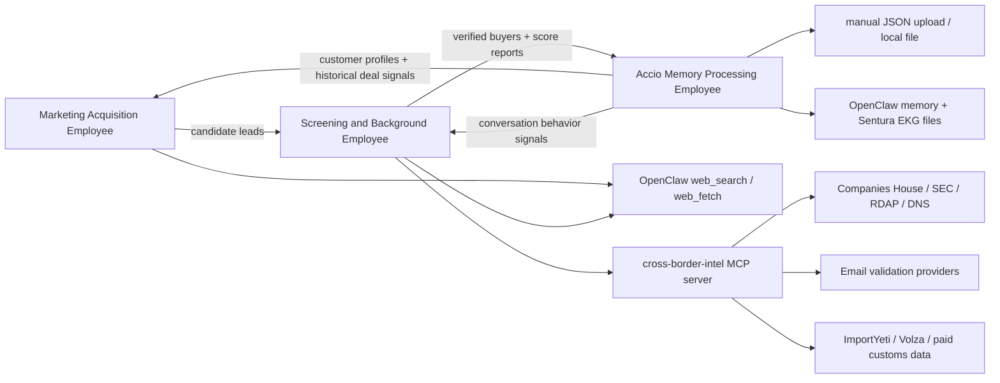

# Sentura x Cross-Border E-Commerce Phase-1 MVP Design

> Customer: cross-border B2B exporter of mobile-phone accessories.
> Date: 2026-06-07.
> Status: detailed design and development plan. No production employee workspaces have been generated in this session.

## 1. Inputs and Current Platform Baseline

### 1.1 Inputs read

- `README.md` — Sentura is an enterprise AI employee platform built on OpenClaw. Each AI employee is an OpenClaw agent with its own workspace files, skills, tools, guardrails, memory, approvals, and channel bindings.
- `docs/MEMORY.md` — current ground truth: OpenClaw `2026.6.2`, exactly 8 OpenClaw-native workspace files, Creator deployment path is green, MCP server wiring lives at `mcp.servers.<name>`, sandboxed employees need sandbox tool allowlists for MCP/plugin tools.
- `docs/TeamPlan.md` and `docs/TESTS.md` — current sprint/test policy. This customer lane should be tracked as an independent client project, not as A/B/C/D core sprint progress.
- `docs/PLATFORM-DESIGN.md` — current product direction: multi-tenant Sentura control plane, local OpenClaw runtime, connector layer via MCP servers, future Cloud SQL/GCS/Secret Manager/Cloud Run migration.
- `跨境电商/Sentura_跨境电商_Agent_商业汇报_v2.pdf` — customer problem statement and three-agent proposal.
- OpenClaw official docs:
  - Agent workspace: `https://docs.openclaw.ai/agent-workspace`
  - Agent runtime: `https://docs.openclaw.ai/agent`
  - Web search tool: `https://docs.openclaw.ai/tools/web`
  - MCP CLI/config: `https://docs.openclaw.ai/cli/mcp`
  - Tool config and sandbox MCP/plugin allowlist: `https://docs.openclaw.ai/gateway/config-tools`
  - Config RPC/hot reload: `https://docs.openclaw.ai/gateway/configuration`

### 1.2 Customer facts from the PDF

The customer sells mobile-phone accessories through cross-border B2B channels, mainly Alibaba International Station and overseas social / public channels. Current market coverage includes Europe, North America, and South America.

The sales team is blocked by five front-end problems:

1. Inconsistent buyer authenticity judgement.
2. Low stickiness from disposable or weak buyer emails.
3. Heavy manual company background research across many overseas sources.
4. Fragmented customer records across chats, spreadsheets, and memory.
5. No quantitative scoring system.

The project promise is to let AI replace the sales front-end work of finding customers, verifying authenticity, and retaining records, while human sales focus on final conversion with verified buyers.

### 1.3 Sentura capability status relevant to this MVP

Built and usable now:

- Creator, Tuner, Orchestrator, Data Scavenger, and MCP Builder source workspaces exist; Creator deployment path has passed E2E.
- `sentura-agents` can write workspace files and register agents in-process without Gateway pairing deadlock.
- RBAC, approval, audit, cost, monitoring, MCP health, and tenant memory extensions exist.
- Existing MCP server pattern is proven under `sentura/mcp-servers/*` with TypeScript + Zod + `@modelcontextprotocol/sdk`.
- OpenClaw native `web_search`, `web_fetch`, `memory_search`, `memory_get`, `cron`, and MCP bundle tooling are available when allowlisted.

Not fully implemented or deferred:

- GCP Cloud SQL/GCS/Secret Manager/Cloud Run connector migration is design-stage.
- REST API connector MCP server is planned but not yet added.
- MCP Builder and Data Scavenger are built but deferred; Phase 1 should not depend on them being autonomous.
- No customer-specific Cross-Border E-Commerce employees or MCP server exist yet.

MVP consequence: implement this client using local OpenClaw agent workspaces plus local stdio MCP server(s), storing secrets in `~/.openclaw/.env` / OpenClaw secret references. Keep the design compatible with future Cloud Run MCP migration, but do not require it for Phase 1.

## 2. Target Employees

### 2.1 Employee roster

| Employee | Proposed agent id | Chinese name | Primary output |
|---|---|---|---|
| Marketing Acquisition Employee | `cbe-lead-discovery` | 跨境营销获客员工 | Daily deduplicated potential buyer list for phone accessories |
| Screening and Background Employee | `cbe-buyer-screening` | 跨境筛选背调员工 | Buyer authenticity score report with evidence chain |
| Accio Memory Processing Employee | `cbe-accio-memory` | 跨境记忆处理员工 | Uploaded Accio chat summary report + structured customer memory |

Tenant slug for this client lane: `cross-border-ecommerce`.

Workspace ids should be tenant-prefixed if deployed into a shared Sentura instance:

- `cross-border-ecommerce-lead-discovery`
- `cross-border-ecommerce-buyer-screening`
- `cross-border-ecommerce-accio-memory`

### 2.2 Shared knowledge base

All three employees share a cross-border mobile-accessory knowledge pack:

- Product category tree:
  - phone cases: TPU, silicone, leather, rugged, clear case, MagSafe case
  - screen protectors: tempered glass, privacy glass, hydrogel film
  - chargers: USB-C charger, GaN charger, wall charger, travel adapter
  - cables: USB-C cable, Lightning cable, braided cable, fast charging cable
  - mobile holders: car mount, magnetic holder, desk stand
  - power accessories: power bank, wireless charger, MagSafe charger
  - repair accessories: LCD screen replacement, battery replacement, tool kits
- Buyer personas:
  - importer, distributor, wholesaler, retailer, repair chain, e-commerce seller, marketplace seller, electronics store, mobile shop chain.
- Geographic focus:
  - Phase 1: US, UK, Germany, France, Spain, Italy, Brazil, Mexico, Chile, Colombia.
  - Expandable through country adapter files.
- Scoring rules:
  - The PDF model remains the starting point: authenticity 60, business fit 25, behavior signal 15.
- Outreach boundary:
  - Phase 1 does not send cold email automatically. It produces buyer lists, reports, and email drafts only if asked.

## 3. High-Level Architecture



### 3.1 OpenClaw/Sentura implementation shape

Each employee is an OpenClaw embedded agent with:

- exactly the 8 native files:
  - `AGENTS.md`
  - `SOUL.md`
  - `TOOLS.md`
  - `IDENTITY.md`
  - `USER.md`
  - `HEARTBEAT.md`
  - `BOOTSTRAP.md`
  - `MEMORY.md`
- `skills/*/SKILL.md`
- optional `ekg/` files for structured product keywords, scoring rules, and customer memory.
- `sandbox: { mode: "non-main" }`.
- MCP/plugin tools allowed at both the normal tool-policy layer and the sandbox tool-policy layer.

OpenClaw docs confirm that `TOOLS.md` is guidance only; actual tool availability is controlled by config. OpenClaw docs also confirm MCP tools in sandboxed sessions are filtered unless `tools.sandbox.tools` includes `bundle-mcp`, `group:plugins`, or exact MCP server globs.

### 3.2 Proposed MCP server

Add one read-mostly MCP server in Phase 1:

```text
sentura/mcp-servers/cross-border-intel/
```

Purpose: wrap deterministic low-cost APIs and local checks behind audited tools so the agents do not hand-roll HTTP calls.

Tool set:

| Tool | Used by | Phase-1 behavior |
|---|---|---|
| `cbe_intel_company_registry_search` | Screening | UK Companies House exact API when country is UK; OpenCorporates only if paid key exists; otherwise web-search registry fallback. |
| `cbe_intel_company_profile` | Screening | Fetch company profile from known registry source. |
| `cbe_intel_domain_rdap_lookup` | Screening | RDAP lookup through RDAP.org for low volume, IANA bootstrap client for scale. |
| `cbe_intel_email_domain_check` | Screening | Syntax, free-provider flag, disposable-domain list, DNS MX/SPF/DMARC, optional paid validation provider. |
| `cbe_intel_sec_lookup` | Screening | SEC EDGAR lookup for US public-company candidates when a CIK/ticker is found. |
| `cbe_intel_trade_record_search` | Screening | ImportYeti when key exists; Volza when key exists; otherwise web evidence query and mark evidence as weak. |
| `cbe_intel_score_buyer` | Screening | Deterministic contextual scoring from normalized evidence. Excludes not-applicable blocks, reports evidence coverage, and applies forced-downgrade rules. |
| `cbe_intel_parse_accio_chat` | Memory | Validate and normalize uploaded Accio JSON fixture. |
| `cbe_intel_summarize_accio_chat` | Memory | Produce structured summary fields for the Memory employee. |

Phase 1 should avoid custom runtime/gateway work. This MCP server is a normal
stdio server and is wired by `scripts/sentura-setup.sh` /
`scripts/sentura-setup.ps1` after OpenClaw onboard. Operators should not paste
this server through the OpenClaw MCP UI during normal Sentura setup; they set
env vars in `~/.openclaw/.env`, build the MCP package, then rerun Sentura
setup. The setup script writes OpenClaw's required flat config shape:

```json5
{
  mcp: {
    servers: {
      "cross-border-intel": {
        command: "node",
        args: ["sentura/mcp-servers/cross-border-intel/dist/index.js"],
        cwd: ".",
        env: {
          COMPANIES_HOUSE_API_KEY: "${COMPANIES_HOUSE_API_KEY}",
          HUNTER_API_KEY: "${HUNTER_API_KEY}",
          ABSTRACT_API_KEY: "${ABSTRACT_API_KEY}",
          IMPORTYETI_API_KEY: "${IMPORTYETI_API_KEY}",
          SEC_USER_AGENT: "SenturaCrossBorderIntel/0.1 contact=ops@example.invalid",
          CBE_ENABLE_PAID_TRADE_DATA: "false",
          CBE_MAX_PAID_SPEND_USD: "0",
          CBE_INTEL_REQUEST_TIMEOUT_MS: "30000"
        },
        requestTimeoutMs: 30000
      }
    }
  }
}
```

`TAVILY_API_KEY` and `BRAVE_API_KEY` belong to OpenClaw `web_search` provider
auto-detection, not to `cross-border-intel`'s MCP env block.

Agent tool policy must include the MCP tools twice:

```json5
tools: {
  profile: "minimal",
  allow: ["web_search", "web_fetch", "memory_search", "memory_get", "cron", "group:plugins"],
  sandbox: {
    tools: {
      allow: ["web_search", "web_fetch", "memory_search", "memory_get", "cross-border-intel__*"]
    }
  },
  deny: ["exec", "gateway", "write", "edit", "apply_patch", "sessions_spawn", "subagents", "sessions_yield"]
}
```

### 3.3 Client demo UI surfaces

Like the Sitlink demo, each Cross-border e-commerce employee needs its own customer-facing UI. These are not marketing landing pages; they are operational demo workbenches that expose the exact workflow a human sales team would use. Each page must use a real OpenClaw `AgentChat` session for the employee and visualize tool results beside the chat, so the customer sees both the AI conversation and the evidence trail.

Routes:

| Route | Employee | Human workflow |
|---|---|---|
| `/client-demos/cross-border/lead-discovery` | `cbe-lead-discovery` | Configure a lead-search run, watch query/source progress, review a deduped buyer table, select leads, and send selected leads to Screening. |
| `/client-demos/cross-border/screening` | `cbe-buyer-screening` | Investigate leads from Marketing or manually entered company/email/domain/contact data, inspect evidence, adjust enabled data sources/budget, and export risk reports. |
| `/client-demos/cross-border/accio-memory` | `cbe-accio-memory` | Upload/select Accio chat JSON, inspect conversation threads, review extracted deal facts, approve memory write, and hand buyer context to Screening. |

Shared UI conventions:

- Use a dense workbench layout: left controls, center primary work table/transcript, right evidence/chat panel. Avoid hero pages or marketing copy.
- Keep all customer-facing labels in Simplified Chinese for the demo, while preserving source URLs, API field names, and machine ids in expandable technical details.
- Every visible result must show source type and timestamp: `official_api`, `public_web`, `paid_trade_data`, `demo_fixture`, `self_reported`, or `unverified`.
- Paid or unavailable data sources must appear as explicit disabled/locked toggles with cost notes, not as silent missing evidence.
- Demo fixture data must be visually marked as "演示数据"; live API results must be marked as "实时查询".
- No page should send outreach, write external systems, or expose raw secrets. Buttons that imply downstream action should say "生成草稿", "发送到背调", "写入记忆预览", not "自动联系客户".

#### 3.3.1 Marketing Acquisition UI

Page goal: make lead generation feel like a sales-research console, not a chat-only bot.

Primary layout:

- Left run builder:
  - product keyword chips: phone case, tempered glass, USB-C charger, MagSafe accessories, custom input
  - buyer persona multi-select: importer, distributor, wholesaler, repair chain, electronics retailer
  - country/language selector
  - result target stepper and max-results-per-query slider
  - exclusion domain editor
  - run button: "开始获客搜索"
- Center lead table:
  - columns: company, country, buyer type, matched product, domain, contact candidate, source count, discovery confidence, duplicate status
  - row actions: inspect sources, mark irrelevant, send selected to Screening
  - batch actions: export JSON, export Markdown, handoff to Screening
- Right evidence/chat panel:
  - top: live AgentChat with `cbe-lead-discovery`
  - below: query log, source URLs, snippets, dedupe explanation

Human logic:

1. Operator configures a run using business terms they understand.
2. Agent expands queries and searches.
3. UI streams discovered candidates into a table.
4. Operator filters and selects plausible buyers.
5. Selected rows become a typed handoff batch for Screening.

#### 3.3.2 Screening UI

Page goal: make background investigation understandable and controllable. The user must be able to screen a Marketing lead batch or manually enter a single company/contact.

Primary layout:

- Top intake tabs:
  - "来自获客列表": choose a lead batch or pasted `LeadCandidate[]`.
  - "手动背调": form fields for company name, country, website/domain, email, contact person, title, social/profile URL, notes, and optional product interest.
- Left investigation queue:
  - lead cards with status: pending, running, needs human clue, complete, insufficient evidence, high risk
  - batch controls: run low-cost checks, enable paid trade check for selected, export reports
- Center evidence workspace:
  - evidence timeline grouped by legal registry, domain/email, website/social footprint, trade/customs, financial/public filing, behavior
  - each evidence card shows source type, confidence, cost, and whether it affects score or only coverage
  - missing API evidence is shown as "未启用/不可用", not as a fraud signal
- Right score/report panel:
  - contextual score gauge
  - evidence coverage meter
  - risk tier and forced-downgrade flags
  - recommended next action
  - live AgentChat with `cbe-buyer-screening`

Manual investigation must support these inputs independently:

```json
{
  "investigation_id": "manual-screen-2026-06-08-001",
  "source": "manual_input",
  "company_name": "Berlin Gadget Wholesale GmbH",
  "country": "DE",
  "domain": "berlin-gadget-wholesale.example",
  "email": "daniel.weber@gmail.com",
  "contact_person": "Daniel Weber",
  "contact_title": "Owner",
  "social_or_profile_url": "https://www.linkedin.com/company/example",
  "product_interest": ["65W GaN charger", "EU plug charger"],
  "operator_notes": "客户从 Accio 聊天中出现，但未进入获客列表。"
}
```

The Screening employee must normalize manual input into the same internal `InvestigationTarget` shape as Marketing leads. Missing fields are allowed; the report must state which fields were supplied, inferred, or absent.

#### 3.3.3 Accio Memory UI

Page goal: make chat-record ingestion auditable before anything is written to memory.

Primary layout:

- Left upload/source panel:
  - JSON upload or "加载演示 Accio 记录"
  - validation status and conversation count
  - conversation list with company, country, product, price, and follow-up status
- Center transcript and extraction view:
  - original chat transcript
  - highlighted product/quantity/price/payment/shipping entities
  - attachment list
- Right memory/report panel:
  - company summary
  - purchase intent cards
  - negotiated price table
  - next actions
  - behavior signals, only when a conversation exists
  - "写入记忆预览" and "发送到背调" actions
  - live AgentChat with `cbe-accio-memory`

The UI must never write raw chat content directly to long-term memory without showing the structured preview. Raw chat remains local T2/T3 data; memory writes are concise structured facts plus source references.

## 4. Employee A — Marketing Acquisition

### 4.1 Work content

The Marketing Acquisition Employee finds potential overseas B2B buyers for mobile-phone accessories by calling web-search APIs with product keywords, buyer-persona keywords, and country/language targeting.

Phase-1 requirement: all functionality complete.

### 4.2 Inputs

```json
{
  "run_id": "lead-run-2026-06-07-us-uk",
  "product_keywords": ["phone case", "tempered glass screen protector", "USB-C charger", "MagSafe accessories"],
  "buyer_personas": ["importer", "distributor", "wholesaler", "mobile phone repair chain", "electronics retailer"],
  "countries": ["US", "GB", "DE", "FR", "BR", "MX"],
  "languages": ["en", "de", "fr", "pt", "es"],
  "max_results_per_query": 10,
  "daily_candidate_target": 100,
  "exclude_domains": ["amazon.com", "alibaba.com", "aliexpress.com", "temu.com", "ebay.com"]
}
```

### 4.3 Search strategy

For each product keyword and target country, generate query families:

1. Buyer type:
   - `"phone accessories importer" "United Kingdom"`
   - `"mobile accessories distributor" Germany`
   - `"tempered glass wholesaler" Brazil`
2. Retail and repair channels:
   - `"mobile phone repair chain" "phone parts" "contact"`
   - `"electronics retailer" "mobile accessories" "wholesale"`
3. Trade fair and exhibitor channels:
   - `"MWC exhibitor" "mobile accessories distributor"`
   - `"IFA exhibitor" "phone accessories"`
   - `"CES exhibitor" "mobile accessories"`
   - `"Canton Fair buyer mobile accessories"`
4. B2B platform cross-check:
   - `site:globalsources.com "phone accessories" importer`
   - `site:made-in-china.com "phone accessories" distributor`
5. Public social/business pages through search only:
   - `site:linkedin.com/company "mobile accessories" "distributor"`
   - `site:facebook.com "mobile phone accessories" "wholesale"`
   - `site:youtube.com "phone repair" "parts supplier"`

Do not log in to LinkedIn, Meta, X, or scrape protected pages in Phase 1. Use only public search result snippets and publicly fetchable pages.

### 4.4 Output schema

```json
{
  "lead_id": "lead_20260607_0001",
  "source_run_id": "lead-run-2026-06-07-us-uk",
  "company_name": "Example Mobile Distribution Ltd",
  "website": "https://example-mobile-distribution.co.uk",
  "country": "GB",
  "city": "Manchester",
  "buyer_type": "distributor",
  "matched_products": ["phone case", "screen protector"],
  "contact_candidates": [
    {
      "type": "email",
      "value": "sales@example-mobile-distribution.co.uk",
      "source_url": "https://example-mobile-distribution.co.uk/contact",
      "confidence": 0.74
    }
  ],
  "source_urls": [
    "https://example-mobile-distribution.co.uk",
    "https://www.linkedin.com/company/example-mobile-distribution"
  ],
  "discovery_evidence": [
    {
      "signal": "website_mentions_mobile_accessories",
      "source_url": "https://example-mobile-distribution.co.uk/products",
      "excerpt": "Wholesale mobile accessories and repair parts",
      "confidence": 0.82
    }
  ],
  "dedupe_key": "example-mobile-distribution.co.uk",
  "created_at": "2026-06-07T00:00:00Z"
}
```

### 4.5 Completion criteria

- Runs from a manual chat command and from a scheduled `cron`/heartbeat run.
- Produces JSON and Markdown list outputs.
- Deduplicates by normalized domain, company name, and contact email.
- Applies marketplace/supplier exclusions.
- Hands candidates to Screening Employee in a structured list.
- Logs every source URL and query string for audit.

## 5. Employee B — Screening and Background Investigation

### 5.1 Work content

The Screening Employee investigates every candidate buyer and returns an authenticity/risk report. The user requested web search, social media, customs records, company financials, and email/domain verification. Phase 1 must use tools that are low-cost and realistically accessible.

The Screening Employee has two intake modes:

1. Batch mode from the Marketing Acquisition Employee: accepts `LeadCandidate[]` and preserves `source_run_id`, discovery source URLs, matched products, and contact candidates.
2. Manual investigation mode: accepts user-entered company name, email, domain, website, contact person, role/title, social/profile URL, country, product interest, and notes. This mode is required because the operator may want to check a buyer from Accio, email, trade fair, or offline sales context before it appears in a Marketing lead list.

Manual input schema:

```json
{
  "investigation_target": {
    "source": "manual_input",
    "company_name": "Berlin Gadget Wholesale GmbH",
    "country": "DE",
    "website": "https://berlin-gadget-wholesale.example",
    "domain": "berlin-gadget-wholesale.example",
    "email": "daniel.weber@gmail.com",
    "contact_person": "Daniel Weber",
    "contact_title": "Owner",
    "social_or_profile_url": "https://www.linkedin.com/company/example",
    "product_interest": ["65W GaN charger", "EU plug charger"],
    "operator_notes": "客户来自 Accio 对话，需要先判断真实性。"
  }
}
```

The employee must normalize batch and manual inputs into one internal shape:

```json
{
  "target_id": "screen_target_20260608_0001",
  "source": "manual_input",
  "lead_id": null,
  "company_name": "Berlin Gadget Wholesale GmbH",
  "country": "DE",
  "domain": "berlin-gadget-wholesale.example",
  "email": "daniel.weber@gmail.com",
  "contact_person": "Daniel Weber",
  "product_interest": ["65W GaN charger", "EU plug charger"],
  "supplied_fields": ["company_name", "country", "domain", "email", "contact_person", "product_interest"],
  "missing_fields": ["official_registry_number"]
}
```

Missing fields are acceptable. The report must state whether each key field was supplied by the operator, inferred from search, or unavailable.

### 5.2 Low-cost evidence ladder

The Screening Employee must use the following ladder in order:

1. Registry and legal existence.
2. Website/domain/email credibility.
3. Public digital footprint.
4. Trade behavior / customs evidence.
5. Financial/public filing evidence where applicable.
6. Conversation behavior signals only if Accio history or sales interaction exists.

Each evidence item must be tagged as one of:

- `official_api`
- `official_registry_page`
- `public_web`
- `paid_trade_data`
- `demo_fixture`
- `self_reported`
- `unverified`

### 5.3 Registry checks

Phase-1 country coverage:

| Country / source | Route | Cost posture | Notes |
|---|---|---|---|
| UK Companies House | `GET https://api.company-information.service.gov.uk/search/companies?q=...`, then `GET /company/{companyNumber}` | No public fee found; requires API key | Official docs state API key auth and live real-time public company data. |
| US SEC EDGAR | `GET https://data.sec.gov/submissions/CIK##########.json`, `GET /api/xbrl/companyfacts/CIK##########.json` | Free; no auth/API key; max 10 requests/sec fair access | Useful only for public companies / SEC filers, not normal small importers. |
| OpenCorporates | `GET https://api.opencorporates.com/v0.4/companies/search?q=...` | Paid for commercial use: Essentials £225/month for 500 calls/month; Starter £660/month for 2,500 calls/month; Basic £1,200/month for 5,000 calls/month | Not MVP default because cost per useful lead is high. Use only when client buys a plan. |
| Other countries | Web-search official registry page + manual link capture | $0 search cost plus search API cost | Brazil, Mexico, Germany, France, Spain, Italy adapters can be added incrementally. |

### 5.4 Domain and email checks

Free checks:

- Email syntax and normalization.
- Domain extraction.
- Free-provider flag (`gmail.com`, `outlook.com`, `yahoo.com`, etc.).
- Role inbox flag (`sales@`, `info@`, `admin@`, `采购@` when encountered).
- DNS MX lookup.
- DNS TXT lookup for SPF and DMARC.
- RDAP domain lookup through `https://rdap.org/domain/{domain}` at low volume.
- For scale, use IANA RDAP bootstrap registries instead of RDAP.org because RDAP.org documents a 10 requests / 10 seconds Cloudflare limit.

Optional paid checks:

| Provider | API route / behavior | Public price verified | MVP decision |
|---|---|---|---|
| Abstract Email Validation | Real-time email validation; official page lists email deliverability, sender, domain, quality, risk, breach signals. | Free: 100 requests/month. Starter: $17/month paid annually for 60,000 requests/year. Standard: $37/month paid annually. Professional: $39/month paid annually. | Best low-cost optional add-on after free DNS checks. |
| Hunter | Email Verifier API; Help Center says verifier costs 0.5 credit/call, Domain Search costs 1 credit for 1-10 emails, Email Count is free. | Free plan 50 credits; Starter $49/month or $34/month yearly; Growth $149/month or $104/month yearly; Scale $299/month or $209/month yearly. | Useful if customer also wants email discovery, not just validation. |
| ZeroBounce | Email verification API. | Minimum PAYG purchase 2,000 credits for $39 (~$0.0195/credit); free account includes 100 monthly credits. | More expensive for MVP; keep as fallback for deliverability-sensitive production. |

### 5.5 Social and digital-footprint checks

Phase 1 uses public search and fetch only:

- Search for official website.
- Search public LinkedIn company result via `site:linkedin.com/company`.
- Search public Facebook/Instagram business pages via web search only.
- Search YouTube channels related to repair/e-commerce if relevant.
- Fetch public pages for title, description, product/category evidence, contact page, and last-updated hints.

Do not use login-gated LinkedIn/Meta scraping. Official LinkedIn API access is either self-service limited or requires enterprise product/program approval; it is not a reliable low-cost MVP route. Meta/Instagram Graph API permissions are also app-review and business-asset dependent, so they are post-MVP only.

### 5.6 Customs and trade-record checks

| Source | API / route | Public price verified | MVP decision |
|---|---|---|---|
| ImportYeti | API page shows examples like `GET https://data.importyeti.com/v1.0/company/wal-mart`; other companies/BOLs require API key via pricing. Public site positions US import records as free to search. | API page does not expose a stable public price in the captured docs; user testimonials emphasize free public search. | MVP uses public web search / API only if key is acquired. Evidence is US-import focused. |
| Volza | Trade Intelligence APIs: Global Trade API, Buyer Insights API, Supplier Insights API, Decision Maker Contact API. | Global search $0.10/search, data from $0.02/record; Buyer/Supplier Insights $5/report; decision-maker contact $1.50/record. | Best paid trade-data option for Phase 1 because price is public and usage can be capped. |
| Panjiva | REST API with Bearer Token and shipment data sources. S&P page claims broad shipment/company/contact data. | Public pricing not exposed; likely enterprise sales. | Post-MVP enterprise option only. |
| ImportGenius | Global trade data platform; pricing page exists but API/pricing is account/sales oriented. | Public API price not reliably captured. | Post-MVP or manual human research source. |

Trade-data scoring must not assume missing customs data means the company is fake. Many legitimate small buyers will not appear in public or affordable customs datasets. Missing trade data should reduce evidence confidence, not automatically fail the buyer.

### 5.7 Financial checks

Low-cost route:

- SEC EDGAR for US public companies or SEC filers.
- Official company annual reports found through web search/fetch.
- Registry filing history when a registry exposes it.

Not Phase 1:

- Paid D&B, Creditsafe, Experian, S&P Capital IQ, or equivalent credit reports.
- Direct credit-risk scoring.

### 5.8 Scoring model

The PDF's 60/25/15 model remains the long-term reference, but Phase 1 must use a contextual scoring model. The reason is practical: a cold lead discovered by the Marketing employee has no inquiry professionalism or responsiveness yet, so behavior must be `not_applicable` rather than zero. Likewise, demo quality depends on what APIs are actually enabled. Missing paid customs data should lower evidence coverage, not automatically make the buyer look fake.

Scoring principles:

1. Score only evidence blocks that are applicable to the current context.
2. Show `evidence_coverage` separately from `normalized_score`.
3. Mark unavailable paid/API evidence as `unavailable_api` or `disabled_by_budget`; do not silently penalize it as fraud.
4. Apply forced-downgrade rules after normalized scoring.
5. For demo mode, prefer a transparent "score based on available evidence" over a fake-looking fixed 100-point score.

Evidence block statuses:

| Status | Meaning | In score denominator? | In coverage denominator? |
|---|---|---:|---:|
| `scored` | Evidence was checked and produced positive/negative/neutral points. | Yes | Yes |
| `not_applicable` | The block does not apply to this target, e.g. behavior for a cold lead with no chat history. | No | No |
| `unavailable_api` | The block is relevant but the required API/key/source is unavailable. | No | Yes |
| `disabled_by_budget` | The block is relevant but the operator did not enable paid checks. | No | Yes |
| `pending_human_input` | The block needs an operator clue, such as registry number or confirmed legal name. | No | Yes |

Default Phase-1 block library:

| Block | Max points | Applicable when | Low-cost source |
|---|---:|---|---|
| `legal_identity` | 25 | company name or registry number exists | Companies House/SEC where applicable, official registry web result, public official page |
| `domain_email` | 25 | domain, website, or email exists or can be discovered | DNS MX/SPF/DMARC, RDAP, email syntax/free-provider/disposable checks, optional Abstract/Hunter |
| `public_footprint` | 20 | website, social/profile URL, or public search result exists | `web_search`, `web_fetch`, public LinkedIn/company pages, Facebook/Instagram/YouTube public snippets |
| `business_fit` | 20 | product interest or discovered product/category evidence exists | website categories, search snippets, Accio product requests, lead matched products |
| `trade_financial` | 10 | country/source supports an affordable check or operator enables paid data | ImportYeti/Volza/SEC/annual report/registry filings |
| `conversation_behavior` | 15 | Accio chat or sales interaction exists | Accio Memory summary, CRM/chat transcript, manual sales notes |

Formula:

```text
applicable_blocks = blocks where status != not_applicable
scored_blocks = blocks where status == scored
score_denominator = sum(max_points of scored_blocks)
raw_score = sum(earned_points of scored_blocks)
normalized_score = raw_score / score_denominator * 100
evidence_coverage = sum(max_points of scored_blocks) / sum(max_points of applicable_blocks)
```

If `score_denominator` is `0`, the report must return `risk_tier="insufficient_evidence"` and explain which minimum clues are needed.

Cold lead example from Marketing, no behavior record:

```json
{
  "score": {
    "profile": "cold_lead_low_cost",
    "normalized_score": 76,
    "evidence_coverage": 0.9,
    "risk_tier": "trusted_candidate",
    "blocks": [
      {
        "block": "legal_identity",
        "status": "scored",
        "max_points": 25,
        "earned_points": 19,
        "source_count": 2
      },
      {
        "block": "domain_email",
        "status": "scored",
        "max_points": 25,
        "earned_points": 20,
        "source_count": 3
      },
      {
        "block": "public_footprint",
        "status": "scored",
        "max_points": 20,
        "earned_points": 15,
        "source_count": 4
      },
      {
        "block": "business_fit",
        "status": "scored",
        "max_points": 20,
        "earned_points": 15,
        "source_count": 2
      },
      {
        "block": "trade_financial",
        "status": "disabled_by_budget",
        "max_points": 10,
        "earned_points": null,
        "reason": "Volza/ImportYeti key not enabled for this demo run"
      },
      {
        "block": "conversation_behavior",
        "status": "not_applicable",
        "max_points": 15,
        "earned_points": null,
        "reason": "Cold lead from Marketing; no Accio or sales conversation yet"
      }
    ]
  }
}
```

Risk tiers:

- `trusted_candidate`: normalized score >= 75, evidence coverage >= 0.70, and no forced downgrade.
- `cautious`: normalized score 55-74, or score >= 75 with evidence coverage 0.40-0.69.
- `insufficient_evidence`: evidence coverage < 0.40 and no forced downgrade.
- `high_risk`: normalized score < 55 with evidence coverage >= 0.40, or any forced downgrade.

Demo display rule:

- The UI should show both values, e.g. `可信候选 76/100 · 证据覆盖 90%`.
- If coverage is low, the main message should be "证据不足，建议补充公司注册号/域名/公司邮箱", not "客户很差".
- If behavior is not applicable, the UI must display "行为记录：未适用（冷启动潜客）" rather than `0/15`.

Forced downgrade rules:

- Company name cannot be matched to any registry or stable official source, and the website/domain is younger than 90 days.
- Contact uses only disposable/free email and no business domain can be verified.
- Website claims a different company/legal name than registry and no explanation is found.
- Customs/trade evidence contradicts claimed country or product category in a material way.
- Public sources show fraud/scam accusations from credible official or repeated independent sources.
- Requested payment / compliance behavior in Accio chat is abnormal, e.g. asks for unrelated third-party bank payment before any formal order.

### 5.9 Screening output schema

```json
{
  "report_id": "screen_20260607_0001",
  "lead_id": "lead_20260607_0001",
  "target_source": "marketing_lead",
  "company_name": "Example Mobile Distribution Ltd",
  "risk_tier": "trusted_candidate",
  "normalized_score": 76,
  "evidence_coverage": 0.9,
  "recommended_action": "试探接触，要求对方使用公司域名邮箱确认需求，并补充公司注册号或采购历史。",
  "score_blocks": [
    {
      "block": "legal_identity",
      "status": "scored",
      "max_points": 25,
      "earned_points": 19,
      "summary": "Company active; registered address matches website footer."
    },
    {
      "block": "conversation_behavior",
      "status": "not_applicable",
      "max_points": 15,
      "earned_points": null,
      "summary": "Cold lead from Marketing; no Accio or sales conversation exists yet."
    }
  ],
  "evidence": [
    {
      "layer": "registry",
      "source_type": "official_api",
      "source": "Companies House",
      "url": "https://api.company-information.service.gov.uk/company/12345678",
      "finding": "Company active; registered address matches website footer.",
      "score_block": "legal_identity",
      "score_impact": "positive"
    },
    {
      "layer": "domain_email",
      "source_type": "public_dns",
      "source": "DNS MX/TXT/RDAP",
      "finding": "Domain has MX and SPF; RDAP creation date older than 3 years.",
      "score_block": "domain_email",
      "score_impact": "positive"
    }
  ],
  "open_questions": [
    "未找到可验证的海关记录；如果客户愿意购买 Volza Buyer Insights，可进一步确认采购历史。"
  ],
  "missing_or_unavailable_evidence": [
    {
      "block": "trade_financial",
      "status": "disabled_by_budget",
      "recommended_next_step": "如需提高证据覆盖率，可为此客户启用一次 Volza Buyer Insights。"
    }
  ],
  "created_at": "2026-06-07T00:00:00Z"
}
```

## 6. Employee C — Accio Memory Processing

### 6.1 Work content

The Memory Processing Employee receives manually uploaded Alibaba cross-border e-commerce Accio chat records, analyzes the conversation, and writes a summary report emphasizing:

- buyer company information
- requested products
- quantities/specifications
- negotiated price
- agreed or disputed terms
- next actions

Phase-1 requirement: create simulated Accio chat records in JSON format and fully implement parsing/summarization against that fixture.

### 6.2 Manual upload route

Phase 1 supports either:

1. User sends a JSON file to the Memory employee in chat if the active OpenClaw surface supports attachments.
2. Operator places JSON under a local client fixture folder and asks the agent to process it:

```text
跨境电商/fixtures/accio-chat-records.sample.json
```

This session also creates the fixture file at `跨境电商/fixtures/accio-chat-records.sample.json` so the later Memory employee implementation has a stable test input with no real customer data.

### 6.3 Simulated Accio JSON schema

```json
{
  "export_metadata": {
    "platform": "Alibaba Accio",
    "exported_at": "2026-06-07T09:30:00Z",
    "seller_company": "Sentura Demo Mobile Accessories Co., Ltd.",
    "source_file": "accio-chat-records.sample.json"
  },
  "conversations": [
    {
      "conversation_id": "accio_conv_001",
      "buyer": {
        "display_name": "Maria Torres",
        "company_name": "Andes Mobile Parts SpA",
        "country": "CL",
        "city": "Santiago",
        "email": "purchasing@andesmobileparts.cl",
        "website": "https://andesmobileparts.cl",
        "claimed_role": "Purchasing Manager"
      },
      "messages": [
        {
          "timestamp": "2026-06-01T14:05:00Z",
          "sender": "buyer",
          "text": "Hello, we distribute mobile phone repair parts in Chile. We need tempered glass screen protectors for iPhone 15 and Samsung S24. What is your MOQ and FOB Shenzhen price?"
        },
        {
          "timestamp": "2026-06-01T14:12:00Z",
          "sender": "seller",
          "text": "MOQ is 2,000 pcs per model. FOB Shenzhen price is USD 0.38 per piece for iPhone 15 and USD 0.42 per piece for Samsung S24."
        },
        {
          "timestamp": "2026-06-01T14:30:00Z",
          "sender": "buyer",
          "text": "If we order 10,000 pcs mixed models, can you do USD 0.35? We need retail packaging with our brand."
        },
        {
          "timestamp": "2026-06-01T14:44:00Z",
          "sender": "seller",
          "text": "For 10,000 pcs, best price is USD 0.36 per piece. Custom retail packaging adds USD 0.03 per piece and 7 days lead time."
        },
        {
          "timestamp": "2026-06-01T15:10:00Z",
          "sender": "buyer",
          "text": "Please send PI for 10,000 pcs at USD 0.36 plus USD 0.03 packaging. Payment by T/T 30% deposit, balance before shipment is acceptable."
        }
      ],
      "attachments": [
        {
          "file_name": "brand_packaging_reference.pdf",
          "type": "packaging_reference",
          "description": "Buyer brand packaging sample"
        }
      ]
    },
    {
      "conversation_id": "accio_conv_002",
      "buyer": {
        "display_name": "Daniel Weber",
        "company_name": "Berlin Gadget Wholesale GmbH",
        "country": "DE",
        "city": "Berlin",
        "email": "daniel.weber@gmail.com",
        "website": "https://berlin-gadget-wholesale.example",
        "claimed_role": "Owner"
      },
      "messages": [
        {
          "timestamp": "2026-06-03T08:20:00Z",
          "sender": "buyer",
          "text": "We are looking for 65W GaN chargers with EU plug, CE and RoHS certificates. Initial quantity 500 pcs for testing."
        },
        {
          "timestamp": "2026-06-03T08:35:00Z",
          "sender": "seller",
          "text": "For 65W GaN charger EU plug, MOQ is 1,000 pcs. EXW price USD 6.80 per piece. CE/RoHS certificates available."
        },
        {
          "timestamp": "2026-06-03T09:05:00Z",
          "sender": "buyer",
          "text": "Can we start with 500 pcs at USD 6.50? We need delivery to Hamburg warehouse."
        }
      ],
      "attachments": []
    }
  ]
}
```

### 6.4 Memory summary output

For each conversation, produce:

```json
{
  "conversation_id": "accio_conv_001",
  "customer_profile": {
    "company_name": "Andes Mobile Parts SpA",
    "country": "CL",
    "city": "Santiago",
    "contact_person": "Maria Torres",
    "role": "Purchasing Manager",
    "email": "purchasing@andesmobileparts.cl",
    "website": "https://andesmobileparts.cl",
    "company_evidence_status": "needs_screening"
  },
  "purchase_intent": [
    {
      "product": "tempered glass screen protector",
      "models": ["iPhone 15", "Samsung S24"],
      "quantity": 10000,
      "packaging": "custom retail packaging with buyer brand",
      "target_price_usd": 0.35,
      "seller_best_price_usd": 0.36,
      "packaging_addon_usd": 0.03,
      "incoterm": "FOB Shenzhen",
      "payment_terms": "T/T 30% deposit, balance before shipment"
    }
  ],
  "negotiation_summary": "Buyer requested 10,000 mixed tempered glass protectors, pushed price from USD 0.38/0.42 to USD 0.35, seller countered USD 0.36 plus USD 0.03 packaging. Buyer accepted PI request.",
  "next_actions": [
    "Prepare PI with 10,000 pcs at USD 0.36 plus USD 0.03 packaging.",
    "Send packaging artwork requirements.",
    "Send buyer profile to Screening Employee for registry/domain/trade verification."
  ],
  "behavior_signals": {
    "inquiry_professionalism_points": 8,
    "responsiveness_points": 7,
    "notes": "Specific products, models, volume, Incoterm, payment terms, and packaging requirements supplied."
  }
}
```

### 6.5 Memory write policy

- Store structured summaries under the customer profile EKG, not as unbounded prose only.
- Keep raw chat files local and classify as at least T2/T3 because they contain business contacts, prices, and negotiation history.
- Do not send raw chats through external channels.
- Only promote concise facts to `MEMORY.md` / vector memory:
  - buyer name/company/domain
  - verified product interest
  - accepted or discussed price
  - next action
  - risk tier if Screening Employee has scored it

## 7. API and Tool Selection

### 7.1 Web search APIs

| Tool | Official docs / route | Public pricing verified | MVP use |
|---|---|---|---|
| OpenClaw `web_search` | Native tool. Params include `query`, `count` 1-10, `country`, `language`, freshness/date filters. Provider auto-detection supports Brave, MiniMax, Gemini, Grok, Kimi, Perplexity, Firecrawl, Exa, Tavily, Parallel, DuckDuckGo, Ollama, SearXNG. | OpenClaw itself is runtime; provider pricing applies. Docs state Parallel Free and DuckDuckGo can work without API key when no API-backed provider is configured. | Default abstraction for Marketing and Screening employees. |
| Brave Search API | `GET https://api.search.brave.com/res/v1/web/search` or other Brave endpoints with `X-Subscription-Token`. | Search API page lists Free AI / Base AI / Pro AI plans in public snippets; captured official page also shows API key header examples. Use current dashboard before purchase. | Recommended paid provider for stable search because OpenClaw supports `BRAVE_API_KEY`. |
| Tavily Search | `POST /search` with Bearer API key. Params include `query`, `search_depth`, date filters, include/exclude domains, country, raw content. | Free 1,000 credits/month; pay-as-you-go $0.008/credit; basic search 1 credit, advanced 2 credits. | Optional if we want search + extracted content in one call. |
| Exa Search | `POST https://api.exa.ai/search` with `x-api-key`; can return contents/highlights. | Search $7/1,000 requests up to 10 results; Deep Search $12/1,000; Contents $1/1,000 pages. | Optional for high-quality AI search; not lowest-cost default. |
| SerpApi | Google Search API endpoint `https://serpapi.com/search?engine=google`; many search engines supported. | Free 250 searches/month; Starter $25/month for 1,000; Developer $75/month for 5,000; Production $150/month for 15,000. | Optional fallback when exact Google SERP behavior is needed. |
| Google Custom Search JSON API | Requires API key and Programmable Search Engine ID. | Official docs state existing customers only until discontinuation on 2027-01-01; not available to new customers. Existing customers get 100/day free, then $5/1,000 up to 10k/day. | Do not choose for new customer MVP. |

### 7.2 Registry, domain, email, trade, and finance APIs

| Area | Tool | Official API facts | Cost | MVP decision |
|---|---|---|---|---|
| UK registry | Companies House | `GET /search/companies?q=...`; `GET /company/{companyNumber}`; API key auth required. | No fee surfaced in official docs. | Implement if customer can create API key. |
| US public filings | SEC EDGAR | `data.sec.gov` APIs require no auth/API keys; submissions and XBRL facts are JSON. Fair access max 10 requests/sec. | Free. | Implement for public-company candidates. |
| Global registry | OpenCorporates | REST API returns JSON/XML; API key required; usage limits depend on plan; `/v0.4/companies/search?q=...`. | Essentials £225/month, Starter £660/month, Basic £1,200/month. | Not default MVP; add paid adapter behind feature flag. |
| Domain registration | RDAP.org / IANA | `https://rdap.org/domain/{domain}` redirects to authoritative RDAP; IANA publishes RDAP bootstrap records. | Free; RDAP.org low-volume limit 10 requests/10 sec. | Implement free low-volume; use bootstrap client for scale. |
| Email validation | DNS + Abstract/Hunter/ZeroBounce | DNS checks are free; paid APIs add SMTP, deliverability, risk, enrichment. | Abstract free 100/month; Hunter free 50 credits; ZeroBounce free 100/month, PAYG starts 2,000 credits for $39. | Start with free DNS/RDAP; add Abstract as first paid option. |
| US trade records | ImportYeti | API page shows sample endpoints; API key needed for non-sample endpoints. | Public API price not confirmed from captured docs. | Use public search evidence or API if key/pricing confirmed. |
| Global trade records | Volza | Global Trade API, Buyer/Supplier Insights, Decision Maker Contact API. | $0.10/search, from $0.02/record, $5/report, $1.50/contact. | Best paid Phase-1 add-on with capped budget. |
| Enterprise trade data | Panjiva / ImportGenius | Panjiva API uses Bearer Token; enterprise supply-chain data. | Public pricing not exposed. | Post-MVP only. |

## 8. Phase-1 Build Plan

### Milestone 1 — Design and source tracking

Deliverables:

- Complete this `跨境电商/DESIGN.md`.
- Add independent memory/test classification in `AGENTS.md`, `docs/MEMORY.md`, `docs/TESTS.md`, and detail files.

Status: this session.

### Milestone 2 — Shared data fixtures and schemas

Deliverables:

- `跨境电商/fixtures/accio-chat-records.sample.json` — created in this session as the first fixture input.
- `sentura/config/industry-ontologies/cross-border-mobile-accessories/`
  - `assets/product-taxonomy.json5`
  - `rules/scoring-rules.json5`
  - `workflows/lead-discovery-sop.json5`
  - `workflows/buyer-screening-sop.json5`
- Zod schemas for:
  - `LeadCandidate`
  - `ScreeningReport`
  - `AccioChatExport`
  - `AccioChatSummary`

Tests:

- JSON fixture validates.
- Product keyword ontology includes the required mobile-accessory categories.
- Scoring rules define contextual evidence blocks, not a single fixed denominator.
- Cold Marketing leads exclude `conversation_behavior` as `not_applicable`.
- Disabled paid APIs reduce evidence coverage but do not automatically reduce normalized score.

### Milestone 3 — `cross-border-intel` MCP server

Deliverables:

- `sentura/mcp-servers/cross-border-intel/package.json`
- `src/index.ts`
- `src/config.ts`
- `src/tools.ts`
- `src/schemas.ts`
- `src/server.test.ts`
- README with API key setup and cost controls.

Implementation notes:

- Use `@modelcontextprotocol/sdk` + `McpServer`.
- Use `StdioServerTransport` for Phase 1.
- Use Zod for every input schema.
- Mock all external HTTP calls in Vitest.
- Every tool returns `source_url`, `source_type`, `fetched_at`, and `confidence`.
- Tool annotations should mark all tools read-only except any future write/import tool.

Tests:

- Tool catalog contains exactly expected tools.
- Companies House route builds `GET /search/companies` and `GET /company/{companyNumber}`.
- SEC route pads CIK to 10 digits and uses SEC-compliant User-Agent.
- RDAP route handles 200/302/404/429.
- DNS checker handles no MX, free email, role email, SPF, DMARC.
- Scoring engine covers trusted_candidate/cautious/insufficient_evidence/high_risk, not-applicable behavior, disabled paid API evidence, and forced downgrade cases.
- Accio fixture parser produces expected product/price fields.

### Milestone 4 — Marketing Acquisition employee

Deliverables:

- `sentura/agents/cbe-lead-discovery/` with 8 native workspace files and skills:
  - `lead-query-generation/SKILL.md`
  - `lead-deduplication/SKILL.md`
  - `lead-list-production/SKILL.md`
  - `handoff-to-screening/SKILL.md`
- Config with `web_search`, `web_fetch`, `cron`, and `cross-border-intel__*` if needed.
- Demo UI route: `sentura/dashboard/src/app/client-demos/cross-border/lead-discovery/page.tsx`.
- Manual command:
  - "根据手机壳、钢化膜、充电器关键词，为英国和美国找 50 个潜在 B2B 买家。"

Acceptance:

- Produces >= requested candidate count or explains shortage by country/source.
- Every candidate has source URL(s), matched product, buyer type, and dedupe key.
- No automated outreach is sent.
- UI supports keyword/persona/country setup, lead table review, source inspection, and selected-lead handoff to Screening.

### Milestone 5 — Screening and Background employee

Deliverables:

- `sentura/agents/cbe-buyer-screening/` with 8 native workspace files and skills:
  - `evidence-collection/SKILL.md`
  - `registry-verification/SKILL.md`
  - `domain-email-verification/SKILL.md`
  - `trade-record-check/SKILL.md`
  - `buyer-scoring/SKILL.md`
  - `report-writing/SKILL.md`
- Config with `web_search`, `web_fetch`, `cross-border-intel__*`, `memory_search`, `memory_get`.
- Demo UI route: `sentura/dashboard/src/app/client-demos/cross-border/screening/page.tsx`.

Acceptance:

- Takes a list of `LeadCandidate` records.
- Takes manual company/email/domain/contact/person/product-interest input and normalizes it into the same investigation target shape.
- Produces one `ScreeningReport` per candidate.
- Uses low-cost route by default and clearly marks paid-source gaps.
- Uses contextual scoring: no behavior penalty for cold leads, unavailable API data shown as coverage gap, and score/recommendation adapts to enabled sources.
- Never invents registry/trade evidence.
- UI supports batch queue, manual investigation tab, source toggles, evidence timeline, coverage meter, score report, and report export.

### Milestone 6 — Accio Memory Processing employee

Deliverables:

- `sentura/agents/cbe-accio-memory/` with 8 native workspace files and skills:
  - `accio-upload-intake/SKILL.md`
  - `chat-normalization/SKILL.md`
  - `deal-summary/SKILL.md`
  - `customer-profile-memory/SKILL.md`
  - `handoff-to-screening/SKILL.md`
- Fixture processing using `跨境电商/fixtures/accio-chat-records.sample.json`.
- Demo UI route: `sentura/dashboard/src/app/client-demos/cross-border/accio-memory/page.tsx`.

Acceptance:

- Reads fixture JSON.
- Writes structured summary for every conversation.
- Extracts company info, requested products, negotiated prices, quantities, payment/shipping terms, and next actions.
- Produces behavior signal points for Screening Employee.
- Stores concise memory facts without leaking raw chat to external channels.
- UI supports JSON upload/sample loading, transcript review, extracted fact highlights, memory-write preview, and handoff to Screening.

### Milestone 7 — Client demo UI surfaces

Deliverables:

- `/client-demos/cross-border/lead-discovery`
- `/client-demos/cross-border/screening`
- `/client-demos/cross-border/accio-memory`
- Shared demo utilities for:
  - opening/creating the correct employee session
  - streaming AgentChat messages
  - parsing MCP/tool results into UI side panels
  - marking demo fixture vs live API data
  - exporting JSON/Markdown reports

Acceptance:

- Each page is directly usable without reading instructions.
- Each page has one primary workflow and does not collapse into a generic chat UI.
- Each page clearly shows source/evidence/provenance beside the chat.
- Screening page supports both Marketing handoff and manual investigation.
- Screening page displays normalized score and evidence coverage separately.
- Accio page previews structured memory writes before committing or handing off.

### Milestone 8 — End-to-end MVP smoke

Scenario:

1. Marketing Employee finds 20 buyers for phone cases and chargers in UK/US.
2. Operator sends selected leads to Screening through the lead-discovery UI.
3. Screening Employee scores the top 5 with evidence reports using contextual scoring.
4. Operator manually enters one company/domain/email from outside the lead list and gets a report.
5. Memory Employee processes the simulated Accio JSON through the Accio UI.
6. Screening Employee updates one buyer score using chat behavior when Accio summary exists.

Expected output:

- `lead_candidates.json`
- `screening_reports/*.json`
- `accio_summaries/*.json`
- UI screenshots or Playwright snapshots for all three pages
- `mvp_summary.md` in Chinese with:
  - trusted buyers
  - cautious buyers
  - high-risk buyers
  - insufficient-evidence buyers
  - missing paid data
  - recommended next sales action

## 9. Cost-Control Policy

Phase-1 default cost target:

- Web search: start with OpenClaw managed free provider or Brave/Tavily low tier.
- Email/domain: free DNS/RDAP checks first.
- Registry: Companies House + SEC free/low-cost official APIs first.
- Trade records: only public/free search unless customer approves Volza budget.
- Paid monthly tools require human approval and budget cap.

Suggested MVP budget caps:

| Category | Default cap |
|---|---:|
| Search API | $0-$30/month during development |
| Email validation | $0-$17/month unless production deliverability matters |
| Trade records | $0 for demo; optional Volza pilot capped at $50-$100 |
| Company registry | $0 unless OpenCorporates is approved |

Any paid API key must live in OpenClaw secrets / `~/.openclaw/.env`, never in config files or chat.

## 10. Safety, Compliance, and Data Classification

- Do not scrape login-gated social media or bypass anti-bot controls.
- Do not send outreach automatically in Phase 1.
- Do not claim a buyer is fraudulent solely because evidence is missing.
- Mark raw Accio chats as T2/T3 business data.
- Mask personal emails/phone numbers in demo reports unless the operator requests full internal report view.
- Every report must include source URLs and evidence confidence.
- Every paid lookup must be traceable with query, provider, timestamp, and approximate cost.

## 11. Official Sources Checked

OpenClaw:

- `https://docs.openclaw.ai/agent-workspace`
- `https://docs.openclaw.ai/agent`
- `https://docs.openclaw.ai/tools/web`
- `https://docs.openclaw.ai/cli/mcp`
- `https://docs.openclaw.ai/gateway/config-tools`
- `https://docs.openclaw.ai/gateway/configuration`

Search APIs:

- `https://brave.com/search/api/`
- `https://docs.tavily.com/documentation/api-reference/endpoint/search`
- `https://docs.tavily.com/documentation/api-credits`
- `https://exa.ai/docs/reference/search`
- `https://exa.ai/pricing`
- `https://serpapi.com/search-api`
- `https://serpapi.com/pricing`
- `https://developers.google.com/custom-search/v1/overview`

Registry / domain / finance:

- `https://developer.company-information.service.gov.uk`
- `https://developer-specs.company-information.service.gov.uk/companies-house-public-data-api/reference/search/search-companies`
- `https://developer-specs.company-information.service.gov.uk/companies-house-public-data-api/reference/company-profile/company-profile`
- `https://www.sec.gov/search-filings/edgar-application-programming-interfaces`
- `https://www.sec.gov/about/developer-resources`
- `https://api.opencorporates.com/documentation/API-Reference`
- `https://opencorporates.com/pricing/`
- `https://about.rdap.org/`
- `https://www.iana.org/help/rdap-requirements`

Email and trade data:

- `https://www.abstractapi.com/api/email-verification-validation-api`
- `https://hunter.io/pricing/`
- `https://help.hunter.io/en/articles/1970956-hunter-api`
- `https://www.zerobounce.net/docs/frequently-asked-questions/billing-and-payments/how-is-pricing-determined-for-email-verification`
- `https://www.importyeti.com/yeti-api`
- `https://data.importyeti.com/`
- `https://www.volza.com/trade-intelligence-apis/`
- `https://panjiva.com/api-guide/`
- `https://www.spglobal.com/market-intelligence/en/solutions/products/panjiva-supply-chain-intelligence`

Social API constraints:

- `https://www.linkedin.com/help/linkedin/answer/a526048/accessing-linkedin-apis`
- `https://learn.microsoft.com/en-us/linkedin/marketing/increasing-access`
- `https://docs.x.com/x-api`

## 12. Open Questions Before Implementation

1. Does the customer already have Brave/Tavily/Exa/SerpApi, Companies House, Hunter/Abstract, ImportYeti, or Volza accounts?
2. Which countries are mandatory for the first live demo: US/UK only, or include Brazil/Mexico/EU from day one?
3. Should Marketing Employee output only buyer lists, or also draft first-contact emails in Chinese/English/Spanish/Portuguese/German?
4. Where should uploaded Accio chat files enter the system: dashboard upload, chat attachment, or local operator drop folder?
5. Should Phase 1 persist customer profiles in local JSON files first, or directly write EKG pillar files under the Memory employee workspace?
